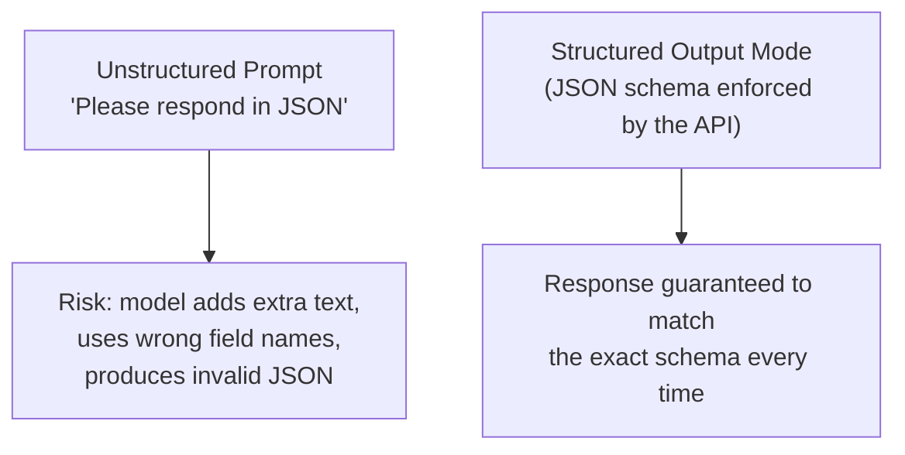

# Structured Outputs

> If your code has to `.parse()` an LLM's free-form text with regular expressions, you're one phrasing change away from a production incident.

**Type:** Learn
**Prerequisites:** Prompt Chaining
**Time:** ~20 minutes

## Learning Objectives

- Explain why unstructured LLM text output is risky for any feature that feeds into other systems
- Describe how schemas and structured output modes constrain a model's response format
- Distinguish "asking nicely for JSON" from a provider's enforced structured output feature
- Formulate the right questions when reviewing a feature that parses LLM output programmatically

## What It Is

**Structured output** means constraining an LLM's response to a specific, machine-readable format (usually JSON), reliably, rather than hoping the model follows a formatting instruction.

A **schema** is the contract: it lists which fields must exist, each field's type (text, number, true/false, list), and any constraints, such as an **enum** (a field that may only hold one of a fixed set of values). When the schema is handed to the provider's structured output feature, the provider enforces the shape during generation instead of merely suggesting it.

## Why It Matters

A feature asks an LLM to extract a customer's name, order number, and issue category from an email, and feeds the answer to a program. It works in testing, but occasionally in production the model adds a friendly preamble ("Sure! Here's the extracted information:") before the data, the receiving program cannot read it, and the feature crashes. This is not a rare fluke. It is the expected, well-documented risk of relying on a model to "just format it correctly" with no enforcement.

## How It Works

There are two levels of asking for structure:

1. **Prompt-only request**: the prompt says "respond only with JSON". Better than nothing, but the model can still add extra text, rename fields, or produce invalid JSON, especially in long or complex prompts.
2. **Enforced structured output**: the provider's "JSON mode", "structured outputs", or schema parameter constrains generation itself, so the response is valid and matches the defined shape.

Even with enforcement, a second line of defense is validation on the receiving side: check that all required fields are present and that enum fields hold allowed values before the data is used.

An example schema for the email extraction, described in words:

| Field | Type | Rule |
| :--- | :--- | :--- |
| `customer_name` | Text | Required |
| `order_number` | Text | Required |
| `issue_category` | Enum | Required; one of shipping, billing, product defect, other |

## Architecture and Workflow



```archify
src: diagrams/structured-vs-free-json.html
title: Unstructured prompt versus structured output mode
aspect: 880/312
```

## A Real-World Example

An email says the customer's shipment from order A-4821 never arrived.

| Approach | What the model returns | What happens downstream |
| :--- | :--- | :--- |
| Prompt-only | Friendly sentence, then the data | Parser fails on the sentence; the ticket is never created |
| Enforced schema | Only the three fields, category "shipping" | Ticket is created and routed to the shipping team |
| Enforced schema, model invents category "refund" | Rejected by validation, since "refund" is not in the enum | Request is retried or sent to human review |

Where it is used: extracting data from documents for a database, function calling (next lesson), and any UI that renders model output into components like charts or forms.

## What a TPM Needs to Understand

- Any AI feature whose output is consumed by other systems, not only displayed to a human, needs enforced structured output, not a polite instruction.
- Prompt-only formatting is a known reliability risk that tends to appear unpredictably in production rather than in testing.
- Structure guarantees the shape, not the truth: a perfectly formatted answer can still contain a wrong order number. Content accuracy needs separate evaluation.
- The schema is a product decision: fewer, tighter fields (with enums) are easier to validate and route.

## Risks, Dependencies, and Trade-Offs

| Approach | Reliability | Setup Effort | Risk |
| :--- | :--- | :--- | :--- |
| **Prompt-only 'please respond in JSON'** | Low-Moderate | Very low | Occasional malformed output reaching production |
| **Enforced structured output / JSON schema** | High | Low-Moderate (define schema once) | Minimal, if schema is well-designed and validated |
| **No structure, freeform text parsing (regex, string search)** | Very low | Low initially, high maintenance | Frequent, hard-to-predict parsing failures |

Dependencies: provider support for schema enforcement (differs by vendor and model). Failure scenarios: schema changes breaking downstream consumers; overly strict schemas causing refusals or empty fields; a malformed response with no fallback path crashing the feature.

## Questions to Ask Engineers

1. *"Is this feature's output parsed by downstream code, and if so, are we using an enforced structured output/JSON schema feature, or just a prompt instruction asking for JSON?"*
2. *"What happens to this feature if the model ever returns malformed JSON or an unexpected field: does it crash, silently fail, or degrade gracefully?"*
3. *"Is our JSON schema tight enough to catch invalid values (e.g. an enum field) at validation time, not just missing fields?"*

## Scenario Exercise

You manage an invoice-processing feature that extracts vendor, amount, due date, and payment status from emailed invoices and writes them to the finance system.

1. **Easy**: The model returns payment status "paid-ish", which is not one of the allowed values. Does it pass validation, and why?
2. **Medium**: Explain to a stakeholder why "respond only with JSON" in the prompt is a weaker guarantee than the provider's schema enforcement.
3. **Hard**: Describe, in plain English, the fields and rules of a schema for extracting a meeting's date, time, attendees, and virtual-or-in-person flag from an email, and say what the system should do when validation fails.

## Key Terms

- **Structured Output**: A model response constrained to match a specific, machine-readable format, ideally enforced by the provider rather than just requested.
- **JSON Schema**: A precise definition of an expected JSON shape, including required fields, types, and allowed values (enums).
- **Enum (Enumeration)**: A constraint limiting a field to one of a fixed set of allowed values.
- **Parsing Failure**: When code expecting a specific format (e.g. valid JSON) receives something that doesn't match, typically causing an error or crash if not handled defensively.
