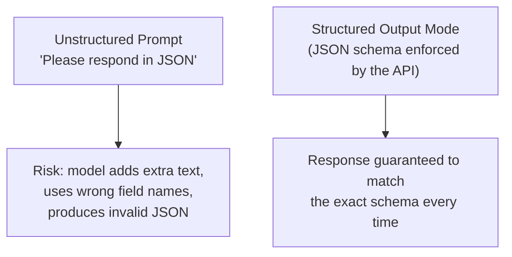

# Structured Outputs

> If your code has to `.parse()` an LLM's free-form text with regular expressions, you're one phrasing change away from a production incident.

**Type:** Learn
**Languages:** Python, JSON
**Prerequisites:** Prompt Chaining
**Time:** ~30 minutes

## Learning Objectives

- Understand why unstructured LLM text output is risky for any feature that feeds into other code
- Understand how JSON schemas and structured output modes constrain a model's response format
- Recognize the difference between "asking nicely for JSON" and using a provider's enforced structured output feature
- Formulate the right questions when reviewing a feature that parses LLM output programmatically

## The Problem

A feature asks an LLM to extract a customer's name, order number, and issue category from an email, then parses the response as JSON. It works in testing, but occasionally in production the model adds a friendly preamble ("Sure! Here's the extracted information:") before the JSON, breaking the parser and crashing the feature. This isn't a rare fluke — it's the expected, well-documented risk of relying on a model to "just format it correctly" without an enforced mechanism.

## The Concept

**Structured output** means constraining an LLM's response to match a specific, machine-readable format (usually JSON) reliably — not just hoping the model follows a formatting instruction.



### Two Levels of "Asking for JSON"

1. **Prompt-only request**: including "respond only with JSON" in the prompt text — better than nothing, but the model can still occasionally add extra text, use inconsistent field names, or produce invalid JSON, especially under longer or more complex prompts.
2. **Enforced structured output**: many providers offer a dedicated feature (e.g. "JSON mode," "structured outputs," or a **JSON schema** parameter) that constrains the model's output at the generation level, guaranteeing valid JSON matching a defined shape every time — a fundamentally more reliable mechanism than a written instruction alone.

### JSON Schema

A **JSON schema** precisely defines the expected shape of a response: which fields must exist, their types (string, number, boolean, array), and any constraints (e.g. an enum of allowed values). Providing this schema to an API's structured output feature is what lets the provider enforce the format, rather than merely suggest it.

```json
{
  "type": "object",
  "properties": {
    "customer_name": {"type": "string"},
    "order_number": {"type": "string"},
    "issue_category": {"type": "string", "enum": ["shipping", "billing", "product_defect", "other"]}
  },
  "required": ["customer_name", "order_number", "issue_category"]
}
```

## Build It

Comparing a fragile prompt-only parsing approach to a schema-validated approach:

```python
import json

def fake_model_call_unstructured(prompt):
    return 'Sure! Here is the extracted information:\n{"customer_name": "Alex Kim", "order_number": "A-4821", "issue_category": "shipping"}'

def fake_model_call_structured(prompt, schema):
    return json.dumps({"customer_name": "Alex Kim", "order_number": "A-4821", "issue_category": "shipping"})

schema = {
    "type": "object",
    "properties": {
        "customer_name": {"type": "string"},
        "order_number": {"type": "string"},
        "issue_category": {"type": "string", "enum": ["shipping", "billing", "product_defect", "other"]},
    },
    "required": ["customer_name", "order_number", "issue_category"],
}

def validate_against_schema(data, schema):
    for field in schema["required"]:
        if field not in data:
            raise ValueError(f"Missing required field: {field}")
    category = data.get("issue_category")
    allowed = schema["properties"]["issue_category"]["enum"]
    if category not in allowed:
        raise ValueError(f"Invalid issue_category: {category}, must be one of {allowed}")
    return True

fragile_response = fake_model_call_unstructured("Extract fields as JSON")
try:
    parsed = json.loads(fragile_response)
    print("Fragile parsing succeeded (got lucky this time):", parsed)
except json.JSONDecodeError as e:
    print(f"Fragile parsing FAILED: {e}")
    print(f"Raw response was: {fragile_response!r}")

structured_response = fake_model_call_structured("Extract fields", schema)
parsed_structured = json.loads(structured_response)
validate_against_schema(parsed_structured, schema)
print("Structured parsing succeeded and validated:", parsed_structured)
```

The "fragile" version's `json.loads()` call fails here because the model added a friendly preamble before the JSON — exactly the kind of production incident that enforced structured output modes are designed to prevent entirely.

## Use It

Structured outputs are essential wherever LLM responses feed directly into other code:

- **Extracting structured data from documents/emails** (names, dates, categories) for storage in a database.
- **Function calling / tool use** (next lesson) — the model's decision about which tool to call and with what arguments must be reliably structured.
- **Any UI that renders LLM output into specific components** (e.g. a chart, a form) rather than freeform chat text.

## Exercises

1. **Easy**: In the schema above, what would happen if the model returned `"issue_category": "refund"` — would it pass or fail validation, and why?
2. **Medium**: Explain why "respond only with JSON" in a prompt is a weaker guarantee than a provider's dedicated structured output/JSON schema feature.
3. **Hard**: Design a JSON schema (in plain English or as a JSON schema block) for extracting a meeting's date, time, attendees list, and whether it's virtual or in-person from an email.

## TPM Perspective

### Strategic Executive Summary
Any AI feature whose output is consumed by other code — not just displayed as chat text to a human — needs enforced structured output, not just a polite prompt instruction. Relying on prompt-only formatting for anything programmatically parsed is a known, well-documented reliability risk that tends to surface unpredictably in production rather than in testing.

### Questions to Challenge Engineering
1. *"Is this feature's output parsed by downstream code, and if so, are we using an enforced structured output/JSON schema feature, or just a prompt instruction asking for JSON?"*
2. *"What happens to this feature if the model ever returns malformed JSON or an unexpected field — does it crash, silently fail, or degrade gracefully?"*
3. *"Is our JSON schema tight enough to catch invalid values (e.g. an enum field) at validation time, not just missing fields?"*

### Trade-Off Matrix

| Approach | Reliability | Setup Effort | Risk |
| :--- | :--- | :--- | :--- |
| **Prompt-only 'please respond in JSON'** | Low-Moderate | Very low | Occasional malformed output reaching production |
| **Enforced structured output / JSON schema** | High | Low-Moderate (define schema once) | Minimal, if schema is well-designed and validated |
| **No structure, freeform text parsing (regex, string search)** | Very low | Low initially, high maintenance | Frequent, hard-to-predict parsing failures |

## Key Terms

- **Structured Output**: A model response constrained to match a specific, machine-readable format, ideally enforced by the provider rather than just requested.
- **JSON Schema**: A precise definition of an expected JSON shape, including required fields, types, and allowed values (enums).
- **Enum (Enumeration)**: A constraint limiting a field to one of a fixed set of allowed values.
- **Parsing Failure**: When code expecting a specific format (e.g. valid JSON) receives something that doesn't match, typically causing an error or crash if not handled defensively.
