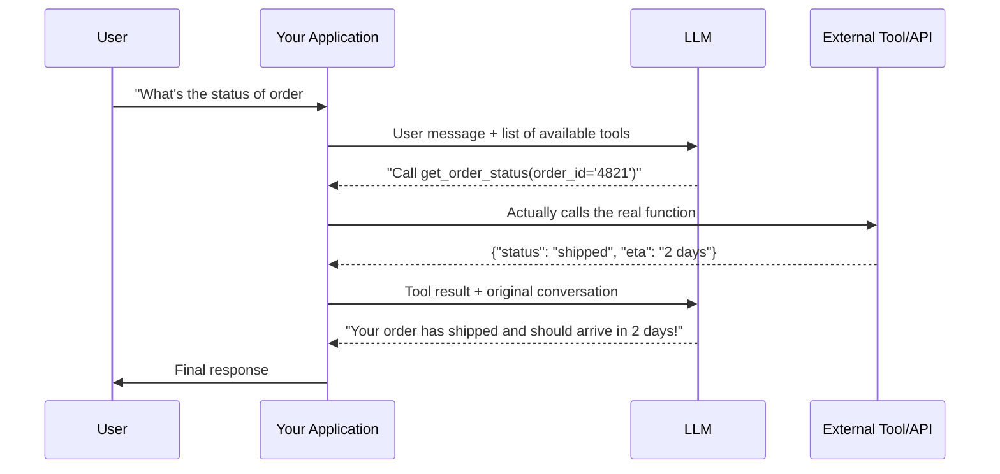

# Function Calling and Tool Use

> The model never actually looks up the weather or books the flight — it decides *that it should*, and your code does the rest.

**Type:** Learn
**Prerequisites:** Structured Outputs
**Time:** ~25 minutes

## Learning Objectives

- Explain what function calling (tool use) is: the model requesting an action, not performing it
- Describe the full request/response loop between your application, the model, and an external tool
- Recognize why the model deciding *when* to call a tool is itself a probabilistic, imperfect decision
- Formulate the right questions when reviewing a feature that gives a model access to tools

## What It Is

**Function calling** (also called **tool use**) lets a model request that your application run a specific function with specific arguments, based on the conversation. The model never executes anything. It only outputs a structured request (using the structured output concept from the previous lesson), which your application executes and whose result it returns to the model.

A **tool** is described to the model by a name, a plain-language description, and the arguments it expects (a schema).

## Why It Matters

A team builds a chatbot that can check order status through an internal API. Occasionally the bot fails to call the tool when it clearly should have, and makes up an answer instead (a hallucination), or it calls the tool with a malformed order number. Without understanding that tool calling is the model *deciding* to request an action, not a guaranteed trigger, a TPM may treat every failure as a pure engineering bug rather than an inherent characteristic that needs monitoring and guardrails.

## How It Works

1. The application tells the model which tools exist: names, descriptions, expected arguments.
2. Based on the conversation, the model decides whether a tool is appropriate and, if so, outputs a structured request naming the tool and its arguments.
3. The application, not the model, executes the function against the real system (database, API, calculator).
4. The result goes back to the model as extra context.
5. The model uses it to write its final natural-language reply.

The decision in step 2 is a prediction, not a hardcoded rule (the probability lesson in Level 2). So the model can fail to call a tool, call the wrong one, or pass malformed arguments. That is why production systems validate and handle fallbacks around every tool call, not just inside the tool. Typical safeguards: reject unknown tool names, check argument formats (for example, an order ID must match the expected pattern), and treat arguments like any untrusted user input.

## Architecture and Workflow



```archify
src: diagrams/order-status-tool-call.html
title: Function calling sequence for an order status lookup
aspect: 1280/580
```

## A Real-World Example

A support bot is asked, "Where is order 4821?"

| Situation | What the model does | What the application does |
| :--- | :--- | :--- |
| Normal | Requests the order-status tool with ID 4821 | Looks it up, returns "shipped, 2 days" |
| Unknown order | Requests the tool with an ID that is not in the database | Tool reports "not found"; model asks the customer to re-check the number |
| Model invents a tool | Requests a tool that does not exist | Application refuses and logs it |
| Model skips the tool | Answers from imagination | Needs monitoring; this is the hallucination failure |

The same loop powers customer-support bots (check status, refund, update account), coding assistants (read files, run tests) and scheduling assistants (check availability, create events). Extended across many tools and steps, it is essentially what an "AI agent" is (covered in the AI Agents level).

## What a TPM Needs to Understand

- Function calling separates "deciding to act" (the model, probabilistic) from "actually acting" (your application, which should be deterministic, validated, and secure).
- Letting the model execute actions directly would be a serious security risk; the application as gatekeeper is the control point.
- Monitor two failure modes: the model not calling a tool when it should, and the model calling with bad or malicious-looking arguments.
- Each tool's permissions define the blast radius of a mistake.

## Risks, Dependencies, and Trade-Offs

| Tool Risk Level | Example | Required Safeguards |
| :--- | :--- | :--- |
| **Low risk (read-only)** | Checking order status, looking up a definition | Basic input validation |
| **Medium risk (reversible write)** | Updating a user's display name, adding a calendar event | Validation + audit logging |
| **High risk (irreversible/financial)** | Processing a refund, sending an email, deleting data | Validation, confirmation step, strict permission scoping, audit logging |

Dependencies: the reliability and latency of each backend API (each tool call adds a round trip), plus the quality of tool descriptions. Failure scenarios: wrong tool chosen, loops of repeated calls driving up cost, prompt injection that tricks the model into requesting a harmful action.

## Questions to Ask Engineers

1. *"Do we validate and sanitize tool call arguments before executing them, treating them the same way we'd treat any other untrusted user input?"*
2. *"How do we monitor and handle cases where the model should have called a tool but didn't (and hallucinated an answer instead)?"*
3. *"What permissions does each tool have, and could a model calling it with unexpected arguments cause unintended real-world side effects (e.g. sending an email, charging a payment)?"*

## Scenario Exercise

Your team plans to give a support bot three tools: order lookup, address update, and refund.

1. **Easy**: The model requests a tool that does not exist. What should the application do, and why is that safer than letting the model act on its own?
2. **Medium**: Classify the three tools by risk level and name one safeguard for each beyond basic validation.
3. **Hard**: Propose a monitoring plan that detects both "answered without calling the tool" and "called the refund tool with suspicious arguments", including what you would measure and what alert would fire.

## Key Terms

- **Function Calling / Tool Use**: A mechanism where a model requests that application code execute a specific function with specific arguments, based on the conversation.
- **Tool**: A function made available to a model, described to it via a name, description, and expected arguments (schema).
- **Tool Call**: The model's structured request to invoke a specific tool with specific arguments.
- **Agent**: A system that uses function calling in a loop, potentially across multiple steps and tools, to accomplish a broader goal (covered in depth in the AI Agents level).
