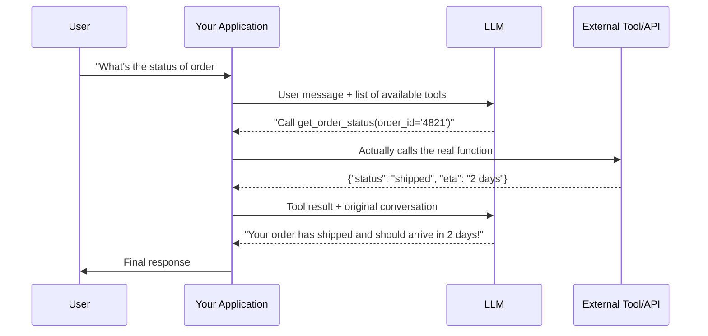

# Function Calling and Tool Use

> The model never actually looks up the weather or books the flight — it decides *that it should*, and your code does the rest.

**Type:** Learn
**Languages:** Python, JSON
**Prerequisites:** Structured Outputs
**Time:** ~35 minutes

## Learning Objectives

- Understand what function calling (tool use) actually is: the model requesting an action, not performing it
- Understand the full request/response loop between your code, the model, and an external tool
- Recognize why the model deciding *when* to call a tool is itself a probabilistic, imperfect decision
- Formulate the right questions when reviewing a feature that gives a model access to tools

## The Problem

A team builds a chatbot that can "check order status" by calling an internal API. Occasionally, the bot either fails to call the tool when it clearly should have (and makes up an answer instead — a hallucination), or calls it with a malformed order number. Without understanding that tool calling is the model *deciding* to request an action — not a guaranteed, deterministic trigger — a TPM might treat every failure as a pure engineering bug rather than an inherent characteristic of the mechanism that needs monitoring and guardrails.

## The Concept

**Function calling** (also called **tool use**) lets a model request that your code run a specific function with specific arguments, based on the conversation — the model itself never executes any code; it only outputs a structured request (using the structured output concept from the previous lesson), which your application then executes and returns the result of.



### The Full Loop, Step by Step

1. Your application tells the model which tools (functions) are available, including their names, descriptions, and expected arguments (essentially a JSON schema, from the previous lesson).
2. Based on the conversation, the model decides whether calling a tool is appropriate, and if so, outputs a structured request naming the tool and its arguments.
3. Your application code — not the model — actually executes that function against the real system (a database, an API, a calculator).
4. The result is sent back to the model as additional context.
5. The model uses that result to produce its final, natural-language response to the user.

### Why This Decision Is Probabilistic, Not Guaranteed

Just like everything else about an LLM (from the probability lesson in Level 2), the decision of *whether* and *how* to call a tool is a prediction, not a hardcoded rule. This means a model can occasionally fail to call a tool when it should, call the wrong tool, or pass malformed arguments — which is why production tool-use systems need validation and fallback handling around every tool call, not just around the tool's own logic.

## Build It

A simplified simulation of the full function-calling loop:

```python
import json

def get_order_status(order_id):
    fake_database = {"4821": {"status": "shipped", "eta": "2 days"}}
    return fake_database.get(order_id, {"error": "Order not found"})

available_tools = {
    "get_order_status": get_order_status,
}

def fake_model_decides_tool_call(user_message):
    if "order" in user_message.lower():
        return {"tool": "get_order_status", "arguments": {"order_id": "4821"}}
    return None

def fake_model_generates_final_response(tool_result):
    if "error" in tool_result:
        return "I couldn't find that order, could you double-check the order number?"
    return f"Your order has {tool_result['status']} and should arrive in {tool_result['eta']}."

def handle_user_message(user_message):
    tool_call = fake_model_decides_tool_call(user_message)

    if tool_call is None:
        return "I'm not sure how to help with that — could you clarify?"

    tool_name = tool_call["tool"]
    arguments = tool_call["arguments"]

    if tool_name not in available_tools:
        return f"Model requested unknown tool: {tool_name}"

    print(f"Model requested tool call: {tool_name}({arguments})")
    tool_result = available_tools[tool_name](**arguments)
    print(f"Tool executed, result: {tool_result}")

    return fake_model_generates_final_response(tool_result)

response = handle_user_message("What's the status of order #4821?")
print(f"\nFinal response to user: {response}")
```

Notice that `get_order_status` — the actual database lookup — is real Python code that your application runs. The model only ever decided *that* it should be called and *with what arguments*; it never touched the database itself.

## Use It

Function calling is the foundational mechanism behind most "AI agent" products:

- **Customer support bots** calling internal APIs to check order status, process a refund, or update an account.
- **Coding assistants** calling functions to read files, run tests, or execute code.
- **Scheduling assistants** calling a calendar API to check availability and create events.

This exact request/execute/respond loop, extended across multiple tools and multiple steps, is essentially what an "AI agent" is — covered in much greater depth in the AI Agents level.

## Exercises

1. **Easy**: In the code above, what happens if the model calls a tool name that doesn't exist in `available_tools`? Is that handled safely?
2. **Medium**: Explain why letting the model directly execute a function itself (instead of your application code doing it after validating the request) would be a significant security risk.
3. **Hard**: Propose a validation step your application should perform on `arguments` before calling `get_order_status`, to guard against a malformed or malicious order ID.

## TPM Perspective

### Strategic Executive Summary
Function calling is powerful specifically because it separates "deciding to act" (the model's job, which is probabilistic) from "actually acting" (your application code's job, which should be deterministic, validated, and secure). Any tool-use feature needs monitoring for both failure modes: the model failing to call a tool when it should, and the model calling a tool with bad or malicious-looking arguments.

### Questions to Challenge Engineering
1. *"Do we validate and sanitize tool call arguments before executing them, treating them the same way we'd treat any other untrusted user input?"*
2. *"How do we monitor and handle cases where the model should have called a tool but didn't (and hallucinated an answer instead)?"*
3. *"What permissions does each tool have, and could a model calling it with unexpected arguments cause unintended real-world side effects (e.g. sending an email, charging a payment)?"*

### Trade-Off Matrix

| Tool Risk Level | Example | Required Safeguards |
| :--- | :--- | :--- |
| **Low risk (read-only)** | Checking order status, looking up a definition | Basic input validation |
| **Medium risk (reversible write)** | Updating a user's display name, adding a calendar event | Validation + audit logging |
| **High risk (irreversible/financial)** | Processing a refund, sending an email, deleting data | Validation, confirmation step, strict permission scoping, audit logging |

## Key Terms

- **Function Calling / Tool Use**: A mechanism where a model requests that application code execute a specific function with specific arguments, based on the conversation.
- **Tool**: A function made available to a model, described to it via a name, description, and expected arguments (schema).
- **Tool Call**: The model's structured request to invoke a specific tool with specific arguments.
- **Agent**: A system that uses function calling in a loop, potentially across multiple steps and tools, to accomplish a broader goal (covered in depth in the AI Agents level).
