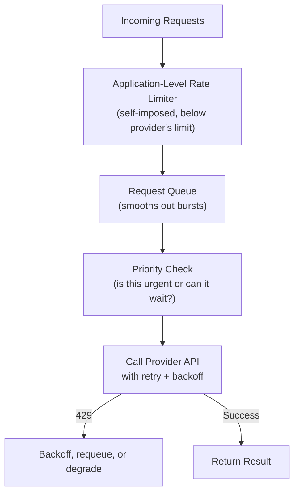

# Rate Limiting in Practice

> Knowing what a rate limit is (Level 0) is different from knowing how to design a system that survives one.

**Type:** Learn
**Languages:** Python
**Prerequisites:** Function Calling and Tool Use
**Time:** ~30 minutes

## Learning Objectives

- Move from understanding what RPM/TPM limits are (Level 0) to designing systems that handle them gracefully
- Understand queueing, request prioritization, and graceful degradation as rate-limit strategies
- Recognize the difference between a provider-side rate limit and a self-imposed application-level rate limit
- Formulate the right questions when reviewing how a feature behaves under sustained high load

## The Problem

A feature works fine in testing with a handful of users, but during a product launch, hundreds of users trigger AI calls simultaneously, the provider's rate limit is hit, and every user sees a raw error message at the same time. The rate limit itself (Level 0) wasn't the real failure — the failure was not designing the application to degrade gracefully when it's hit.

## The Concept

Handling rate limits well in production requires more than a single retry — it requires a small set of standard, composable strategies working together.



### Application-Level Rate Limiting

Rather than sending requests as fast as possible and reacting only when the provider returns a 429, well-designed systems impose their own, slightly lower internal limit — deliberately throttling themselves so they rarely (ideally never) hit the provider's hard limit in the first place. This turns an unpredictable failure mode into a predictable, controlled one.

### Request Queueing and Prioritization

Instead of processing every request the instant it arrives, requests can be placed in a queue and processed at a controlled rate. Combined with **prioritization** (e.g. a paying customer's request processed before a background batch job's request), this ensures the most important work gets done first when capacity is constrained.

### Graceful Degradation

When limits are genuinely reached despite the above, the system should degrade predictably rather than fail loudly for everyone:

- Serve a cached or simplified response instead of a fresh AI call.
- Show users a clear "high demand, please wait" message instead of a raw error.
- Temporarily disable a lower-priority feature to preserve capacity for a higher-priority one.

## Build It

A simplified request queue with prioritization and self-imposed throttling, showing the mechanism (not a production-grade implementation):

```python
import time
import heapq

class PriorityRequestQueue:
    def __init__(self, max_requests_per_second=2):
        self.queue = []
        self.counter = 0
        self.max_rps = max_requests_per_second

    def add_request(self, priority, request_id):
        heapq.heappush(self.queue, (priority, self.counter, request_id))
        self.counter += 1

    def process_all(self):
        processed = []
        while self.queue:
            priority, _, request_id = heapq.heappop(self.queue)
            processed.append((priority, request_id))
            time.sleep(1 / self.max_rps)
        return processed

queue = PriorityRequestQueue(max_requests_per_second=5)

queue.add_request(priority=2, request_id="background_batch_job_1")
queue.add_request(priority=0, request_id="paying_customer_urgent_request")
queue.add_request(priority=1, request_id="free_tier_user_request")
queue.add_request(priority=2, request_id="background_batch_job_2")
queue.add_request(priority=0, request_id="paying_customer_urgent_request_2")

print("Processing order (lower priority number = processed first):")
for priority, request_id in queue.process_all():
    print(f"  priority={priority}  {request_id}")
```

Even though requests arrived in a mixed order, the priority queue ensures paying-customer requests are processed before background batch jobs, and the `time.sleep` call self-throttles below any provider limit.

## Use It

Real production AI systems combine these techniques:

- **Self-imposed rate limits set below the provider's actual limit**, leaving safety margin for traffic spikes.
- **Separate queues or priority tiers** for interactive (user-facing, latency-sensitive) vs. batch (background, latency-tolerant) requests.
- **Circuit breakers**: temporarily stopping all calls to a struggling provider for a short period, rather than continuing to hammer it with requests that will fail anyway.

## Exercises

1. **Easy**: In the code above, what would happen to the processing order if `background_batch_job_1` were given priority `0` instead of `2`?
2. **Medium**: Explain why setting your application's self-imposed rate limit exactly equal to the provider's stated limit (rather than somewhat below it) is risky.
3. **Hard**: Design (in plain English) a graceful degradation plan for a customer-facing AI chat feature that hits its rate limit during a traffic spike — what should different types of users see, and why?

## TPM Perspective

### Strategic Executive Summary
Surviving rate limits in production is a design discipline, not a single retry mechanism: self-imposed throttling, request queueing, prioritization, and graceful degradation together turn "everyone gets an error during a spike" into "the most important requests still succeed, and everyone else sees a clear, controlled message." A launch plan should specify these mechanisms explicitly, not just cite the provider's RPM/TPM numbers.

### Questions to Challenge Engineering
1. *"Do we throttle ourselves below the provider's actual rate limit, or do we only react after hitting a 429?"*
2. *"When we do hit capacity limits, which requests get prioritized, and what do lower-priority users/features see instead of a raw error?"*
3. *"Do we have a circuit breaker or similar mechanism to stop hammering a struggling provider, rather than retrying indefinitely into a wall?"*

### Trade-Off Matrix

| Strategy | Protects Against Spikes | User Experience Under Load | Implementation Complexity |
| :--- | :--- | :--- | :--- |
| **React only to 429s (no self-throttling)** | Poor — hits limits unpredictably | Raw errors during spikes | Low |
| **Self-imposed throttling below provider limit** | Good | Smoother, more predictable delays | Medium |
| **Priority queueing + graceful degradation** | Very good | Best — important requests succeed, others degrade clearly | Medium-High |

## Key Terms

- **Application-Level Rate Limiting**: A self-imposed request limit set below the provider's actual limit, to avoid unpredictably hitting the hard ceiling.
- **Request Queue**: A mechanism holding incoming requests and processing them at a controlled rate rather than immediately as they arrive.
- **Prioritization**: Processing more important requests (e.g. paying customers, urgent tasks) ahead of lower-priority ones under constrained capacity.
- **Graceful Degradation**: Providing a reduced but functional experience (cached results, clear waiting messages) when full capacity isn't available, instead of failing loudly.
- **Circuit Breaker**: A pattern that temporarily halts calls to a struggling dependency, preventing repeated failed attempts from worsening the situation.
