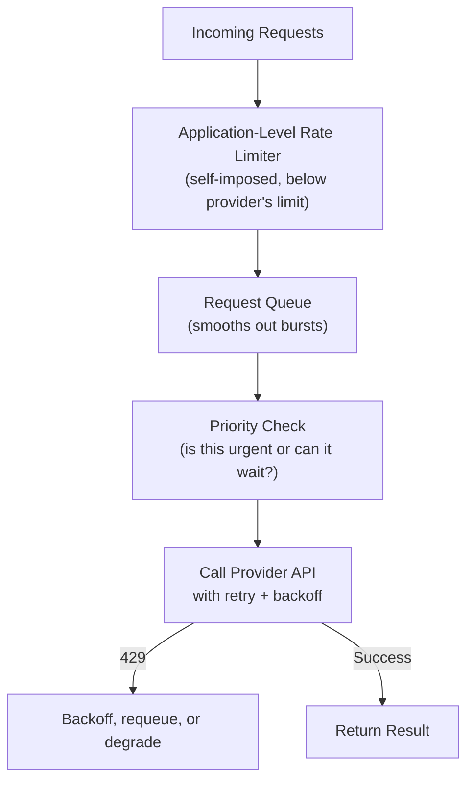

# Rate Limiting in Practice

> Knowing what a rate limit is (Level 0) is different from knowing how to design a system that survives one.

**Type:** Learn
**Prerequisites:** Function Calling and Tool Use
**Time:** ~20 minutes

## Learning Objectives

- Move from understanding what RPM/TPM limits are (Level 0) to designing systems that handle them gracefully
- Describe queueing, request prioritization, and graceful degradation as rate-limit strategies
- Distinguish a provider-side rate limit from a self-imposed application-level rate limit
- Formulate the right questions when reviewing how a feature behaves under sustained high load

## What It Is

Handling rate limits well in production takes more than a single retry. It is a small set of standard, composable strategies working together: self-imposed throttling, queueing, prioritization, graceful degradation, and circuit breakers.

## Why It Matters

A feature works fine in testing with a handful of users. During a product launch, hundreds of users trigger AI calls at once, the provider's limit is hit, and every user sees a raw error at the same time. The rate limit itself was not the real failure. The failure was not designing the application to degrade gracefully when it is hit.

## How It Works

**Application-level rate limiting.** Rather than sending requests as fast as possible and reacting only when the provider returns a 429 ("too many requests"), the system imposes its own slightly lower limit. For example, with a provider limit of 1,000 requests per minute, the app might cap itself at 800. This turns an unpredictable failure into a predictable, controlled one and leaves margin for spikes.

**Queueing and prioritization.** Requests wait in a queue and are processed at a controlled rate. With priorities, a paying customer's urgent request is served before a background batch job, so the most important work completes first when capacity is tight.

**Graceful degradation.** When limits are still reached:

- Serve a cached or simplified response instead of a fresh AI call.
- Show a clear "high demand, please wait" message instead of a raw error.
- Temporarily disable a lower-priority feature to preserve capacity for a higher-priority one.

**Circuit breakers.** Temporarily stop all calls to a struggling provider for a short period, rather than hammering it with requests that will fail. Retries should use backoff (for example, waiting 1, 2, 4, then 8 seconds, with small random variation) so that all clients do not retry at the same moment.

## Architecture and Workflow



```archify
src: diagrams/rate-limiting-flow.html
title: Rate limiting in practice: how a request flows to the provider
aspect: 1130/404
```

## A Real-World Example

A launch sends 3,000 requests in one minute to a provider limit of 1,000 per minute.

| Design | What users experience |
| :--- | :--- |
| React only to 429s | About two thirds of users see raw errors; retries from everyone at once make it worse |
| Self-throttle at 800 per minute plus queue | Requests wait in line; some users wait several minutes but none see errors |
| Add priorities and degradation | Paying customers are served within seconds; free-tier users see "high demand" and a cached answer; the overnight batch job is paused |

In practice, teams also keep separate queues or tiers for interactive (latency-sensitive) and batch (latency-tolerant) traffic.

## What a TPM Needs to Understand

- Surviving rate limits is a design discipline, not a single retry mechanism. A launch plan should specify these mechanisms explicitly, not just cite the provider's RPM/TPM numbers.
- The goal is turning "everyone gets an error during a spike" into "the most important requests still succeed and everyone else sees a clear message."
- Limits apply per provider account, so multiple features or teams can starve each other. Capacity needs an owner.
- Higher limits can often be negotiated with the provider, but with lead time; plan it before the launch.

## Risks, Dependencies, and Trade-Offs

| Strategy | Protects Against Spikes | User Experience Under Load | Implementation Complexity |
| :--- | :--- | :--- | :--- |
| **React only to 429s (no self-throttling)** | Poor, hits limits unpredictably | Raw errors during spikes | Low |
| **Self-imposed throttling below provider limit** | Good | Smoother, more predictable delays | Medium |
| **Priority queueing + graceful degradation** | Very good | Best, important requests succeed, others degrade clearly | Medium-High |

Setting the self-imposed limit exactly at the provider's limit is risky: there is no headroom for bursts, for measurement differences between your counter and the provider's, or for other services sharing the same account. Dependencies: the provider's published limits and tier, and a clear definition of which traffic is "priority". Failure scenarios: queues growing without bound and making responses stale; retry storms; a priority scheme that starves low-tier users entirely.

## Questions to Ask Engineers

1. *"Do we throttle ourselves below the provider's actual rate limit, or do we only react after hitting a 429?"*
2. *"When we do hit capacity limits, which requests get prioritized, and what do lower-priority users/features see instead of a raw error?"*
3. *"Do we have a circuit breaker or similar mechanism to stop hammering a struggling provider, rather than retrying indefinitely into a wall?"*

## Scenario Exercise

Your company is launching an AI chat feature with a Monday announcement email to 50,000 customers. The provider limit is 1,000 requests per minute.

1. **Easy**: If a background batch job and a paying customer's request arrive together, which should go first, and why?
2. **Medium**: Explain why a self-imposed limit equal to the provider's stated limit is risky.
3. **Hard**: Write a graceful degradation plan for the launch spike: what should paying users, free users, and background jobs each see, and what metrics would tell you to trigger the plan?

## Key Terms

- **Application-Level Rate Limiting**: A self-imposed request limit set below the provider's actual limit, to avoid unpredictably hitting the hard ceiling.
- **Request Queue**: A mechanism holding incoming requests and processing them at a controlled rate rather than immediately as they arrive.
- **Prioritization**: Processing more important requests (e.g. paying customers, urgent tasks) ahead of lower-priority ones under constrained capacity.
- **Graceful Degradation**: Providing a reduced but functional experience (cached results, clear waiting messages) when full capacity isn't available, instead of failing loudly.
- **Circuit Breaker**: A pattern that temporarily halts calls to a struggling dependency, preventing repeated failed attempts from worsening the situation.
