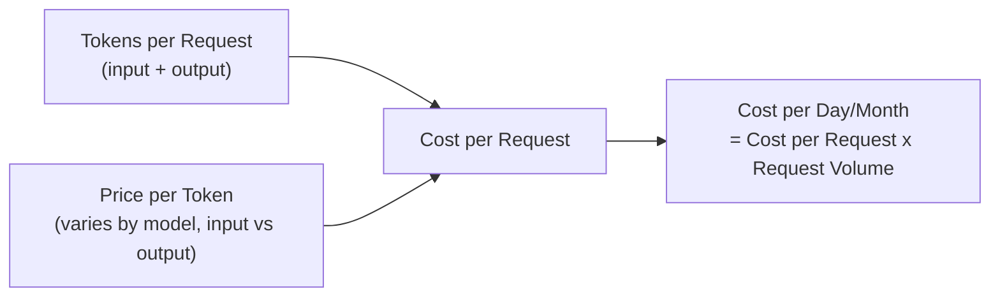

# Token Economics

> "How much will this AI feature cost per month?" is a spreadsheet question with a precise answer — if you know what to multiply.

**Type:** Learn
**Languages:** Python
**Prerequisites:** Rate Limiting in Practice
**Time:** ~30 minutes

## Learning Objectives

- Build a real cost model for an AI feature: tokens per request x requests per period x price per token
- Understand the cost difference between input tokens and output tokens
- Recognize the biggest cost levers: prompt length, output length, model choice, and caching
- Formulate the right questions when reviewing an AI feature's projected operating cost

## The Problem

A team estimates an AI feature will cost "a few hundred dollars a month" without showing the math. After launch, it costs $8,000 in the first month, because the estimate didn't account for a long system prompt sent on every single request, verbose model outputs, or the actual number of daily active users. Token economics is not guesswork — it's a straightforward multiplication that should be shown, not estimated by feel.

## The Concept

The cost of an AI feature is a direct function of a small number of measurable variables:



### Input Tokens vs. Output Tokens

Providers typically charge different rates for **input tokens** (the prompt sent to the model, including system prompt, conversation history, and any retrieved context) and **output tokens** (the model's generated response) — output tokens are often priced several times higher than input tokens, since generating text is more computationally expensive than reading it.

### The Biggest Cost Levers

1. **System prompt length**: if every single request includes a long, repeated system prompt, that cost multiplies across every request, every day — a large, often underestimated recurring cost.
2. **Conversation history**: as a chat gets longer, each new turn re-sends the entire prior conversation as input tokens (unless prefix caching, from the memory hierarchy lesson, is used), so cost per turn grows as a conversation continues.
3. **Output length**: verbose responses cost more, especially since output tokens are typically priced higher than input tokens.
4. **Model choice**: larger, more capable models are typically priced higher per token — a real trade-off against quality, not just a cost slider.
5. **Caching**: reusing a cached response or a cached prompt prefix avoids paying for the same computation repeatedly.

## Build It

A real cost model, computing monthly cost from measurable inputs:

```python
def estimate_monthly_cost(
    daily_active_users,
    requests_per_user_per_day,
    system_prompt_tokens,
    avg_user_message_tokens,
    avg_conversation_history_tokens,
    avg_output_tokens,
    input_price_per_1k=0.003,
    output_price_per_1k=0.015,
):
    input_tokens_per_request = system_prompt_tokens + avg_user_message_tokens + avg_conversation_history_tokens
    output_tokens_per_request = avg_output_tokens

    input_cost_per_request = (input_tokens_per_request / 1000) * input_price_per_1k
    output_cost_per_request = (output_tokens_per_request / 1000) * output_price_per_1k
    cost_per_request = input_cost_per_request + output_cost_per_request

    requests_per_day = daily_active_users * requests_per_user_per_day
    daily_cost = requests_per_day * cost_per_request
    monthly_cost = daily_cost * 30

    return {
        "input_tokens_per_request": input_tokens_per_request,
        "cost_per_request": round(cost_per_request, 5),
        "requests_per_day": requests_per_day,
        "daily_cost": round(daily_cost, 2),
        "monthly_cost": round(monthly_cost, 2),
    }

scenario_a = estimate_monthly_cost(
    daily_active_users=5000,
    requests_per_user_per_day=3,
    system_prompt_tokens=800,
    avg_user_message_tokens=50,
    avg_conversation_history_tokens=200,
    avg_output_tokens=300,
)

scenario_b = estimate_monthly_cost(
    daily_active_users=5000,
    requests_per_user_per_day=3,
    system_prompt_tokens=200,
    avg_user_message_tokens=50,
    avg_conversation_history_tokens=200,
    avg_output_tokens=150,
)

print("Scenario A (long system prompt, verbose output):")
for k, v in scenario_a.items():
    print(f"  {k}: {v}")

print("\nScenario B (trimmed system prompt, concise output):")
for k, v in scenario_b.items():
    print(f"  {k}: {v}")

savings = scenario_a["monthly_cost"] - scenario_b["monthly_cost"]
print(f"\nMonthly savings from trimming prompt/output: ${savings:.2f}")
```

Trimming the system prompt from 800 to 200 tokens and encouraging more concise output can produce a meaningfully lower monthly cost at scale — exactly the kind of concrete, model-free optimization a TPM can push for without touching the underlying model at all.

## Use It

Real cost conversations should always ground themselves in this multiplication:

- **"Why did our AI costs spike this month?"** → check for increases in daily active users, average conversation length, or a change in system prompt/output length — usually one of these explains it directly.
- **"Should we use a cheaper model?"** → model price per token is one lever, but often smaller than prompt/output length optimization, which should be checked first.
- **"What's our cost per user per month?"** → a standard SaaS-style metric that should be tracked continuously for any AI feature, not just estimated once before launch.

## Exercises

1. **Easy**: In the code above, which single change (system prompt length or output length) had the bigger cost impact between Scenario A and B? (Try isolating each change separately.)
2. **Medium**: Estimate the monthly cost impact of average conversation history growing from 200 tokens to 2,000 tokens per request, holding everything else constant.
3. **Hard**: Propose two concrete optimizations (not switching models) that would reduce this feature's cost by at least 30%, and justify each with the cost model above.

## TPM Perspective

### Strategic Executive Summary
AI feature cost should always be presented as a calculation with visible inputs (tokens per request, request volume, price per token), not a single estimated number. This lets a TPM immediately identify the biggest cost lever — often prompt length or output verbosity, not model choice — and hold the team accountable to a specific, auditable cost model rather than a vague monthly estimate.

### Questions to Challenge Engineering
1. *"Can you show me the actual token counts (system prompt, average conversation history, average output) behind this cost estimate, rather than just the final number?"*
2. *"Given that output tokens are priced higher than input tokens, have we looked at reducing average output length as a cost lever, not just model choice?"*
3. *"As conversations get longer over a session, how does per-turn cost grow, and are we using any caching to offset that (from the memory hierarchy lesson)?"*

### Trade-Off Matrix

| Cost Lever | Effort to Change | Typical Cost Impact |
| :--- | :--- | :--- |
| **Trim system prompt length** | Low | Often significant, since it repeats on every request |
| **Reduce average output length (concise responses)** | Low-Medium | Significant, since output tokens are priced higher |
| **Switch to a cheaper model** | Medium (requires quality validation) | Can be significant, but risks quality trade-offs |
| **Add prefix/prompt caching** | Medium (engineering work) | Significant for repeated system prompts/shared prefixes |

## Key Terms

- **Input Tokens**: Tokens in the prompt sent to the model, including system prompt, conversation history, and any retrieved context.
- **Output Tokens**: Tokens the model generates in its response, typically priced higher than input tokens.
- **Cost per Request**: The total price of a single API call, computed from input and output token counts and their respective prices.
- **Cost per User**: A standard metric tracking total AI cost divided by active users, useful for monitoring cost trends over time.
- **Token Economics**: The overall discipline of modeling, measuring, and optimizing AI feature costs based on token usage.
