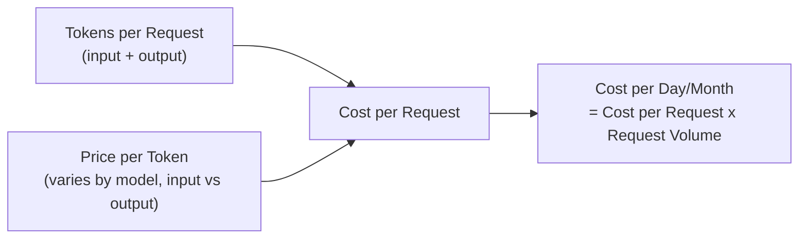

# Token Economics

> "How much will this AI feature cost per month?" is a spreadsheet question with a precise answer — if you know what to multiply.

**Type:** Learn
**Prerequisites:** Rate Limiting in Practice
**Time:** ~25 minutes

## Learning Objectives

- Build a cost model for an AI feature: tokens per request x requests per period x price per token
- Explain the cost difference between input tokens and output tokens
- Identify the biggest cost levers: prompt length, output length, model choice, and caching
- Formulate the right questions when reviewing an AI feature's projected operating cost

## What It Is

Token economics is the discipline of modeling, measuring, and optimizing an AI feature's cost from a small number of measurable variables: tokens per request (input plus output), price per token, and request volume. Providers usually charge different rates for **input tokens** (system prompt, conversation history, retrieved context, user message) and **output tokens** (the generated response). Output is often priced several times higher than input, because generating text is more computationally expensive than reading it.

## Why It Matters

A team estimates an AI feature will cost "a few hundred dollars a month" without showing the math. After launch it costs $8,000 in the first month, because the estimate ignored a long system prompt sent on every request, verbose outputs, and the real number of daily users. Token economics is not guesswork. It is a multiplication that should be shown, not estimated by feel.

## How It Works

Cost per request = (input tokens / 1,000 x input price) + (output tokens / 1,000 x output price). Monthly cost = cost per request x requests per day x 30.

The biggest levers:

1. **System prompt length**: repeated on every request, so a long one is a large, often underestimated recurring cost.
2. **Conversation history**: each new turn re-sends the prior conversation as input, so cost per turn grows through a session (unless prefix caching is used).
3. **Output length**: verbose responses cost more, at the higher output price.
4. **Model choice**: larger models cost more per token; a real trade-off against quality, not just a cost slider.
5. **Caching**: reusing a cached response or prompt prefix avoids paying for the same computation repeatedly.

## Architecture and Workflow



```archify
src: diagrams/token-cost-model.html
title: How tokens and price combine into daily and monthly cost
aspect: 869/528
```

## A Real-World Example

A feature has 5,000 daily active users making 3 requests each (15,000 requests per day). Illustrative prices: $0.003 per 1,000 input tokens, $0.015 per 1,000 output tokens.

| | Scenario A: long prompt, verbose | Scenario B: trimmed, concise |
| :--- | :--- | :--- |
| System prompt | 800 tokens | 200 tokens |
| User message + history | 50 + 200 tokens | 50 + 200 tokens |
| Input tokens per request | 1,050 | 450 |
| Output tokens per request | 300 | 150 |
| Cost per request | $0.00765 | $0.0036 |
| Daily cost | $114.75 | $54.00 |
| Monthly cost | about $3,443 | $1,620 |

Trimming the prompt and encouraging concise answers saves roughly $1,800 per month without touching the model. Typical cost conversations map to the same multiplication:

- **"Why did costs spike?"** Look for more users, longer conversations, or a changed prompt or output length.
- **"Should we use a cheaper model?"** Often prompt and output length are a bigger lever; check those first.
- **"What's our cost per user per month?"** A standard metric to track continuously, not estimate once.

## What a TPM Needs to Understand

- Present AI cost as a calculation with visible inputs, not a single number. This exposes the biggest lever, often prompt length or output verbosity rather than model choice, and makes the team accountable to an auditable model.
- Growth in history length is a hidden multiplier: if average history in Scenario A grows from 200 to 2,000 tokens, input per request becomes 2,850 tokens and the monthly bill rises from about $3,443 to about $5,870.
- Track cost per user and per request in production, not only before launch.

## Risks, Dependencies, and Trade-Offs

| Cost Lever | Effort to Change | Typical Cost Impact |
| :--- | :--- | :--- |
| **Trim system prompt length** | Low | Often significant, since it repeats on every request |
| **Reduce average output length (concise responses)** | Low-Medium | Significant, since output tokens are priced higher |
| **Switch to a cheaper model** | Medium (requires quality validation) | Can be significant, but risks quality trade-offs |
| **Add prefix/prompt caching** | Medium (engineering work) | Significant for repeated system prompts/shared prefixes |

Dependencies: provider price changes, usage growth you do not control, and quality evaluation before any model downgrade. Failure scenarios: trimming a prompt so far that quality drops; unbounded conversation history; agent loops making many calls per user request; an estimate built on test traffic that does not reflect real usage.

## Questions to Ask Engineers

1. *"Can you show me the actual token counts (system prompt, average conversation history, average output) behind this cost estimate, rather than just the final number?"*
2. *"Given that output tokens are priced higher than input tokens, have we looked at reducing average output length as a cost lever, not just model choice?"*
3. *"As conversations get longer over a session, how does per-turn cost grow, and are we using any caching to offset that (from the memory hierarchy lesson)?"*

## Scenario Exercise

Your team proposes a support assistant for 10,000 daily users, with 4 requests per user per day, a 1,000-token system prompt, and 400-token average answers.

1. **Easy**: Which quantities do you multiply to get daily cost, and which input here repeats on every request?
2. **Medium**: Conversation history is expected to grow from 200 to 2,000 tokens on average. Explain how this changes cost and which lever might offset it.
3. **Hard**: Propose two optimizations (not switching models) that aim to cut cost by 30 percent or more, justify each using the cost model, and state what quality check you would require before shipping them.

## Key Terms

- **Input Tokens**: Tokens in the prompt sent to the model, including system prompt, conversation history, and any retrieved context.
- **Output Tokens**: Tokens the model generates in its response, typically priced higher than input tokens.
- **Cost per Request**: The total price of a single API call, computed from input and output token counts and their respective prices.
- **Cost per User**: A standard metric tracking total AI cost divided by active users, useful for monitoring cost trends over time.
- **Token Economics**: The overall discipline of modeling, measuring, and optimizing AI feature costs based on token usage.
