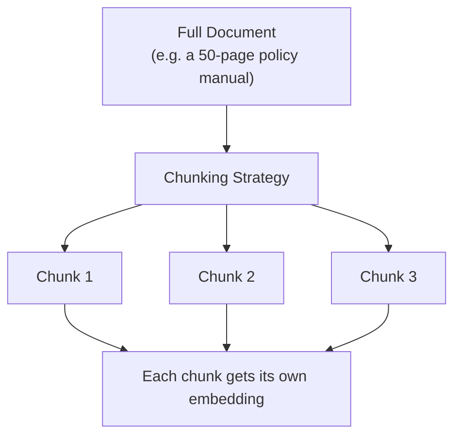

# Chunking Strategies

> A RAG system can only retrieve what it chunked sensibly — cut a document in the wrong place, and the right answer gets split from its own context.

**Type:** Learn
**Prerequisites:** Token Economics
**Time:** ~20 minutes

## Learning Objectives

- Explain why documents must be split into chunks before being embedded and retrieved
- Describe the trade-off between chunk size, retrieval precision, and lost context
- Compare common chunking strategies: fixed-size, sentence/paragraph-based, overlapping, and structure-aware
- Formulate the right questions when a RAG system retrieves technically-relevant-but-unhelpful content

## What It Is

Before a document can be embedded and retrieved, it must be split into smaller pieces called **chunks**. Embedding a whole long document as one vector loses the fine-grained detail needed for precise retrieval, and context windows (Level 0) limit how much retrieved text can be fed to the model at once.

## Why It Matters

A RAG-powered support bot retrieves a chunk of a policy document that says "...this exception does not apply," but the sentence explaining *which* exception was cut off in the previous chunk. The bot confidently gives a wrong answer. Retrieval did not fail to find a relevant document; the document was split in a way that separated a statement from the context needed to interpret it.

## How It Works

Each chunk is embedded separately and stored. At question time, the best-matching chunks are retrieved and handed to the model. The core trade-off is chunk size:

- **Too small**: high precision (a matched chunk is very specifically relevant) but risks losing the surrounding context needed to interpret it, as in the example above.
- **Too large**: better context, but one embedding now blends several topics, so similarity search matches narrow queries less precisely, and context window space is wasted on irrelevant text.

Common strategies:

- **Fixed-size**: split every N tokens or characters regardless of sentence boundaries. Simple, but can cut sentences in half.
- **Sentence/paragraph-based**: split along natural language boundaries. More coherent chunks, but variable sizes.
- **Overlapping**: each chunk repeats a bit of the previous chunk's ending (for example, 500-token chunks with a 50-token overlap), so context is not lost at a boundary. Cost: some redundant storage and duplicate retrieval hits.
- **Structure-aware**: use the document's own headings and sections as boundaries. Often the most coherent choice for manuals and policies.

## Architecture and Workflow



```archify
src: diagrams/chunking-fan-out.html
title: One document split into chunks, each embedded
aspect: 881/528
```

## A Real-World Example

A refund policy reads: "Refunds are available within 30 days of purchase. This policy does not apply to digital downloads, which are final sale. Exceptions may be granted by a manager for defective products."

| Strategy | What can go wrong or right |
| :--- | :--- |
| Fixed-size, no overlap | A boundary falls between "does not apply to" and "digital downloads"; the bot retrieves half the rule and may tell a customer a download is refundable |
| Fixed-size with overlap | Both neighboring chunks contain the full exclusion sentence; the rule survives |
| Sentence-based | Each rule is one clean chunk, though the exception sentence loses its link to "refunds" |
| Structure-aware | The whole "Refund Policy" section is one chunk, with complete context |

Real systems choose by document type: legal and policy documents by section or clause; chat transcripts by conversation turn or time window; code documentation by function or class.

## What a TPM Needs to Understand

- Chunking is one of the highest-leverage and most underappreciated decisions in RAG quality. Poor chunking produces wrong or incomplete answers that look like a "model problem" but are a data preparation problem.
- Treat it as a design decision to review explicitly, not an implementation detail.
- When an answer is wrong, inspect the retrieved chunk first before blaming the model.
- Changing chunking means re-chunking and re-embedding the corpus, so it is not free to revisit late.

## Risks, Dependencies, and Trade-Offs

| Strategy | Retrieval Precision | Context Preservation | Implementation Simplicity |
| :--- | :--- | :--- | :--- |
| **Fixed-size, no overlap** | Moderate | Low, can cut mid-thought | Very simple |
| **Fixed-size with overlap** | Moderate | Better, boundary context partially preserved | Simple |
| **Sentence/paragraph-based** | Good | Good | Moderate |
| **Structure-aware (headings/sections)** | Best for structured docs | Best for structured docs | More complex, document-type-specific |

Dependencies: clean source documents (tables, scanned PDFs, and headers or footers can corrupt chunks), and the embedding model's input limit. Failure scenarios: tables split across chunks, duplicated overlap crowding out diverse results, stale chunks after a document is updated.

## Questions to Ask Engineers

1. *"What chunking strategy are we using for this document type, and has it been validated against known cases where context spans a chunk boundary?"*
2. *"Are we using chunk overlap, and if not, how are we mitigating the risk of splitting a statement from its necessary context?"*
3. *"When this RAG feature gives a wrong or incomplete answer, have we checked whether the retrieved chunk itself was missing necessary context, before assuming the model reasoned incorrectly?"*

## Scenario Exercise

You are managing a RAG assistant over a 200-page HR policy manual with numbered sections. Employees report that answers about parental leave sometimes omit eligibility exceptions.

1. **Easy**: What is the most likely chunking-related cause, and what should engineers inspect first?
2. **Medium**: Explain in plain English why increasing chunk overlap reduces the risk of lost context, and what it costs in exchange.
3. **Hard**: Propose a chunking strategy for the manual, justify why it beats fixed-size chunking here, and describe how you would validate the change on known problem questions before rollout.

## Key Terms

- **Chunk**: A smaller piece of a document, split for embedding and retrieval, since whole documents are too large and imprecise to embed as a single vector.
- **Chunk Overlap**: Including part of the previous chunk's content at the start of the next chunk, to reduce lost context at boundaries.
- **Fixed-Size Chunking**: Splitting text at a set token/character count regardless of natural language boundaries.
- **Structure-Aware Chunking**: Splitting a document along its own natural structure (headings, sections) rather than an arbitrary size.
