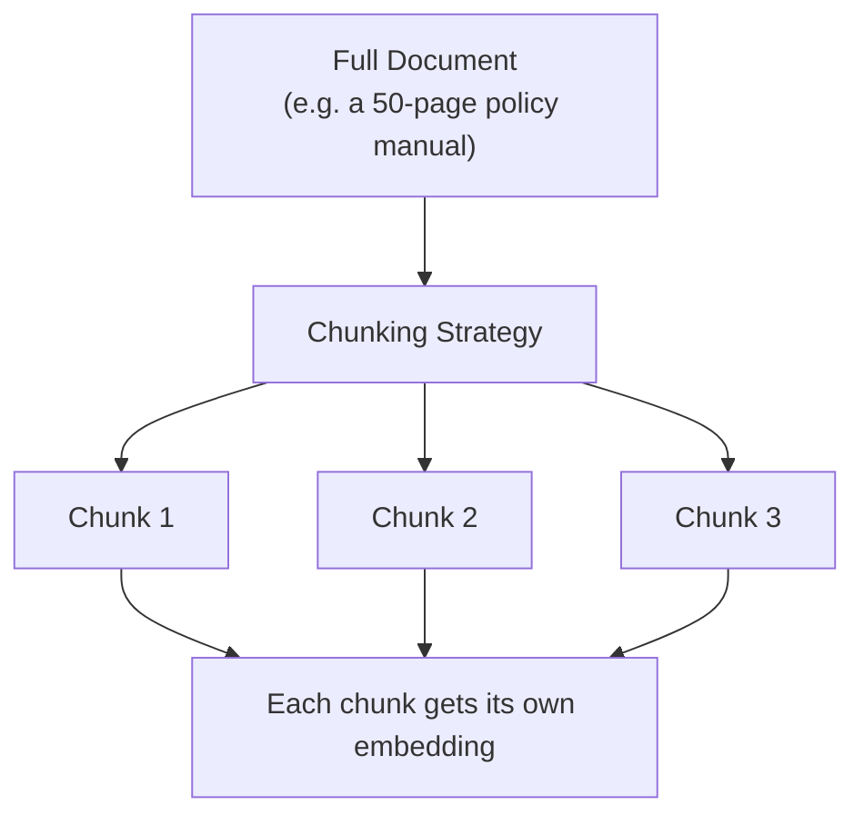

# Chunking Strategies

> A RAG system can only retrieve what it chunked sensibly — cut a document in the wrong place, and the right answer gets split from its own context.

**Type:** Learn
**Languages:** Python
**Prerequisites:** Token Economics
**Time:** ~30 minutes

## Learning Objectives

- Understand why documents must be split into chunks before being embedded and retrieved
- Recognize the trade-off between chunk size, retrieval precision, and lost context
- Understand common chunking strategies: fixed-size, sentence/paragraph-based, and overlapping chunks
- Formulate the right questions when a RAG system retrieves technically-relevant-but-unhelpful content

## The Problem

A RAG-powered support bot retrieves a chunk of a policy document that says "...this exception does not apply," but the sentence explaining *which* exception was cut off in the previous chunk. The bot confidently gives a wrong answer, not because retrieval failed to find a relevant document, but because the document was split in a way that separated a statement from the context needed to interpret it correctly.

## The Concept

Before a document can be embedded and retrieved (from the tokens/embeddings lesson), it must first be split into smaller pieces called **chunks** — because embedding an entire long document as one vector loses the fine-grained detail needed for precise retrieval, and because context windows (Level 0) limit how much retrieved text can be fed to the model at once.



### The Core Trade-off: Chunk Size

- **Chunks too small**: high retrieval precision (a matched chunk is very specifically relevant), but risks losing surrounding context needed to correctly interpret the content — as in the example above.
- **Chunks too large**: better context preservation, but a single embedding now represents a mix of topics, making it harder for similarity search to precisely match a narrow query, and wastes context window space with irrelevant surrounding text.

### Common Chunking Strategies

- **Fixed-size chunking**: split every N tokens/characters, regardless of sentence or paragraph boundaries — simple, but can cut sentences awkwardly.
- **Sentence/paragraph-based chunking**: split along natural language boundaries — usually produces more coherent chunks, at the cost of variable chunk sizes.
- **Overlapping chunks**: each chunk includes a bit of the previous chunk's ending, so context isn't lost at a boundary — a common mitigation for the "cut mid-thought" problem, at the cost of some redundant storage and retrieval overlap.
- **Structure-aware chunking**: using a document's own structure (headings, sections) to define chunk boundaries — often the most coherent option for structured documents like policy manuals or documentation.

## Build It

Comparing fixed-size chunking (which can awkwardly cut content) against overlapping chunking (which preserves boundary context):

```python
document = (
    "Refunds are available within 30 days of purchase. "
    "This policy does not apply to digital downloads, which are final sale. "
    "Exceptions may be granted by a manager for defective products. "
    "Contact support to request an exception."
)

def fixed_size_chunk(text, chunk_size=60):
    return [text[i:i + chunk_size] for i in range(0, len(text), chunk_size)]

def overlapping_chunk(text, chunk_size=60, overlap=20):
    chunks = []
    start = 0
    while start < len(text):
        chunks.append(text[start:start + chunk_size])
        start += chunk_size - overlap
    return chunks

print("Fixed-size chunks (no overlap):")
for i, chunk in enumerate(fixed_size_chunk(document)):
    print(f"  Chunk {i}: {chunk!r}")

print("\nOverlapping chunks:")
for i, chunk in enumerate(overlapping_chunk(document)):
    print(f"  Chunk {i}: {chunk!r}")
```

Notice how the fixed-size chunks can cut directly through a sentence (splitting "does not apply" from "digital downloads, which are final sale"), while overlapping chunks preserve some of that boundary text in both neighboring chunks, reducing the chance that critical context is fully lost.

## Use It

Real RAG systems choose chunking strategy based on document type and use case:

- **Legal/policy documents**: often use structure-aware chunking (by section/clause) since precise, complete statements matter enormously.
- **Chat transcripts/logs**: often chunk by conversation turn or time window rather than fixed size.
- **Code documentation**: often chunk by function/class boundaries rather than arbitrary character counts, so a chunk represents one coherent unit.

## Exercises

1. **Easy**: In the fixed-size chunking example above, identify one place where a chunk boundary cuts through a meaningful phrase.
2. **Medium**: Explain in plain English why increasing chunk overlap reduces the risk of lost context, and what it costs in exchange.
3. **Hard**: Propose a chunking strategy for a 200-page technical manual with numbered sections and subsections, and justify why it's better suited than fixed-size chunking for this document type.

## TPM Perspective

### Strategic Executive Summary
Chunking strategy is one of the highest-leverage, most underappreciated design decisions in a RAG system's quality — poor chunking causes systematically wrong or incomplete answers that look like a "model problem" but are actually a data preparation problem. This is a design decision worth reviewing explicitly, not an implementation detail to skip past.

### Questions to Challenge Engineering
1. *"What chunking strategy are we using for this document type, and has it been validated against known cases where context spans a chunk boundary?"*
2. *"Are we using chunk overlap, and if not, how are we mitigating the risk of splitting a statement from its necessary context?"*
3. *"When this RAG feature gives a wrong or incomplete answer, have we checked whether the retrieved chunk itself was missing necessary context, before assuming the model reasoned incorrectly?"*

### Trade-Off Matrix

| Strategy | Retrieval Precision | Context Preservation | Implementation Simplicity |
| :--- | :--- | :--- | :--- |
| **Fixed-size, no overlap** | Moderate | Low — can cut mid-thought | Very simple |
| **Fixed-size with overlap** | Moderate | Better — boundary context partially preserved | Simple |
| **Sentence/paragraph-based** | Good | Good | Moderate |
| **Structure-aware (headings/sections)** | Best for structured docs | Best for structured docs | More complex, document-type-specific |

## Key Terms

- **Chunk**: A smaller piece of a document, split for embedding and retrieval, since whole documents are too large and imprecise to embed as a single vector.
- **Chunk Overlap**: Including part of the previous chunk's content at the start of the next chunk, to reduce lost context at boundaries.
- **Fixed-Size Chunking**: Splitting text at a set token/character count regardless of natural language boundaries.
- **Structure-Aware Chunking**: Splitting a document along its own natural structure (headings, sections) rather than an arbitrary size.
