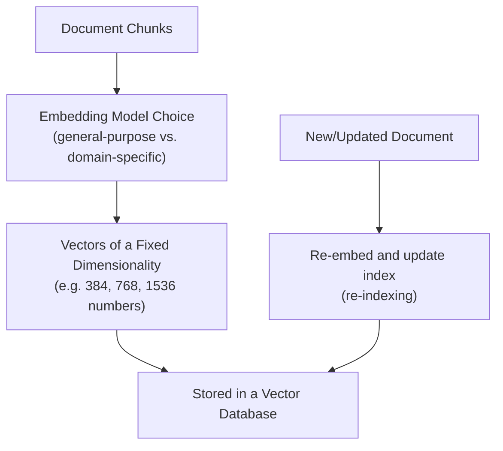

# Vector Embeddings in Practice

> An embedding model is a separate, specific choice with its own quality and cost trade-offs — not a free byproduct of the LLM you're already using.

**Type:** Learn
**Languages:** Python
**Prerequisites:** Chunking Strategies
**Time:** ~30 minutes

## Learning Objectives

- Move from the conceptual understanding of embeddings (Level 3) to practical embedding model choices and pipelines
- Understand why embedding model choice, dimensionality, and domain fit all matter for retrieval quality
- Recognize when embeddings need to be recomputed (re-indexed) and why that has real operational cost
- Formulate the right questions when reviewing which embedding model a RAG system uses

## The Problem

A team builds a RAG system using a general-purpose embedding model, and it performs poorly on internal engineering documentation full of specific jargon and acronyms. Without knowing that embedding model choice is a distinct, evaluable decision — separate from which LLM generates the final answer — a TPM might assume the whole RAG approach is fundamentally flawed, when the actual fix might be as targeted as trying a different or domain-adapted embedding model.

## The Concept

An **embedding pipeline** in a real RAG system involves several concrete, practical decisions beyond the conceptual idea "text becomes a vector":



### Embedding Model Choice Matters

Different embedding models are trained on different data and optimize for different notions of "similarity." A general-purpose embedding model trained mostly on web text may perform noticeably worse on specialized domains (legal, medical, internal engineering jargon) than a domain-adapted or fine-tuned embedding model — this is a genuinely evaluable, benchmarkable choice, not a fixed given.

### Dimensionality

Embeddings are vectors of a fixed length (**dimensionality**) — common sizes range from a few hundred to a few thousand numbers. Higher dimensionality can capture more nuance but costs more to store and search; this is a real, measurable trade-off, not just an arbitrary model setting.

### Re-indexing: An Operational Cost People Forget

If the embedding model is changed or upgraded, **every existing chunk must be re-embedded** with the new model, since embeddings from different models aren't comparable to each other. For a large document corpus, this re-indexing is a real, sometimes significant compute and time cost — a factor that should be considered before treating "just switch embedding models" as a trivial change.

## Build It

A simplified comparison showing why embeddings from different "models" (here, different simple scoring approaches) aren't interchangeable:

```python
def embedding_model_a(text):
    words = text.lower().split()
    return [len(words), sum(len(w) for w in words) / max(len(words), 1)]

def embedding_model_b(text):
    words = set(text.lower().split())
    keywords = {"refund", "policy", "exception", "manager"}
    return [len(words & keywords), len(words)]

document = "Exceptions may be granted by a manager for defective products."

vec_a = embedding_model_a(document)
vec_b = embedding_model_b(document)

print(f"Embedding from Model A: {vec_a}")
print(f"Embedding from Model B: {vec_b}")
print("\nThese vectors are NOT comparable to each other — they represent")
print("completely different notions of 'similarity,' just like real")
print("embeddings from different models. Mixing them in one vector")
print("database would produce meaningless similarity search results.")

def simulate_reindex_cost(num_chunks, seconds_per_chunk=0.05, cost_per_1k_chunks=0.10):
    total_seconds = num_chunks * seconds_per_chunk
    total_cost = (num_chunks / 1000) * cost_per_1k_chunks
    return total_seconds / 60, total_cost

minutes, cost = simulate_reindex_cost(num_chunks=500_000)
print(f"\nRe-indexing 500,000 chunks would take ~{minutes:.1f} minutes and cost ~${cost:.2f}")
```

This illustrates two practical points: embeddings from different models can't be mixed or compared directly, and re-indexing a large corpus has a real, calculable time and cost impact worth factoring into any "switch embedding models" decision.

## Use It

Real RAG systems treat embedding model selection as an ongoing, evaluable decision:

- **Benchmarking embedding models** on a domain-specific test set (queries paired with known-relevant documents) before committing to one.
- **Planning for re-indexing** as part of any embedding model upgrade, including the compute cost and any downtime or staleness during the transition.
- **Domain-adapted or fine-tuned embedding models** for specialized fields (legal, medical, code) when general-purpose models underperform.

## Exercises

1. **Easy**: Why can't embeddings produced by two different embedding models be directly compared for similarity search?
2. **Medium**: A team wants to switch to a "better" embedding model for their RAG system with 2 million chunks. List two costs beyond the model's own price they need to account for.
3. **Hard**: Propose a simple benchmark methodology (in plain English) for comparing two candidate embedding models on your own domain-specific documents before committing to one.

## TPM Perspective

### Strategic Executive Summary
Embedding model choice is a distinct, benchmarkable engineering decision — not an invisible default that comes free with an LLM. Poor RAG performance on domain-specific content is frequently a symptom of a mismatched embedding model, not a fundamental flaw in the RAG approach. Any embedding model change also carries a real, quantifiable re-indexing cost that should be planned for explicitly.

### Questions to Challenge Engineering
1. *"Have we benchmarked our embedding model on domain-specific queries and documents, or are we using a general-purpose default without validation?"*
2. *"If we change embedding models, what's the estimated time and cost to re-index our existing corpus, and what happens to search quality during that transition?"*
3. *"Is our current retrieval quality issue actually an embedding model mismatch, a chunking problem (previous lesson), or something else entirely?"*

### Trade-Off Matrix

| Embedding Choice | Domain Fit | Cost | Re-indexing Risk |
| :--- | :--- | :--- | :--- |
| **General-purpose embedding model** | Moderate, weaker on specialized jargon | Lower | N/A until changed |
| **Domain-adapted/fine-tuned embedding model** | High for its specific domain | Higher upfront cost | Requires re-indexing existing corpus |
| **Switching embedding models later** | Improves fit, if well-chosen | One-time re-indexing cost (compute + time) | Real operational cost, must be planned |

## Key Terms

- **Embedding Model**: The specific model used to convert text into vectors, chosen and evaluated independently from the LLM generating final answers.
- **Dimensionality**: The fixed length of an embedding vector, trading off nuance captured against storage and search cost.
- **Re-indexing**: Re-embedding an entire document corpus after changing embedding models, since embeddings from different models aren't comparable.
- **Domain-Adapted Embedding Model**: An embedding model trained or fine-tuned on domain-specific data (legal, medical, code) to better capture that domain's notion of similarity.
