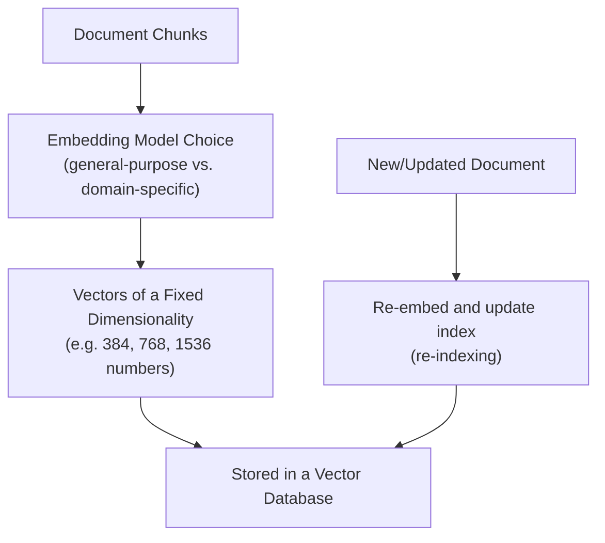

# Vector Embeddings in Practice

> An embedding model is a separate, specific choice with its own quality and cost trade-offs — not a free byproduct of the LLM you're already using.

**Type:** Learn
**Prerequisites:** Chunking Strategies
**Time:** ~20 minutes

## Learning Objectives

- Move from the conceptual understanding of embeddings (Level 3) to practical embedding model choices and pipelines
- Explain why embedding model choice, dimensionality, and domain fit all matter for retrieval quality
- Recognize when embeddings need to be recomputed (re-indexed) and why that has real operational cost
- Formulate the right questions when reviewing which embedding model a RAG system uses

## What It Is

An **embedding model** converts text into a vector (a fixed-length list of numbers) so that similar meanings land close together. In a RAG system it is a distinct component, chosen and evaluated independently from the LLM that writes the final answer. The length of the vector is its **dimensionality**.

## Why It Matters

A team builds a RAG system with a general-purpose embedding model, and it performs poorly on internal engineering documentation full of jargon and acronyms. Without knowing that embedding model choice is a separate, evaluable decision, a TPM might conclude the whole RAG approach is flawed, when the fix may be as targeted as trying a different or domain-adapted embedding model.

## How It Works

1. Document chunks are passed through the chosen embedding model.
2. Each chunk becomes a vector of fixed dimensionality (commonly 384, 768, or 1536 numbers).
3. Vectors are stored in a vector database.
4. When a document is added or updated, its chunks are re-embedded and the index is updated.

Three practical decisions follow:

- **Model choice**: models are trained on different data and optimize different notions of similarity. A general-purpose model trained mostly on web text may do noticeably worse on legal, medical, or internal jargon than a domain-adapted one. This is benchmarkable, not a fixed given.
- **Dimensionality**: higher dimensions capture more nuance but cost more to store and search. Going from 768 to 1536 roughly doubles vector storage.
- **Re-indexing**: embeddings from different models are not comparable, so switching or upgrading the model means every existing chunk must be re-embedded. Mixing old and new vectors in one index gives meaningless search results.

## Architecture and Workflow



```archify
src: diagrams/embedding-indexing.html
title: From chunks to stored vectors, plus re-indexing updates
aspect: 1094/404
```

## A Real-World Example

A company with 500,000 chunks wants to move to a better embedding model. Illustrative numbers: embedding takes about 0.05 seconds per chunk and costs about $0.10 per 1,000 chunks.

| Item | Estimate |
| :--- | :--- |
| Compute time (sequential) | 500,000 x 0.05 s, about 7 hours (much less if parallelized) |
| Embedding cost | 500 x $0.10 = $50 |
| Hidden costs | Building a second index alongside the first, re-running quality tests, a cutover plan, and engineer time |

The cost for this corpus is modest, but at 50 million chunks the same job is a multi-day, multi-thousand-dollar project. Good teams benchmark candidate models on a domain-specific test set (real queries paired with known-relevant documents) before committing, and plan re-indexing as part of any upgrade, including staleness during the transition. Domain-adapted or fine-tuned embedding models are worth considering for specialized fields.

## What a TPM Needs to Understand

- Embedding model choice is a distinct, benchmarkable engineering decision, not an invisible default that comes free with an LLM.
- Poor RAG performance on domain-specific content is often an embedding mismatch, not a flaw in RAG itself. Distinguish it from a chunking problem (previous lesson).
- Any embedding model change carries a quantifiable re-indexing cost and must be planned like a migration.
- The query must be embedded with the same model as the documents.

## Risks, Dependencies, and Trade-Offs

| Embedding Choice | Domain Fit | Cost | Re-indexing Risk |
| :--- | :--- | :--- | :--- |
| **General-purpose embedding model** | Moderate, weaker on specialized jargon | Lower | N/A until changed |
| **Domain-adapted/fine-tuned embedding model** | High for its specific domain | Higher upfront cost | Requires re-indexing existing corpus |
| **Switching embedding models later** | Improves fit, if well-chosen | One-time re-indexing cost (compute + time) | Real operational cost, must be planned |

Dependencies: the embedding provider (a deprecated model version forces an unplanned re-index), and vector database storage capacity. Failure scenarios: partially re-indexed corpus mixing two models; a provider silently updating a model; quality regressions discovered only after cutover.

## Questions to Ask Engineers

1. *"Have we benchmarked our embedding model on domain-specific queries and documents, or are we using a general-purpose default without validation?"*
2. *"If we change embedding models, what's the estimated time and cost to re-index our existing corpus, and what happens to search quality during that transition?"*
3. *"Is our current retrieval quality issue actually an embedding model mismatch, a chunking problem (previous lesson), or something else entirely?"*

## Scenario Exercise

Your team's internal-docs assistant struggles with product acronyms. Engineering proposes switching to a "better" embedding model for a corpus of 2 million chunks.

1. **Easy**: Why can't vectors produced by two different embedding models be compared for similarity search?
2. **Medium**: List two costs beyond the model's own price that must be in the plan.
3. **Hard**: Outline a benchmark methodology (in plain English) for comparing two candidate models on your own documents, including how you would build the test set and what result would justify the migration.

## Key Terms

- **Embedding Model**: The specific model used to convert text into vectors, chosen and evaluated independently from the LLM generating final answers.
- **Dimensionality**: The fixed length of an embedding vector, trading off nuance captured against storage and search cost.
- **Re-indexing**: Re-embedding an entire document corpus after changing embedding models, since embeddings from different models aren't comparable.
- **Domain-Adapted Embedding Model**: An embedding model trained or fine-tuned on domain-specific data (legal, medical, code) to better capture that domain's notion of similarity.
