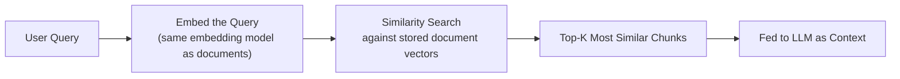

# Similarity Search

> Searching a million vectors one by one would work — it would just take longer than your users are willing to wait.

**Type:** Learn
**Prerequisites:** Vector Embeddings in Practice
**Time:** ~20 minutes

## Learning Objectives

- Explain how similarity search finds the most relevant chunks for a query, at a conceptual level
- Describe why exact (brute-force) search doesn't scale, and what approximate nearest neighbor (ANN) search trades off to fix that
- Recognize the role of a vector database (from the database basics lesson) in making this fast at scale
- Formulate the right questions when reviewing a RAG system's retrieval speed or recall quality

## What It Is

**Similarity search** finds the stored vectors closest (most similar) to a query's embedding. It is the retrieval half of "Retrieval-Augmented Generation". The query is embedded with the same model as the documents, compared against stored vectors, and the top matches are handed to the LLM as context.

## Why It Matters

A RAG prototype works well with 500 documents. At 5 million documents, retrieval latency jumps from 50 ms to several seconds and the feature feels broken. Without understanding how similarity search scales, a TPM might assume a fundamentally different approach is needed, when it is a well-understood scaling problem with standard solutions.

## How It Works

**Exact (brute-force) search** compares the query against every stored vector (for example using cosine similarity) and returns the best. It is always correct, but cost grows linearly with corpus size: 5 million vectors takes roughly 10,000 times longer than 500.

**Approximate nearest neighbor (ANN) search** pre-organizes vectors into a structure (graphs or trees; HNSW is the most common) that lets the system find very likely nearest matches by checking only a small, smart subset. It trades a small amount of accuracy (occasionally missing the technically closest match) for a large speed gain.

**Top-K retrieval** returns the K most similar chunks (for example, 5), not one. Choosing K is a trade-off: too few risks missing a relevant chunk; too many wastes context window space and money (token economics) on marginally relevant content and can distract the model.

Most ANN implementations expose a tunable setting trading speed against the probability of finding the true best match (recall).

## Architecture and Workflow



```archify
src: diagrams/similarity-search-flow.html
title: From user query to top-K chunks fed to the LLM
aspect: 1081/280
```

## A Real-World Example

Illustrative scaling for one query:

| Corpus size | Exact search | ANN search | Practical choice |
| :--- | :--- | :--- | :--- |
| 5,000 vectors | A few milliseconds | A few milliseconds | Exact is fine; avoid ANN complexity |
| 500,000 vectors | Hundreds of milliseconds | Tens of milliseconds | ANN worth enabling |
| 5,000,000 vectors | Seconds | Around 50 ms at 95-99% recall | ANN required |

Production vector databases (such as Pinecone, Weaviate, or pgvector with an ANN index) use ANN by default at scale. Teams then tune recall versus speed against real queries.

## What a TPM Needs to Understand

- Retrieval speed at scale is a well-solved problem. The standard answer to "retrieval got slow as our corpus grew" is adopting or properly configuring ANN, not rearchitecting RAG.
- Top-K is a real, tunable trade-off, not an arbitrary default. Raising K from 5 to 50 "to be safe" can lower quality, because irrelevant chunks dilute the context and distract the model, and it raises token cost.
- ANN means some queries will miss the best chunk. That is acceptable if measured, and a hidden quality loss if not.

## Risks, Dependencies, and Trade-Offs

| Search Approach | Accuracy | Speed at Scale | Best For |
| :--- | :--- | :--- | :--- |
| **Exact (brute-force) search** | Always finds true best match | Poor at scale (linear cost) | Small corpora (thousands of vectors) |
| **Approximate Nearest Neighbor (ANN)** | Very high, occasionally misses true best match | Excellent at scale | Large corpora (millions+ of vectors) |

Dependencies: the vector database and index configuration, memory capacity (ANN indexes are often held in RAM), and the embedding model. Failure scenarios: recall tuned too low for speed, so relevant chunks silently disappear; index not updated after new documents are added; latency spikes under concurrent load.

## Questions to Ask Engineers

1. *"Is our vector database using exact or approximate (ANN) search, and is that appropriate for our current and expected corpus size?"*
2. *"What's our current top-K setting, and has it been tuned against real retrieval quality data, rather than left at a default?"*
3. *"For our ANN configuration, what's the recall/speed trade-off we've chosen, and has that been validated against real user queries?"*

## Scenario Exercise

Your RAG feature's p95 retrieval latency grew from 80 ms to 3 seconds as the corpus grew from 100,000 to 6 million chunks.

1. **Easy**: In plain English, why does exact search cost grow roughly in line with the number of stored vectors?
2. **Medium**: What is the most likely fix, and what quality trade-off must you ask engineers to measure?
3. **Hard**: A team raises top-K from 5 to 50 to "be safe" and answer quality gets worse. Propose a hypothesis for why, and describe an experiment to find a better K.

## Key Terms

- **Similarity Search**: Finding the stored vectors most similar to a query vector, forming the retrieval step of RAG.
- **Brute-Force (Exact) Search**: Comparing a query against every single stored vector, guaranteeing the true best match but scaling poorly.
- **Approximate Nearest Neighbor (ANN) Search**: A search method trading a small amount of accuracy for a large speed improvement at scale, standard in production vector databases.
- **Top-K Retrieval**: Returning the K most similar chunks to a query, where K is a tunable trade-off between completeness and context/cost.
