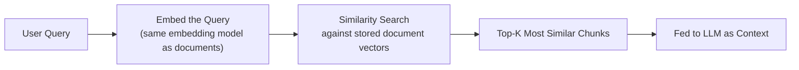

# Similarity Search

> Searching a million vectors one by one would work — it would just take longer than your users are willing to wait.

**Type:** Learn
**Languages:** Python
**Prerequisites:** Vector Embeddings in Practice
**Time:** ~30 minutes

## Learning Objectives

- Understand how similarity search finds the most relevant chunks for a query, at a mechanical level
- Understand why exact (brute-force) search doesn't scale, and what approximate nearest neighbor (ANN) search trades off to fix that
- Recognize the role of a vector database (from the database basics lesson) in making this fast at scale
- Formulate the right questions when reviewing a RAG system's retrieval speed or recall quality

## The Problem

A RAG prototype works great with 500 documents. At 5 million documents, retrieval latency jumps from 50ms to several seconds, making the feature feel broken. Without understanding how similarity search actually works and scales, a TPM might assume this requires a fundamentally different approach, when it's actually a well-understood scaling problem with standard, well-established solutions.

## The Concept

**Similarity search** finds the stored vectors closest (most similar) to a query's embedding — this is the retrieval half of "Retrieval-Augmented Generation."



### Exact (Brute-Force) Search

The simplest approach: compute the similarity (e.g. cosine similarity, from the tokens/embeddings lesson) between the query vector and *every single* stored vector, then return the top matches. This is exact and always correct, but its cost grows linearly with the number of stored vectors — comparing against 5 million vectors takes roughly 10,000x longer than comparing against 500.

### Approximate Nearest Neighbor (ANN) Search

To scale beyond a small corpus, production vector databases use **ANN algorithms**, which pre-organize vectors into a structure (e.g. graphs or trees) that allows finding *very likely* nearest matches without checking every single vector — trading a small amount of accuracy (occasionally missing the technically-closest match) for a massive speed improvement.

```
Exact search: check all N vectors -> slow but always finds the true best match
ANN search:   check a small, smart subset of vectors -> fast, finds a near-best match almost always
```

### Top-K Retrieval

Similarity search doesn't return just one match — it returns the **top K** most similar chunks (e.g. top 5), which are then fed to the LLM as context. Choosing K is itself a trade-off: too few risks missing a relevant chunk; too many wastes context window space (and money, from the token economics lesson) on marginally relevant content.

## Build It

Comparing brute-force search timing against a simulated ANN approach that only checks a smart subset:

```python
import time
import random
import math

def cosine_similarity(a, b):
    dot = sum(x * y for x, y in zip(a, b))
    mag_a = math.sqrt(sum(x * x for x in a))
    mag_b = math.sqrt(sum(y * y for y in b))
    return dot / (mag_a * mag_b) if mag_a and mag_b else 0

random.seed(42)
num_vectors = 50_000
dimension = 32
vectors = [[random.random() for _ in range(dimension)] for _ in range(num_vectors)]
query = [random.random() for _ in range(dimension)]

start = time.perf_counter()
similarities = [(i, cosine_similarity(query, v)) for i, v in enumerate(vectors)]
top_k_exact = sorted(similarities, key=lambda x: x[1], reverse=True)[:5]
exact_time = time.perf_counter() - start

def simulated_ann_search(query, vectors, sample_fraction=0.1, top_k=5):
    sample_size = int(len(vectors) * sample_fraction)
    sample_indices = random.sample(range(len(vectors)), sample_size)
    sampled_similarities = [(i, cosine_similarity(query, vectors[i])) for i in sample_indices]
    return sorted(sampled_similarities, key=lambda x: x[1], reverse=True)[:top_k]

start = time.perf_counter()
top_k_approx = simulated_ann_search(query, vectors)
approx_time = time.perf_counter() - start

print(f"Exact search over {num_vectors} vectors: {exact_time*1000:.2f} ms")
print(f"Simulated ANN search (10% sample): {approx_time*1000:.2f} ms")
print(f"Speedup: {exact_time / approx_time:.1f}x faster")
print(f"\nTop match (exact): index {top_k_exact[0][0]}, score {top_k_exact[0][1]:.4f}")
print(f"Top match (approximate): index {top_k_approx[0][0]}, score {top_k_approx[0][1]:.4f}")
```

Real ANN algorithms (like HNSW, used in most production vector databases) are far smarter than random sampling, but this illustrates the core trade-off: checking fewer vectors intelligently trades a small amount of exactness for a large speed gain, which is essential once a corpus grows large.

## Use It

Real vector database choices and configurations reflect this trade-off directly:

- **Small corpora (thousands of vectors)**: exact search is often fast enough, avoiding ANN complexity entirely.
- **Large corpora (millions+ of vectors)**: production vector databases (Pinecone, pgvector with an ANN index, Weaviate) use ANN algorithms by default, since exact search would be too slow.
- **Recall vs. speed tuning**: most ANN implementations expose a tunable parameter trading search speed against the probability of finding the true best match — a real, adjustable knob worth understanding rather than treating as a fixed black box.

## Exercises

1. **Easy**: In plain English, explain why exact search cost grows roughly linearly with the number of stored vectors.
2. **Medium**: A RAG feature's retrieval latency became unacceptable as the document corpus grew. Propose the most likely fix based on this lesson.
3. **Hard**: A team increases `top_k` from 5 to 50 to "be safe" and retrieval quality gets worse, not better. Propose a hypothesis for why more retrieved chunks could hurt rather than help.

## TPM Perspective

### Strategic Executive Summary
Similarity search performance is a well-understood, well-solved engineering problem at scale — the standard answer to "retrieval got slow as our corpus grew" is adopting or properly configuring approximate nearest neighbor search, not rearchitecting the whole RAG system. Top-K choice is also a real, tunable trade-off worth reviewing rather than an arbitrary default.

### Questions to Challenge Engineering
1. *"Is our vector database using exact or approximate (ANN) search, and is that appropriate for our current and expected corpus size?"*
2. *"What's our current top-K setting, and has it been tuned against real retrieval quality data, rather than left at a default?"*
3. *"For our ANN configuration, what's the recall/speed trade-off we've chosen, and has that been validated against real user queries?"*

### Trade-Off Matrix

| Search Approach | Accuracy | Speed at Scale | Best For |
| :--- | :--- | :--- | :--- |
| **Exact (brute-force) search** | Always finds true best match | Poor at scale (linear cost) | Small corpora (thousands of vectors) |
| **Approximate Nearest Neighbor (ANN)** | Very high, occasionally misses true best match | Excellent at scale | Large corpora (millions+ of vectors) |

## Key Terms

- **Similarity Search**: Finding the stored vectors most similar to a query vector, forming the retrieval step of RAG.
- **Brute-Force (Exact) Search**: Comparing a query against every single stored vector, guaranteeing the true best match but scaling poorly.
- **Approximate Nearest Neighbor (ANN) Search**: A search method trading a small amount of accuracy for a large speed improvement at scale, standard in production vector databases.
- **Top-K Retrieval**: Returning the K most similar chunks to a query, where K is a tunable trade-off between completeness and context/cost.
