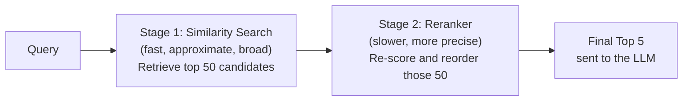

# Reranking

> Fast, approximate retrieval gets you a good shortlist — reranking is what turns that shortlist into the right answer.

**Type:** Learn
**Prerequisites:** Similarity Search
**Time:** ~20 minutes

## Learning Objectives

- Explain why initial similarity search retrieval and final ranking quality are two separate problems
- Describe what a reranker does differently (and more expensively) than the initial retrieval step
- Recognize the two-stage retrieval pattern: fast, broad retrieval followed by slower, precise reranking
- Formulate the right questions when a RAG system retrieves "relevant but not the best" results

## What It Is

**Reranking** is a second retrieval stage that re-scores and reorders a shortlist of candidates produced by initial similarity search. The overall pattern is **two-stage retrieval**: a fast, broad first pass, then a slower, more precise second pass on a smaller set.

## Why It Matters

A RAG system retrieves the top 20 chunks by embedding similarity, but the single most helpful chunk is ranked 14th. If only the top 5 go to the LLM (to save context and cost, per the token economics lesson), the best answer is left out entirely. Similarity search is fast but only approximately right about true relevance, so a separate step is needed to reorder candidates before the LLM sees them.

## How It Works

Embedding-based similarity search is fast because it compares pre-computed vectors with simple math. The price of that speed is a simplification: it never looks at the specific relationship between this exact query and each candidate text. A **reranker** is a more expensive model (commonly a **cross-encoder**) that reads the query and a candidate chunk together and produces a more accurate relevance score. Running it over millions of documents would be far too slow, so it only runs on the **shortlist** from stage 1.

- **Stage 1 (similarity search)**: fast, scales to millions of documents, ordering only approximate.
- **Stage 2 (reranking)**: slow per item, feasible only on a small shortlist, but meaningfully more accurate within it.

## Architecture and Workflow



```archify
src: diagrams/two-stage-retrieval.html
title: Two-stage retrieval: similarity search then reranker
aspect: 1168/280
```

## A Real-World Example

A customer asks, "Can I return a defective product after 30 days?" Four candidates come back from stage 1:

| Candidate chunk | Stage 1 rank (similarity) | Stage 2 rank (reranker) |
| :--- | :--- | :--- |
| "Refunds require a receipt within 30 days." | 1 (0.71) | 2 |
| "Our return policy excludes digital downloads." | 2 (0.69) | 3 |
| "Defective products may be exchanged with manager approval, even past 30 days." | 3 (0.55) | 1 |
| "Store hours are 9am to 9pm daily." | 4 (0.40) | 4 |

The chunk that actually answers the question is third in stage 1 and first after reranking. If only two chunks were sent to the LLM without reranking, the answer would be missing. Typical production setup: retrieve 50 to 100 candidates, rerank to the final 3 to 5, and A/B test the reranker, since its effect on answer quality is measurable.

## What a TPM Needs to Understand

- Reranking is a well-established, high-leverage stage that helps when the top results are topically relevant but not ordered by true relevance.
- Treat it as a separable component with its own latency and cost trade-off: do not assume it exists, and do not dismiss it as complexity without testing.
- When a relevant answer was missed, ask whether it was excluded from the shortlist (a stage 1 problem) or included but ranked too low (a reranking opportunity).
- Reranker models are separate from embedding models and the LLM; each is a distinct choice.

## Risks, Dependencies, and Trade-Offs

| Approach | Relevance Ordering Quality | Added Latency | Added Cost |
| :--- | :--- | :--- | :--- |
| **Similarity search only (no reranking)** | Approximate | None | None |
| **Similarity search + reranking** | Higher precision on final top results | Moderate (only applied to shortlist) | Moderate (extra model calls on shortlist) |

Dependencies: a reranker model or service, and a shortlist big enough that the right chunk is in it. Failure scenarios: shortlist too small, so the best chunk never reaches the reranker; reranker latency (for example an extra 100 to 300 ms) breaking a response-time target; reranker tuned on general text underperforming on domain content.

## Questions to Ask Engineers

1. *"Are we using a two-stage retrieval pattern (broad similarity search, then reranking), or sending raw similarity search results directly to the LLM?"*
2. *"What's the added latency and cost of adding a reranking stage, and has it been measured against the actual improvement in answer quality?"*
3. *"When our RAG feature misses an obviously relevant answer, was that content excluded entirely from the shortlist, or included but ranked too low to be sent to the LLM?"*

## Scenario Exercise

Your support RAG feature sends the top 5 similarity results to the LLM. Agents report that the correct policy chunk is often present in the top 20 but not the top 5.

1. **Easy**: Why would running a reranker over the full corpus, skipping stage 1, be impractical?
2. **Medium**: Engineers propose adding a reranker that adds about 200 ms. What information do you need to decide whether that is acceptable?
3. **Hard**: Design a measurement plan to prove whether reranking improved final answer quality, not just ranking order, including the test set, the metrics, and the decision threshold.

## Key Terms

- **Reranking**: A second retrieval stage that more precisely re-scores and reorders a shortlist of candidates produced by initial similarity search.
- **Two-Stage Retrieval**: The pattern of fast, broad retrieval followed by slower, precise reranking on a smaller candidate set.
- **Cross-Encoder**: A common model architecture used for reranking that directly compares a query and a document together, rather than comparing pre-computed embeddings.
- **Shortlist**: The smaller set of top candidates (e.g. top 50) produced by initial retrieval, which reranking then refines.
