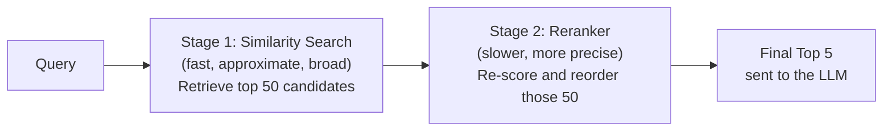

# Reranking

> Fast, approximate retrieval gets you a good shortlist — reranking is what turns that shortlist into the right answer.

**Type:** Learn
**Languages:** Python
**Prerequisites:** Similarity Search
**Time:** ~25 minutes

## Learning Objectives

- Understand why initial similarity search retrieval and final ranking quality are two separate problems
- Understand what a reranker does differently (and more expensively) than the initial retrieval step
- Recognize the two-stage retrieval pattern: fast, broad retrieval followed by slower, precise reranking
- Formulate the right questions when a RAG system retrieves "relevant but not the best" results

## The Problem

A RAG system retrieves the top 20 chunks by embedding similarity, but the single most helpful chunk is ranked 14th, not 1st — meaning if only the top 5 are sent to the LLM (to save on context/cost, from the token economics lesson), the best answer gets left out entirely. Similarity search is fast but approximate at judging true relevance; a separate step is needed to more precisely re-order candidates before finalizing which ones the LLM actually sees.

## The Concept

Production RAG systems commonly use a **two-stage retrieval pattern**: a fast, broad first pass, followed by a slower, more precise second pass on a smaller set of candidates.



### Why Two Stages, Not One

Embedding-based similarity search (previous lesson) is fast precisely because it compares pre-computed vectors using simple math (cosine similarity) — but this speed comes from a simplification: it can't deeply consider the specific relationship between this exact query and each candidate document. A **reranker** is a more computationally expensive model that directly compares the query against each candidate chunk (not just their pre-computed embeddings), producing a more accurate relevance score — but running this on millions of documents directly would be far too slow, which is exactly why it's only applied to the smaller shortlist that similarity search already narrowed down.

### The Practical Trade-off

- **Stage 1 (similarity search)**: fast, scales to millions of documents, but relevance ranking is only approximately correct.
- **Stage 2 (reranking)**: slow per-item, so only feasible on a small shortlist (e.g. top 50), but produces meaningfully more accurate relevance ordering within that shortlist.

## Build It

A simplified illustration: a cheap "similarity" first pass followed by an expensive, more careful "rerank" pass:

```python
candidates = [
    ("Refunds require a receipt within 30 days.", 0.71),
    ("Our return policy excludes digital downloads.", 0.69),
    ("Defective products may be exchanged with manager approval, even past 30 days.", 0.55),
    ("Store hours are 9am to 9pm daily.", 0.40),
]

def cheap_similarity_score(query, text_and_score):
    return text_and_score[1]

def expensive_rerank_score(query, text):
    query_terms = set(query.lower().split())
    text_terms = set(text.lower().split())
    overlap = len(query_terms & text_terms)
    length_penalty = 1 / (1 + abs(len(text_terms) - len(query_terms)))
    return overlap * 2 + length_penalty

query = "can I return a defective product after 30 days?"

print("Stage 1 - Initial similarity search ranking:")
stage1_ranked = sorted(candidates, key=lambda c: c[1], reverse=True)
for text, score in stage1_ranked:
    print(f"  [{score:.2f}] {text}")

print("\nStage 2 - Reranked using deeper query-document comparison:")
reranked = sorted(candidates, key=lambda c: expensive_rerank_score(query, c[0]), reverse=True)
for text, score in reranked:
    rerank_score = expensive_rerank_score(query, text)
    print(f"  [{rerank_score:.2f}] {text}")
```

Notice the chunk about defective products past 30 days — most directly relevant to this specific query — may rank lower in the cheap initial pass but rise to the top after reranking, which considers the actual query terms in more depth.

## Use It

Real RAG systems apply reranking as a standard quality improvement:

- **Retrieve broadly, rerank narrowly**: pull the top 50-100 candidates via fast similarity search, then rerank down to the final top 3-5 sent to the LLM.
- **Dedicated reranker models** (e.g. cross-encoder models) are commonly used specifically for this second stage, distinct from the embedding model used in stage one.
- **A/B testing rerankers**: since reranking directly affects which content the LLM sees, its impact on final answer quality is measurable and worth testing empirically, not just assumed to help.

## Exercises

1. **Easy**: In plain English, explain why running a reranker on millions of documents directly (skipping stage 1) would be impractical.
2. **Medium**: In the code example, why might the chunk about store hours consistently rank low in both stages regardless of the query?
3. **Hard**: Propose a way to measure whether adding a reranking stage actually improved a RAG system's final answer quality, rather than just assuming it helps.

## TPM Perspective

### Strategic Executive Summary
Reranking is a well-established, high-leverage second stage that improves RAG answer quality when the top-K similarity search results, while topically relevant, aren't ordered by true relevance to the specific query. It should be evaluated as a distinct, addable component with its own cost/latency trade-off — not assumed to be already happening, and not dismissed as unnecessary complexity without testing.

### Questions to Challenge Engineering
1. *"Are we using a two-stage retrieval pattern (broad similarity search, then reranking), or sending raw similarity search results directly to the LLM?"*
2. *"What's the added latency and cost of adding a reranking stage, and has it been measured against the actual improvement in answer quality?"*
3. *"When our RAG feature misses an obviously relevant answer, was that content excluded entirely from the shortlist, or included but ranked too low to be sent to the LLM?"*

### Trade-Off Matrix

| Approach | Relevance Ordering Quality | Added Latency | Added Cost |
| :--- | :--- | :--- | :--- |
| **Similarity search only (no reranking)** | Approximate | None | None |
| **Similarity search + reranking** | Higher precision on final top results | Moderate (only applied to shortlist) | Moderate (extra model calls on shortlist) |

## Key Terms

- **Reranking**: A second retrieval stage that more precisely re-scores and reorders a shortlist of candidates produced by initial similarity search.
- **Two-Stage Retrieval**: The pattern of fast, broad retrieval followed by slower, precise reranking on a smaller candidate set.
- **Cross-Encoder**: A common model architecture used for reranking that directly compares a query and a document together, rather than comparing pre-computed embeddings.
- **Shortlist**: The smaller set of top candidates (e.g. top 50) produced by initial retrieval, which reranking then refines.
