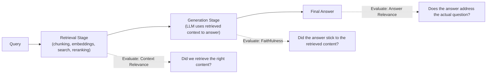

# RAG Evaluation Frameworks

> A RAG system can fail in at least three different places — knowing which one failed is the difference between a five-minute fix and a wasted week.

**Type:** Learn
**Languages:** Python
**Prerequisites:** Reranking
**Time:** ~30 minutes

## Learning Objectives

- Understand why RAG systems need to be evaluated at each stage separately: retrieval, and generation
- Know the core RAG evaluation metrics: context relevance, faithfulness (groundedness), and answer relevance
- Understand why "the answer was wrong" doesn't tell you whether retrieval or generation was the failure point
- Formulate the right questions when reviewing how a team measures RAG quality

## The Problem

A RAG-powered feature gives a wrong answer, and the team's response is to try a bigger, more expensive LLM. The actual problem was that retrieval never found the relevant document in the first place — a completely different fix (chunking, embedding model, or search tuning, from the previous lessons) than the one the team just spent budget and time implementing. Without evaluating retrieval and generation separately, teams routinely misdiagnose which stage actually failed.

## The Concept

RAG has (at least) two distinct stages, and evaluation should measure each one separately rather than only judging the final answer:



### Three Core RAG Metrics

- **Context Relevance**: did retrieval actually find content relevant to the query? (A retrieval-stage metric — independent of what the LLM does afterward.)
- **Faithfulness (Groundedness)**: does the generated answer accurately reflect the retrieved content, without contradicting it or adding unsupported claims (hallucinating on top of real retrieved context)? A generation-stage metric.
- **Answer Relevance**: does the final answer actually address the user's original question, even if it's faithful to the retrieved content? (It's possible to be faithful to irrelevant content and still produce an unhelpful answer.)

### Why Separating These Matters

- **Low context relevance + low faithfulness + low answer relevance** → likely a retrieval problem (wrong content was found, so nothing downstream could succeed).
- **High context relevance + low faithfulness** → likely a generation problem — the right information was retrieved, but the model didn't use it accurately (a hallucination on top of good context, not a retrieval failure).
- **High context relevance + high faithfulness + low answer relevance** → the retrieved content and generated summary were both technically accurate, but didn't actually address what the user was asking — often a sign of a poorly scoped query or missing content elsewhere in the corpus.

## Build It

A simplified scoring function illustrating how these three metrics can be measured independently for a single RAG interaction:

```python
def context_relevance_score(query_keywords, retrieved_text):
    retrieved_words = set(retrieved_text.lower().split())
    matches = query_keywords & retrieved_words
    return len(matches) / len(query_keywords) if query_keywords else 0

def faithfulness_score(generated_answer, retrieved_text):
    answer_words = set(generated_answer.lower().split())
    retrieved_words = set(retrieved_text.lower().split())
    supported = answer_words & retrieved_words
    return len(supported) / len(answer_words) if answer_words else 0

def answer_relevance_score(query_keywords, generated_answer):
    answer_words = set(generated_answer.lower().split())
    matches = query_keywords & answer_words
    return len(matches) / len(query_keywords) if query_keywords else 0

query = "what is the refund policy for defective products"
query_keywords = set(query.lower().split()) - {"what", "is", "the", "for"}

retrieved_text = "defective products may be exchanged with manager approval even past the standard 30 day window"
generated_answer = "defective products can be exchanged with manager approval, even after 30 days, per our policy"

print(f"Context Relevance:  {context_relevance_score(query_keywords, retrieved_text):.2f}")
print(f"Faithfulness:       {faithfulness_score(generated_answer, retrieved_text):.2f}")
print(f"Answer Relevance:   {answer_relevance_score(query_keywords, generated_answer):.2f}")

print("\n--- Now a failure case: retrieval found the wrong content ---")
wrong_retrieved_text = "store hours are 9am to 9pm daily monday through sunday"
wrong_generated_answer = "our store is open from 9am to 9pm every day"

print(f"Context Relevance:  {context_relevance_score(query_keywords, wrong_retrieved_text):.2f}")
print(f"Faithfulness:       {faithfulness_score(wrong_generated_answer, wrong_retrieved_text):.2f}")
print(f"Answer Relevance:   {answer_relevance_score(query_keywords, wrong_generated_answer):.2f}")
```

In the failure case, faithfulness stays reasonably high (the answer accurately reflects what was retrieved), but context relevance and answer relevance both collapse — precisely diagnosing this as a *retrieval* failure, not a generation failure, and pointing straight back to chunking, embeddings, or search tuning as the fix.

## Use It

Real RAG evaluation pipelines run these metrics systematically:

- **Automated evaluation on a test set** of representative queries with known-good expected retrieval and answers, run regularly as the system changes (connecting to the testing practices from the software engineering fundamentals lesson).
- **LLM-as-judge evaluation**: using a separate LLM call to score faithfulness or answer relevance at scale, since manually reviewing every interaction doesn't scale.
- **Production monitoring**: sampling live interactions and scoring them on these three dimensions to catch quality regressions before they become widespread user complaints.

## Exercises

1. **Easy**: In plain English, explain why "the final answer was wrong" alone doesn't tell you whether retrieval or generation caused the failure.
2. **Medium**: Describe a scenario where faithfulness could be high but answer relevance low, and explain what that combination suggests about where the problem lies.
3. **Hard**: Propose a lightweight process for continuously evaluating a production RAG system's quality without requiring a human to manually review every single interaction.

## TPM Perspective

### Strategic Executive Summary
"The RAG feature gave a wrong answer" is not a diagnosis — it's a symptom that could originate in retrieval, generation, or both. Insisting on stage-separated evaluation (context relevance, faithfulness, answer relevance) turns vague quality complaints into precise, actionable fixes, and prevents teams from spending budget on the wrong solution (e.g. a bigger model, when the real issue was retrieval).

### Questions to Challenge Engineering
1. *"When this RAG feature gives a wrong answer, do we know whether it was a retrieval failure (wrong content found) or a generation failure (right content, poor use of it)?"*
2. *"Do we have an ongoing evaluation process (automated test set, LLM-as-judge, or production sampling) measuring context relevance, faithfulness, and answer relevance separately?"*
3. *"Before proposing a bigger/more expensive model to fix a quality issue, have we ruled out retrieval as the actual root cause?"*

### Trade-Off Matrix

| Evaluation Method | Coverage | Cost | Speed |
| :--- | :--- | :--- | :--- |
| **Manual human review** | Low (doesn't scale) | High (human time) | Slow |
| **Automated test set (known queries/answers)** | Moderate, fixed set | Low-Moderate | Fast, repeatable |
| **LLM-as-judge scoring** | High, can cover live traffic | Moderate (extra model calls) | Fast, scalable |

## Key Terms

- **Context Relevance**: A retrieval-stage metric measuring whether retrieved content is actually relevant to the query.
- **Faithfulness (Groundedness)**: A generation-stage metric measuring whether the generated answer accurately reflects the retrieved content without unsupported claims.
- **Answer Relevance**: A metric measuring whether the final answer actually addresses the user's original question.
- **LLM-as-Judge**: Using a separate LLM call to automatically score outputs against quality criteria, enabling evaluation at scale without full manual review.
