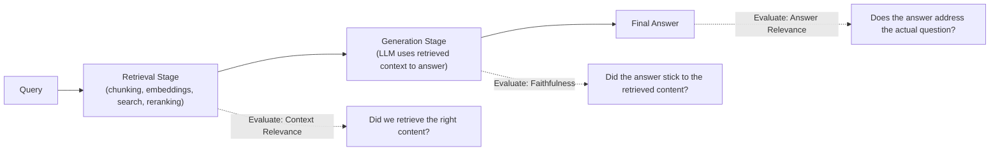

# RAG Evaluation Frameworks

> A RAG system can fail in at least three different places — knowing which one failed is the difference between a five-minute fix and a wasted week.

**Type:** Learn
**Prerequisites:** Reranking
**Time:** ~20 minutes

## Learning Objectives

- Explain why RAG systems need to be evaluated at each stage separately: retrieval and generation
- Describe the core RAG evaluation metrics: context relevance, faithfulness (groundedness), and answer relevance
- Explain why "the answer was wrong" doesn't tell you whether retrieval or generation was the failure point
- Formulate the right questions when reviewing how a team measures RAG quality

## What It Is

A RAG evaluation framework measures quality at each stage of the pipeline rather than judging only the final answer. RAG has at least two stages, retrieval and generation, and three core metrics map onto them:

- **Context Relevance** (retrieval stage): did retrieval find content relevant to the query, independent of what the LLM does afterward?
- **Faithfulness / Groundedness** (generation stage): does the answer reflect the retrieved content, without contradicting it or adding unsupported claims?
- **Answer Relevance** (final answer): does the answer address the user's actual question? An answer can be faithful to irrelevant content and still be unhelpful.

## Why It Matters

A RAG feature gives a wrong answer, and the team responds by trying a bigger, more expensive LLM. The real problem was that retrieval never found the relevant document, a completely different fix (chunking, embedding model, or search tuning, from the previous lessons) than the one just paid for. Without evaluating retrieval and generation separately, teams routinely misdiagnose which stage failed.

## How It Works

Each metric is scored for a set of representative questions, then the pattern of scores points to the failing stage:

| Context relevance | Faithfulness | Answer relevance | Likely diagnosis |
| :--- | :--- | :--- | :--- |
| Low | Low | Low | Retrieval problem: wrong content was found, so nothing downstream could succeed |
| High | Low | Low or mixed | Generation problem: right information retrieved, but the model did not use it accurately |
| High | High | Low | Content was accurate but did not address the question: poorly scoped query, or the needed content is missing from the corpus |
| Low | High | Low | Retrieval problem again: the answer faithfully repeated the wrong content |

Scoring is done by automated test sets, by an **LLM-as-judge** (a separate model call that scores outputs at scale), or by sampling live traffic.

## Architecture and Workflow



```archify
src: diagrams/rag-evaluation-points.html
title: Where each RAG evaluation metric applies
aspect: 1027/404
```

## A Real-World Example

A user asks, "What is the refund policy for defective products?"

| Case | What was retrieved | What the model said | Scores | Diagnosis |
| :--- | :--- | :--- | :--- | :--- |
| Healthy | Defective-product exchange rule, past 30 days | Same rule, accurately restated | All high | Working as intended |
| Retrieval failure | Store hours | "Our store is open 9am to 9pm daily" | Faithfulness high (it repeats the retrieved text), context and answer relevance near zero | Fix chunking, embeddings, or search, not the LLM |
| Generation failure | Correct rule | "Defective items are refundable for 90 days" (invented) | Context relevance high, faithfulness low | Fix prompting, grounding instructions, or the model |

Real pipelines run these checks as an automated test set of representative questions after every change (connecting to the testing practices from software engineering), LLM-as-judge scoring across larger volumes, and production monitoring that samples live interactions to catch regressions before users complain.

## What a TPM Needs to Understand

- "The RAG feature gave a wrong answer" is a symptom, not a diagnosis. Stage-separated evaluation turns vague complaints into precise, actionable fixes.
- It prevents spending on the wrong solution, such as a bigger model when retrieval was the root cause.
- LLM-as-judge scores are themselves imperfect; they should be spot-checked against human review.
- A fixed test set with agreed pass thresholds (for example, 90 percent context relevance) belongs in the launch criteria.

## Risks, Dependencies, and Trade-Offs

| Evaluation Method | Coverage | Cost | Speed |
| :--- | :--- | :--- | :--- |
| **Manual human review** | Low (doesn't scale) | High (human time) | Slow |
| **Automated test set (known queries/answers)** | Moderate, fixed set | Low-Moderate | Fast, repeatable |
| **LLM-as-judge scoring** | High, can cover live traffic | Moderate (extra model calls) | Fast, scalable |

Dependencies: a curated test set with known-good answers (someone must own and refresh it), a judge model, and logging that captures retrieved chunks, not just final answers. Failure scenarios: a stale test set that no longer reflects real questions; judge bias; evaluating only the final answer and misattributing the cause.

## Questions to Ask Engineers

1. *"When this RAG feature gives a wrong answer, do we know whether it was a retrieval failure (wrong content found) or a generation failure (right content, poor use of it)?"*
2. *"Do we have an ongoing evaluation process (automated test set, LLM-as-judge, or production sampling) measuring context relevance, faithfulness, and answer relevance separately?"*
3. *"Before proposing a bigger/more expensive model to fix a quality issue, have we ruled out retrieval as the actual root cause?"*

## Scenario Exercise

A legal-research RAG tool is getting complaints about wrong answers. Leadership asks you to approve a budget for a premium LLM.

1. **Easy**: Why does "the final answer was wrong" alone not tell you whether retrieval or generation caused the failure?
2. **Medium**: Describe a scenario where faithfulness is high but answer relevance is low, and what it suggests about where the problem lies.
3. **Hard**: Propose a lightweight process for continuously evaluating the production system without humans reviewing every interaction, and say what result would justify (or rule out) the premium model.

## Key Terms

- **Context Relevance**: A retrieval-stage metric measuring whether retrieved content is actually relevant to the query.
- **Faithfulness (Groundedness)**: A generation-stage metric measuring whether the generated answer accurately reflects the retrieved content without unsupported claims.
- **Answer Relevance**: A metric measuring whether the final answer actually addresses the user's original question.
- **LLM-as-Judge**: Using a separate LLM call to automatically score outputs against quality criteria, enabling evaluation at scale without full manual review.
