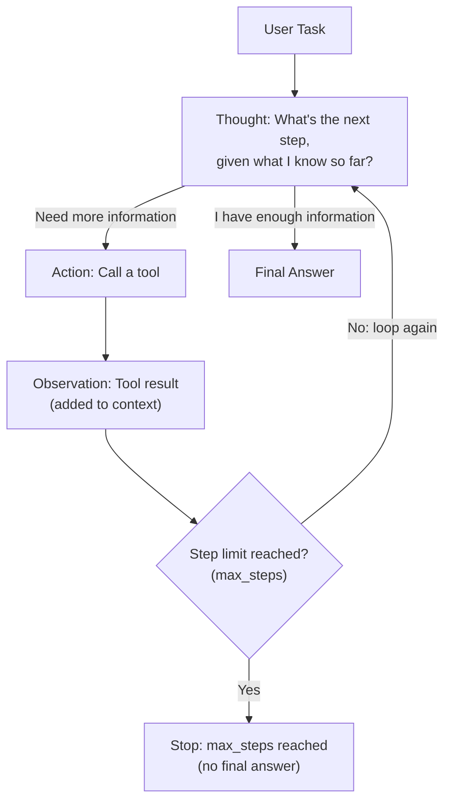

# ReAct: Reasoning and Acting Patterns

> An agent isn't a smarter model — it's the same model, given a loop and permission to check its own work.

**Type:** Learn
**Languages:** Python
**Prerequisites:** RAG Evaluation Frameworks
**Time:** ~30 minutes

## Learning Objectives

- Understand the ReAct pattern: interleaving reasoning ("thought") with actions (tool calls) and observations
- Understand why this loop, not a single prompt, is what turns an LLM into an "agent"
- Recognize why ReAct improves reliability on multi-step tasks compared to a single-shot response
- Formulate the right questions when reviewing an agent's reasoning loop design

## The Problem

A team builds a chatbot that tries to answer "what's the total cost of the last 3 orders for customer #4821?" in a single LLM call with tool access. It fails, because answering requires multiple steps: look up the customer, look up their orders, look up each order's cost, and add them up — a single-shot prompt can't reliably chain all of this together. Without a defined loop structure, the model either gives up, guesses, or calls only one tool and stops.

## The Concept

**ReAct** (Reasoning + Acting) is a pattern where a model alternates between three steps in a loop: think about what to do next, take an action (usually a tool call, from the function calling lesson), observe the result, and repeat until the task is done.



### Why "Thought" Steps Matter

Explicitly generating a reasoning step before each action — rather than jumping straight to a tool call — gives the model a chance to plan, reconsider, and catch its own mistakes based on what it has learned so far. This visible reasoning also gives engineers and TPMs something concrete to inspect when debugging why an agent took a particular action.

### Why This Is a Loop, Not a Single Call

Each "Observation" (a tool's result) becomes new context for the next "Thought" — the agent doesn't decide its entire plan upfront; it adapts step by step based on what it actually learns. This makes ReAct fundamentally different from prompt chaining (Level 4): chaining follows a fixed, pre-determined sequence of steps, while ReAct's sequence of actions is decided dynamically by the model itself, one step at a time.

## Build It

A simplified ReAct-style loop, using fake tools to solve a multi-step lookup task:

```python
customers = {"4821": {"name": "Alex Kim", "order_ids": ["A1", "A2", "A3"]}}
orders = {"A1": 49.99, "A2": 120.00, "A3": 15.50}

def get_customer(customer_id):
    return customers.get(customer_id)

def get_order_cost(order_id):
    return orders.get(order_id)

def fake_agent_step(step_number, context):
    if step_number == 1:
        return {"thought": "I need to find this customer's order IDs first.", "action": "get_customer", "args": {"customer_id": "4821"}}
    if step_number == 2:
        return {"thought": f"Found orders {context['order_ids']}. I need each order's cost.", "action": "get_order_cost", "args": {"order_id": context["order_ids"][context["next_index"]]}}
    return {"thought": "I have all order costs. Computing total.", "action": "final_answer", "args": {}}

def run_agent_loop(max_steps=6):
    context = {}
    total_cost = 0
    order_index = 0

    for step in range(1, max_steps + 1):
        decision = fake_agent_step(1 if step == 1 else (2 if order_index < 3 else 3), {**context, "next_index": order_index})
        print(f"Step {step} - Thought: {decision['thought']}")

        if decision["action"] == "get_customer":
            result = get_customer(**decision["args"])
            context["order_ids"] = result["order_ids"]
            print(f"  Action: get_customer(4821) -> Observation: {result}")

        elif decision["action"] == "get_order_cost":
            order_id = decision["args"]["order_id"]
            result = get_order_cost(order_id)
            total_cost += result
            print(f"  Action: get_order_cost({order_id}) -> Observation: ${result}")
            order_index += 1

        elif decision["action"] == "final_answer":
            print(f"  Final Answer: Total cost of last 3 orders = ${total_cost:.2f}")
            return total_cost

run_agent_loop()
```

Each step's "Observation" (the customer's order IDs, then each order's cost) directly informs the next "Thought" — the agent couldn't have decided which order IDs to look up cost for until it observed the result of the first tool call.

## Use It

The ReAct pattern (or close variants of it) underlies most real-world "AI agent" products:

- **Coding assistants**: reason about what file to check, read it, reason about what to change, make the edit, run tests, observe the result, repeat.
- **Research assistants**: reason about what to search for, search, read results, reason about what's still missing, search again.
- **Customer support agents**: reason about what information is needed, look it up, reason about whether it's sufficient to answer, look up more if not.

## Exercises

1. **Easy**: In the code above, identify one "Thought," one "Action," and one "Observation" from the printed output.
2. **Medium**: Explain in plain English why a single-shot prompt (no loop) would likely fail at the "total cost of last 3 orders" task, even with tool access.
3. **Hard**: Propose a stopping condition for an agent loop to prevent it from running forever if it never reaches a clear "final answer" state (hint: think about `max_steps` in the code above, and what else might be needed).

## TPM Perspective

### Strategic Executive Summary
The ReAct loop is the mechanical foundation of "AI agents" — understanding it demystifies what's actually happening when a team says a feature "uses an agent." It also reveals a key operational risk: an agent that never reaches a clear stopping condition can loop indefinitely, consuming cost and time without resolving — a distinctly different failure mode from a single-call feature simply returning a wrong answer.

### Questions to Challenge Engineering
1. *"Does this agent have a maximum step count or other hard stopping condition, to prevent runaway loops that keep calling tools without converging?"*
2. *"Can we inspect the agent's 'thought' steps when it takes an unexpected action, to understand its reasoning rather than treating it as an unexplainable black box?"*
3. *"For this task, is a full ReAct loop actually necessary, or would a simpler, fixed prompt chain (Level 4) achieve the same result more cheaply and predictably?"*

### Trade-Off Matrix

| Approach | Handles Multi-Step, Adaptive Tasks | Cost | Predictability |
| :--- | :--- | :--- | :--- |
| **Single-shot prompt (no loop)** | Poor for tasks requiring multiple dependent lookups | Lowest | High (one call, one outcome) |
| **Prompt chaining (fixed sequence)** | Good for known, fixed multi-step tasks | Moderate | High (sequence is predetermined) |
| **ReAct loop (dynamic, agent-decided steps)** | Best for tasks where the needed steps aren't known upfront | Higher (variable number of calls) | Lower (steps and step count vary by run) |

## Key Terms

- **ReAct (Reasoning + Acting)**: A pattern interleaving explicit reasoning steps with tool-calling actions and observations, in a loop, until a task is complete.
- **Thought**: An agent's explicit reasoning step, generated before deciding on an action, often used for debugging and inspection.
- **Observation**: The result of an action (typically a tool call), fed back into the agent's context to inform the next thought.
- **Agent Loop**: The repeating cycle of thought, action, and observation that continues until a stopping condition (like a final answer) is reached.
