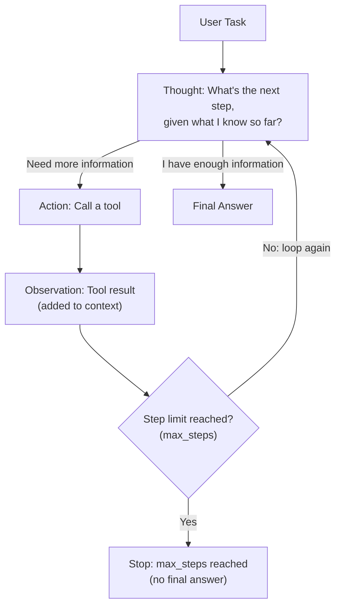

# ReAct: Reasoning and Acting Patterns

> An agent isn't a smarter model — it's the same model, given a loop and permission to check its own work.

**Type:** Learn
**Prerequisites:** RAG Evaluation Frameworks
**Time:** ~25 minutes

## Learning Objectives

- Explain the ReAct pattern: interleaving reasoning ("thought") with actions (tool calls) and observations
- Explain why this loop, not a single prompt, is what turns an LLM into an "agent"
- Recognize why ReAct improves reliability on multi-step tasks compared to a single-shot response
- Formulate the right questions when reviewing an agent's reasoning loop design

## What It Is

**ReAct** (Reasoning + Acting) is a pattern where a model alternates between three steps in a loop: think about what to do next (**thought**), take an action, usually a tool call from the function calling lesson (**action**), and read the result (**observation**). It repeats until the task is done or a limit is hit.

When a team says a feature "uses an agent," this loop is usually what they mean. The model is the same one used elsewhere in the course. What changes is that it is allowed to act, look at what happened, and decide again.

## Why It Matters

A team builds a chatbot that must answer "what's the total cost of the last 3 orders for customer #4821?" in a single LLM call with tool access. It fails, because the answer needs several dependent steps: look up the customer, look up their orders, look up each order's cost, add them up. A single-shot prompt cannot reliably chain these together. Without a loop, the model gives up, guesses, or calls one tool and stops.

## How It Works

1. The user gives the agent a task.
2. **Thought**: the model reasons about the next step given everything it knows so far.
3. **Action**: it calls a tool (or decides it has enough information).
4. **Observation**: the tool's result is added to the model's context.
5. The model loops back to a new thought, now informed by the observation.
6. The loop ends with a **final answer**, or when a hard limit such as a maximum step count is reached.

Two properties matter. First, explicit thoughts let the model plan, reconsider and catch its own mistakes, and give engineers and TPMs something concrete to inspect when an agent does something unexpected. Second, each observation becomes new context, so the agent does not decide its entire plan up front. This is what separates ReAct from prompt chaining (Level 4): chaining follows a fixed, predetermined sequence, while a ReAct agent decides its sequence dynamically, one step at a time.

## Architecture and Workflow



```archify
src: diagrams/react-loop.html
title: The ReAct loop: Thought, Action, Observation
aspect: 1185/404
```

## A Real-World Example

The "total cost of the last 3 orders" task, traced step by step:

| Step | Thought | Action | Observation |
| :--- | :--- | :--- | :--- |
| 1 | I need this customer's order IDs first. | Look up customer 4821 | Customer Alex Kim, orders A1, A2, A3 |
| 2 | I have the IDs. I need each order's cost. | Get cost of order A1 | $49.99 |
| 3 | Now order A2. | Get cost of order A2 | $120.00 |
| 4 | Now order A3. | Get cost of order A3 | $15.50 |
| 5 | I have all three costs and can total them. | None (final answer) | Total: $185.49 |

The agent could not have chosen which orders to price until it observed the result of step 1. That dependency is why a fixed script or single prompt struggles here.

The same loop underlies most real agent products:

- **Coding assistants**: decide which file to check, read it, decide what to change, edit, run tests, observe, repeat.
- **Research assistants**: decide what to search, read results, decide what is still missing, search again.
- **Customer support agents**: decide what information is needed, look it up, judge whether it is enough to answer.

## What a TPM Needs to Understand

- The ReAct loop demystifies "agent": it is a model in a loop with tools, not a separate kind of intelligence.
- The key operational risk is the missing stopping condition. An agent that never reaches a final answer can loop indefinitely, burning cost and time without resolving. That is a different failure mode from a single call returning a wrong answer.
- Variable step count means variable cost and latency per run. Plan budgets and SLAs accordingly.
- Thoughts are a debugging asset: ask for them to be logged so unexpected actions can be explained.
- Not every multi-step task needs a loop. If the steps are known in advance, a fixed chain is cheaper and more predictable.

## Risks, Dependencies, and Trade-Offs

| Approach | Handles Multi-Step, Adaptive Tasks | Cost | Predictability |
| :--- | :--- | :--- | :--- |
| **Single-shot prompt (no loop)** | Poor for tasks requiring multiple dependent lookups | Lowest | High (one call, one outcome) |
| **Prompt chaining (fixed sequence)** | Good for known, fixed multi-step tasks | Moderate | High (sequence is predetermined) |
| **ReAct loop (dynamic, agent-decided steps)** | Best for tasks where the needed steps aren't known upfront | Higher (variable number of calls) | Lower (steps and step count vary by run) |

Dependencies: the reliability of every tool the agent calls, since a failed or misleading observation feeds directly into the next thought. Failure scenarios: runaway loops that never converge, repeated calls to the same tool with the same inputs, and early misreadings that steer all later steps.

## Questions to Ask Engineers

1. *"Does this agent have a maximum step count or other hard stopping condition, to prevent runaway loops that keep calling tools without converging?"*
2. *"Can we inspect the agent's 'thought' steps when it takes an unexpected action, to understand its reasoning rather than treating it as an unexplainable black box?"*
3. *"For this task, is a full ReAct loop actually necessary, or would a simpler, fixed prompt chain (Level 4) achieve the same result more cheaply and predictably?"*

## Scenario Exercise

Your team ships a support agent that looks up orders and refunds status. Some tickets cost ten times more than average, and a few never finish.

1. **Easy**: Using the order-cost table above, point to one thought, one action and one observation.
2. **Medium**: Explain in plain English why a single-shot prompt would likely fail the "total cost of last 3 orders" task, even with tool access.
3. **Hard**: Propose stopping conditions for the agent loop so it cannot run forever (beyond a maximum step count, what else would you require?), and say what you would want logged for the tickets that hit the limit.

## Key Terms

- **ReAct (Reasoning + Acting)**: A pattern interleaving explicit reasoning steps with tool-calling actions and observations, in a loop, until a task is complete.
- **Thought**: An agent's explicit reasoning step, generated before deciding on an action, often used for debugging and inspection.
- **Observation**: The result of an action (typically a tool call), fed back into the agent's context to inform the next thought.
- **Agent Loop**: The repeating cycle of thought, action, and observation that continues until a stopping condition (like a final answer) is reached.
