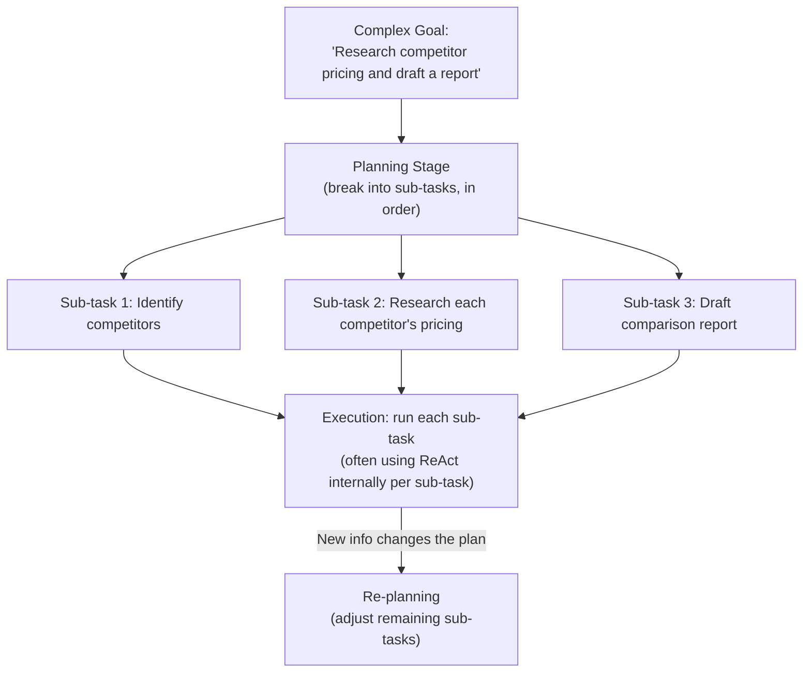

# Autonomous Planning

> An agent that plans badly doesn't fail loudly — it just does a lot of confident, expensive, wrong work.

**Type:** Learn
**Languages:** Python, Concept
**Prerequisites:** ReAct: Reasoning and Acting Patterns
**Time:** ~30 minutes

## Learning Objectives

- Understand the difference between reactive step-by-step agents (ReAct) and agents that plan ahead
- Understand common planning strategies: upfront planning, plan-and-execute, and re-planning
- Recognize why planning quality directly determines whether an agent wastes cost on the wrong sub-tasks
- Formulate the right questions when reviewing how an autonomous agent breaks down a complex goal

## The Problem

An agent is asked to "research competitor pricing and draft a comparison report." Without any explicit planning step, it starts searching immediately, gets sidetracked researching a tangential detail, and never gets to drafting the report at all within its step budget. A team without understanding of agent planning might see this as "the agent isn't smart enough," when the real fix is adding an explicit planning stage before execution begins.

## The Concept

While the ReAct loop (previous lesson) decides one step at a time, more complex goals often benefit from an explicit **planning** stage: breaking a large goal into an ordered list of sub-tasks before execution starts.



### Planning Strategies

- **Upfront planning**: generate the full plan before starting execution, then execute each step in order — simple, but brittle if early steps reveal the plan needs to change.
- **Plan-and-execute**: generate an initial plan, execute the first sub-task, then re-evaluate whether the remaining plan still makes sense given what was learned — more adaptive, at the cost of extra planning overhead.
- **Re-planning**: explicitly revisiting and revising the plan when new information significantly changes what's needed — necessary for long-running or highly uncertain tasks.

### Why This Matters for Cost and Reliability

Without an explicit plan, an agent operating purely step-by-step (as in the ReAct lesson) can wander — pursuing an interesting but low-priority sub-goal while the step budget for the actual goal runs out. A clear plan gives the agent (and the team monitoring it) a scaffold to check progress against, and a way to catch a wandering agent early rather than after it exhausts its budget.

## Build It

A simplified two-stage system: a planning step that breaks a goal into ordered sub-tasks, followed by execution against that plan:

```python
def generate_plan(goal):
    if "competitor pricing" in goal.lower():
        return [
            "Identify main competitors",
            "Research each competitor's pricing page",
            "Summarize pricing differences",
            "Draft comparison report",
        ]
    return ["Unable to plan for this goal"]

def execute_subtask(subtask, step_budget_remaining):
    print(f"  Executing: '{subtask}' (step budget remaining: {step_budget_remaining})")
    return f"Completed: {subtask}"

def run_plan_and_execute(goal, total_step_budget=10):
    plan = generate_plan(goal)
    print(f"Goal: {goal}")
    print(f"Generated plan ({len(plan)} sub-tasks):")
    for i, subtask in enumerate(plan, 1):
        print(f"  {i}. {subtask}")

    print("\nExecuting plan:")
    results = []
    remaining_budget = total_step_budget
    for subtask in plan:
        if remaining_budget <= 0:
            print(f"  STOPPED: step budget exhausted before completing '{subtask}'")
            break
        result = execute_subtask(subtask, remaining_budget)
        results.append(result)
        remaining_budget -= 2

    print(f"\nCompleted {len(results)}/{len(plan)} sub-tasks within budget.")
    return results

run_plan_and_execute("Research competitor pricing and draft a comparison report")
```

With an explicit plan and a visible step budget, it's immediately clear whether the agent is on track to complete the full goal or will run out of budget partway through — something much harder to notice in a purely reactive, step-by-step agent with no upfront plan to check progress against.

## Use It

Real autonomous agent systems use planning to manage complex, multi-part goals:

- **Coding agents**: plan out which files need to change before making any edits, rather than editing reactively file by file.
- **Research agents**: plan out sub-questions to investigate before starting to search, to ensure balanced coverage rather than following one tangent deeply.
- **Long-running task agents**: periodically re-plan as new information arrives, especially for tasks that span many steps or a long time horizon.

## Exercises

1. **Easy**: In the code example, what would happen if `total_step_budget` were set to only 4 instead of 10?
2. **Medium**: Explain in plain English why "plan-and-execute" (re-evaluating after each sub-task) is more adaptive than pure "upfront planning," and what extra cost it introduces.
3. **Hard**: Propose a re-planning trigger: a specific condition under which an agent executing a fixed plan should stop and generate a new plan instead of continuing with the original one.

## TPM Perspective

### Strategic Executive Summary
An explicit planning stage turns "the agent got stuck" from a mysterious failure into a checkable, debuggable process — you can inspect the plan itself, see which sub-task it's on, and know whether it's within budget to complete the goal. This is a real design lever for reliability and cost predictability on complex agent tasks, not an optional nicety.

### Questions to Challenge Engineering
1. *"Does this agent generate an explicit plan before executing, or does it operate purely reactively step-by-step — and for this specific goal's complexity, which is appropriate?"*
2. *"Is there a re-planning mechanism for when new information significantly changes what's needed, or does the agent rigidly follow its original plan regardless?"*
3. *"Can we inspect the agent's plan and progress against it at any point, to catch a wandering or over-budget agent before it fails silently?"*

### Trade-Off Matrix

| Strategy | Adaptiveness | Predictability | Planning Overhead |
| :--- | :--- | :--- | :--- |
| **No explicit planning (pure ReAct)** | High, but can wander on complex goals | Low — hard to predict progress | None |
| **Upfront planning (fixed plan)** | Low — doesn't adjust to new information | High — clear expected steps | Low (one planning pass) |
| **Plan-and-execute (re-evaluate per step)** | High | Moderate | Moderate (re-evaluation after each step) |
| **Full re-planning** | Highest | Moderate | Higher (replanning cost when triggered) |

## Key Terms

- **Planning**: Breaking a complex goal into an ordered set of sub-tasks before or during execution.
- **Upfront Planning**: Generating a complete plan before execution begins, without adjusting it as new information arrives.
- **Plan-and-Execute**: Generating an initial plan, then re-evaluating it after each sub-task based on what was learned.
- **Re-planning**: Explicitly revising a plan mid-execution when new information significantly changes what's needed.
- **Step Budget**: A limit on the number of actions/steps an agent can take, used to bound cost and prevent runaway execution.
