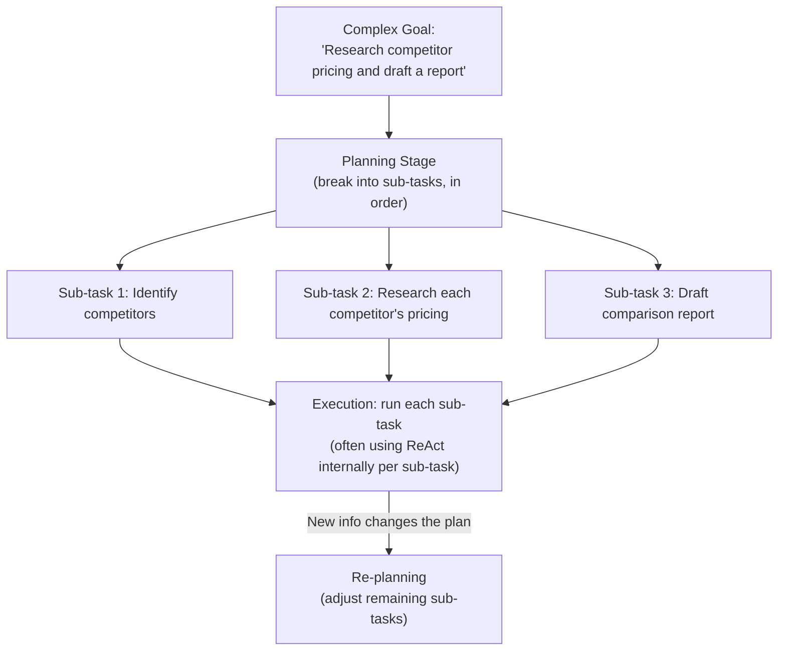

# Autonomous Planning

> An agent that plans badly doesn't fail loudly — it just does a lot of confident, expensive, wrong work.

**Type:** Learn
**Prerequisites:** ReAct: Reasoning and Acting Patterns
**Time:** ~25 minutes

## Learning Objectives

- Explain the difference between reactive step-by-step agents (ReAct) and agents that plan ahead
- Describe common planning strategies: upfront planning, plan-and-execute, and re-planning
- Recognize why planning quality directly determines whether an agent wastes cost on the wrong sub-tasks
- Formulate the right questions when reviewing how an autonomous agent breaks down a complex goal

## What It Is

While the ReAct loop (previous lesson) decides one step at a time, complex goals often benefit from an explicit **planning** stage: breaking a large goal into an ordered list of sub-tasks before execution starts. Each sub-task is then usually executed with a ReAct loop of its own, and the plan acts as the scaffold that progress is checked against.

## Why It Matters

An agent is asked to "research competitor pricing and draft a comparison report." With no explicit plan, it starts searching immediately, gets sidetracked on a tangential detail, and never reaches the drafting stage within its step budget. A team that does not understand planning may conclude "the agent isn't smart enough," when the real fix is adding a planning stage before execution. Without a plan, there is also nothing to compare progress against, so a wandering agent is noticed only after it has spent its budget.

## How It Works

Three strategies, in increasing adaptiveness:

- **Upfront planning**: generate the full plan before starting, then execute each step in order. Simple, but brittle if early steps reveal the plan needs to change.
- **Plan-and-execute**: generate an initial plan, execute the first sub-task, then re-evaluate whether the remaining plan still makes sense. More adaptive, at the cost of extra planning overhead.
- **Re-planning**: explicitly revisit and revise the plan when new information significantly changes what is needed. Necessary for long-running or highly uncertain tasks.

A step budget (a cap on total actions) sits underneath all three. With a visible plan and a visible budget, it is clear at any moment whether the agent is on track to finish or will run out partway.

## Architecture and Workflow



```archify
src: diagrams/planning-flow.html
title: Plan, execute sub-tasks, and re-plan
aspect: 1229/528
```

## A Real-World Example

For the competitor pricing goal, with a budget of 10 steps and roughly 2 steps per sub-task:

| Sub-task | Steps used | Budget left | Status |
| :--- | :--- | :--- | :--- |
| 1. Identify main competitors | 2 | 8 | Done |
| 2. Research each competitor's pricing page | 2 | 6 | Done |
| 3. Summarize pricing differences | 2 | 4 | Done |
| 4. Draft comparison report | 2 | 2 | Done |

With a budget of only 4, the agent would finish just two sub-tasks and stop before the report exists. Because the plan is visible, this shortfall can be seen at the start, not discovered at the end.

Real systems use planning the same way:

- **Coding agents**: plan which files need to change before editing, instead of editing reactively file by file.
- **Research agents**: plan sub-questions first to ensure balanced coverage rather than following one tangent.
- **Long-running agents**: periodically re-plan as new information arrives.

## What a TPM Needs to Understand

- An explicit plan turns "the agent got stuck" from a mystery into a checkable process: you can inspect the plan, see which sub-task is active, and know whether the budget can cover the rest.
- Planning is a reliability and cost-predictability lever for complex tasks, not an optional nicety.
- Match the strategy to the task. Stable, well-understood goals suit upfront planning; uncertain, long-running goals need plan-and-execute or re-planning.
- Re-planning needs a defined trigger. Without one, the agent either never adapts or replans constantly.

## Risks, Dependencies, and Trade-Offs

| Strategy | Adaptiveness | Predictability | Planning Overhead |
| :--- | :--- | :--- | :--- |
| **No explicit planning (pure ReAct)** | High, but can wander on complex goals | Low — hard to predict progress | None |
| **Upfront planning (fixed plan)** | Low — doesn't adjust to new information | High — clear expected steps | Low (one planning pass) |
| **Plan-and-execute (re-evaluate per step)** | High | Moderate | Moderate (re-evaluation after each step) |
| **Full re-planning** | Highest | Moderate | Higher (replanning cost when triggered) |

Failure scenarios: a bad plan executed faithfully (confident, expensive, wrong work); a rigid plan that ignores new facts; replanning loops that consume the budget; sub-tasks that quietly overrun their share of steps.

## Questions to Ask Engineers

1. *"Does this agent generate an explicit plan before executing, or does it operate purely reactively step-by-step — and for this specific goal's complexity, which is appropriate?"*
2. *"Is there a re-planning mechanism for when new information significantly changes what's needed, or does the agent rigidly follow its original plan regardless?"*
3. *"Can we inspect the agent's plan and progress against it at any point, to catch a wandering or over-budget agent before it fails silently?"*

## Scenario Exercise

Your team's research agent is meant to produce a weekly market report. Reports often arrive with a long research section and no conclusions.

1. **Easy**: In the table above, what would happen if the total step budget were only 4 instead of 10?
2. **Medium**: Explain why plan-and-execute is more adaptive than pure upfront planning, and what extra cost it introduces.
3. **Hard**: Propose a re-planning trigger, a specific condition under which the agent should stop and generate a new plan rather than continue the old one, and say how you would stop re-planning from becoming its own runaway cost.

## Key Terms

- **Planning**: Breaking a complex goal into an ordered set of sub-tasks before or during execution.
- **Upfront Planning**: Generating a complete plan before execution begins, without adjusting it as new information arrives.
- **Plan-and-Execute**: Generating an initial plan, then re-evaluating it after each sub-task based on what was learned.
- **Re-planning**: Explicitly revising a plan mid-execution when new information significantly changes what's needed.
- **Step Budget**: A limit on the number of actions/steps an agent can take, used to bound cost and prevent runaway execution.
