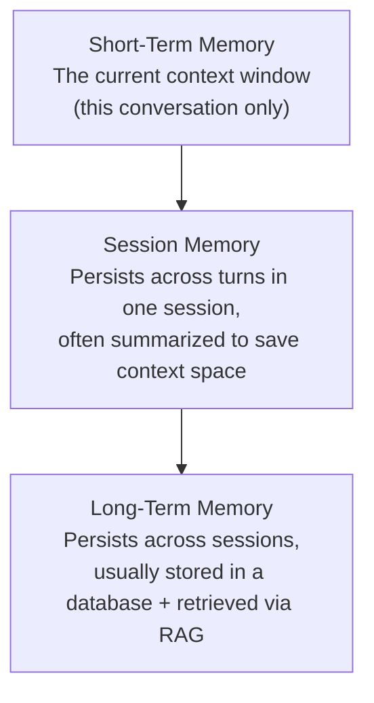

# Memory Architectures for Agents

> "Does the agent remember?" is really three separate questions: remember this turn, this session, or forever?

**Type:** Learn
**Languages:** Python, Concept
**Prerequisites:** Autonomous Planning
**Time:** ~30 minutes

## Learning Objectives

- Understand the three common tiers of agent memory: short-term (context), session, and long-term
- Understand why long-term memory usually relies on the same RAG/embedding concepts from Level 5, not magic
- Recognize the cost and staleness trade-offs of storing and retrieving different kinds of memory
- Formulate the right questions when reviewing what an agent actually remembers between interactions

## The Problem

A user tells a support agent "I already explained this yesterday" and the agent has no idea what they're referring to. A product manager assumes this is a simple bug, when in reality it reflects a specific, common architectural choice: the agent's memory doesn't persist across sessions at all, or does but wasn't designed to retrieve the relevant prior conversation. "Does it remember" requires knowing exactly what kind of memory was actually built.

## The Concept

Agent memory is usually built from three distinct tiers, each with different scope, persistence, and retrieval mechanisms:



### Short-Term Memory (Context Window)

The simplest form: everything currently in the model's context window (from Level 0's memory hierarchy lesson) — the current conversation, including recent tool results. This "memory" disappears the moment the context window fills up or the session ends, unless explicitly saved elsewhere.

### Session Memory

Information that needs to persist across many turns within a single session, but doesn't need to be sent as raw, full context every time — often implemented by periodically summarizing the conversation so far (connecting to summarization strategies from the memory hierarchy lesson) and keeping only the summary plus recent turns in context, rather than the entire raw history.

### Long-Term Memory

Information that should persist across sessions entirely — e.g. a user's stated preferences, past resolved issues, or facts learned in a previous conversation. This is almost always implemented using the same RAG mechanisms from Level 5: relevant memories are stored as embeddings in a vector database and retrieved at the start of a new session based on relevance to the current query, not simply dumped in wholesale.

### Why "Remembering Everything" Doesn't Scale

Just like the KV cache growth problem from Level 0, storing and re-sending an ever-growing raw history isn't sustainable — long-term agent memory faces the exact same "retrieve only what's relevant" pressure that motivated RAG in the first place, rather than a fundamentally new problem.

## Build It

A simplified illustration of the three memory tiers working together for a returning user:

```python
long_term_memory_store = {
    "user_42": [
        "User prefers email responses over phone calls.",
        "User previously reported a billing issue with invoice #881, resolved on 2026-08-10.",
    ]
}

def retrieve_relevant_long_term_memories(user_id, current_query):
    memories = long_term_memory_store.get(user_id, [])
    return [m for m in memories if any(word in m.lower() for word in current_query.lower().split())]

def summarize_session_so_far(session_turns):
    if len(session_turns) <= 2:
        return session_turns
    return [f"[Summary of {len(session_turns) - 1} earlier turns]"] + session_turns[-1:]

session_turns = [
    "User: I'm following up on my billing issue.",
    "Agent: Can you give me more details?",
    "User: It's about invoice 881 again, it's happening again.",
]

current_query = "billing issue invoice"
relevant_long_term = retrieve_relevant_long_term_memories("user_42", current_query)
session_summary = summarize_session_so_far(session_turns)

print("Relevant long-term memories retrieved:")
for m in relevant_long_term:
    print(f"  - {m}")

print("\nSession memory (summarized):")
for turn in session_summary:
    print(f"  {turn}")

print(f"\nShort-term memory (current context): the user's latest message: '{session_turns[-1]}'")
```

This mirrors a real system: long-term memory is retrieved selectively (only relevant items, via search), session memory is compressed rather than sent in full, and short-term memory is just whatever is immediately in context — three distinct mechanisms working together, not one magic "remember everything" feature.

## Use It

Real agent products make explicit memory design choices:

- **Customer support agents**: often use long-term memory to recall a customer's history and preferences across sessions, retrieved via RAG at the start of each new conversation.
- **Coding assistants**: often use session memory (summarized conversation) to stay within context limits during a long working session, without needing to resend the entire history each turn.
- **Personal assistants**: often combine all three tiers — immediate context, session summary, and retrieved long-term facts about user preferences.

## Exercises

1. **Easy**: A user says "as I mentioned earlier in this same conversation," and the agent has no idea what they mean. Which memory tier most likely failed?
2. **Medium**: Explain in plain English why long-term memory retrieval uses the same "relevant items only" approach as RAG, rather than sending a user's entire history every time.
3. **Hard**: Propose a policy for what should and shouldn't be stored in long-term memory for a customer support agent, considering both usefulness and privacy/data retention concerns.

## TPM Perspective

### Strategic Executive Summary
"Does the agent remember" is not a single yes/no feature — it's a specific architectural choice across three tiers (short-term, session, long-term), each with different persistence, cost, and retrieval mechanisms. A user complaint about the agent "not remembering" should be diagnosed against this framework to identify exactly which tier is missing or malfunctioning, rather than treated as one generic bug.

### Questions to Challenge Engineering
1. *"When a user says the agent doesn't remember something from a previous session, is that because we don't have long-term memory at all, or because retrieval didn't surface the relevant memory?"*
2. *"For session memory, are we summarizing the conversation as it grows, or resending the full raw history every turn — and what's the cost/context impact of that choice?"*
3. *"What's our data retention and privacy policy for long-term memory — what gets stored, for how long, and can users request deletion?"*

### Trade-Off Matrix

| Memory Tier | Persistence | Typical Mechanism | Cost Impact |
| :--- | :--- | :--- | :--- |
| **Short-term (context window)** | Current turn/session only | Raw context, no special storage | Grows with conversation length (KV cache, Level 0) |
| **Session memory** | Within one session | Periodic summarization | Reduces cost vs. raw full history |
| **Long-term memory** | Across sessions | RAG-style retrieval from a vector database | Storage + retrieval cost, but avoids resending everything |

## Key Terms

- **Short-Term Memory**: Whatever is currently in the model's context window for the active conversation, disappearing once the session ends or context is cleared.
- **Session Memory**: Information persisted across many turns within a single session, often kept compact via summarization.
- **Long-Term Memory**: Information persisted across sessions, typically stored and retrieved using the same embedding/RAG mechanisms as document retrieval.
- **Memory Retrieval**: Selectively surfacing only relevant stored memories for the current context, rather than resending an entire history.
