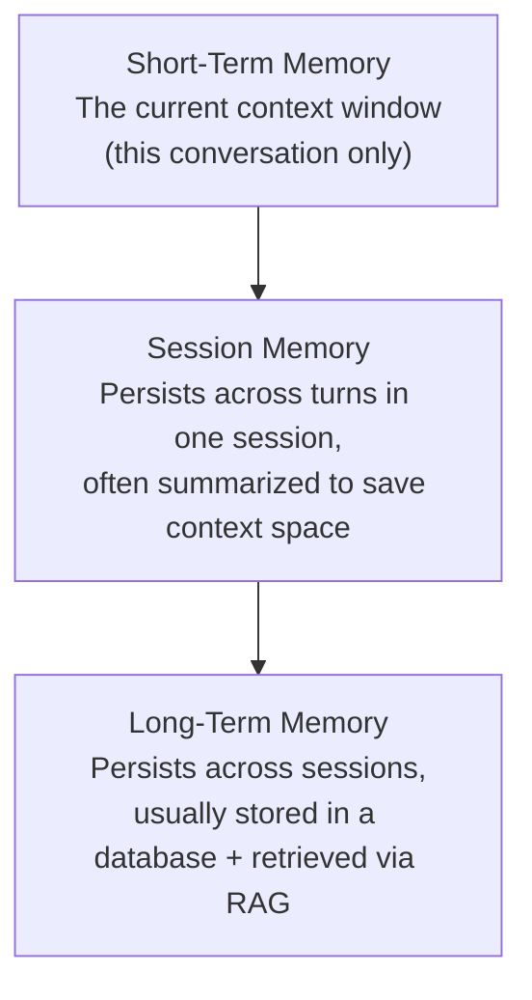

# Memory Architectures for Agents

> "Does the agent remember?" is really three separate questions: remember this turn, this session, or forever?

**Type:** Learn
**Prerequisites:** Autonomous Planning
**Time:** ~25 minutes

## Learning Objectives

- Describe the three common tiers of agent memory: short-term (context), session, and long-term
- Explain why long-term memory usually relies on the same RAG/embedding concepts from Level 5, not magic
- Recognize the cost and staleness trade-offs of storing and retrieving different kinds of memory
- Formulate the right questions when reviewing what an agent actually remembers between interactions

## What It Is

Agent memory is built from three tiers, each with different scope, persistence and retrieval mechanism:

| Tier | Scope | How it works |
| :--- | :--- | :--- |
| **Short-term** | The current context window only | Whatever is in the model's context now: the conversation and recent tool results. Gone when the window fills or the session ends. |
| **Session** | Many turns within one session | Often the conversation so far is periodically summarized; only the summary plus recent turns stay in context. |
| **Long-term** | Across sessions | Facts (preferences, past issues) stored as embeddings in a vector database and retrieved by relevance at the start of a new session. |

## Why It Matters

A user tells a support agent "I already explained this yesterday" and the agent has no idea what they mean. A product manager assumes a simple bug, but it usually reflects a specific architectural choice: memory does not persist across sessions at all, or it does but retrieval was not designed to surface the relevant prior conversation. Answering "does it remember?" requires knowing exactly which kind of memory was built.

## How It Works

1. Each turn, the current conversation and tool results sit in the context window (short-term).
2. As a session grows, older turns are compressed into a summary so the window does not overflow (session memory, building on the summarization ideas in Level 0).
3. At the start of a new session, the system searches the long-term store for memories relevant to the user's current query and adds only those to context.
4. After the session, new facts worth keeping are written back to the long-term store.

"Remember everything" does not scale. Like the KV cache growth problem in Level 0, resending an ever-growing history is unsustainable, so long-term memory faces the same "retrieve only what is relevant" pressure that motivated RAG. It is not a fundamentally new problem.

## Architecture and Workflow



```archify
src: diagrams/memory-tiers.html
title: How agent memory tiers build on each other
aspect: 500/392
```

## A Real-World Example

A returning customer writes: "I'm following up on my billing issue... it's about invoice 881 again."

| Tier | What the agent does |
| :--- | :--- |
| **Long-term** | Searches the stored memories for this user, retrieves two relevant ones: prefers email over phone, and had a billing issue on invoice 881 that was resolved in August. Unrelated memories are not loaded. |
| **Session** | Earlier turns of today's chat are compressed to a short summary, keeping only the latest turn in full. |
| **Short-term** | The model sees the retrieved memories, the summary and the latest message together in its context. |

Three distinct mechanisms cooperate; none is a single "remember everything" feature. In real products, support agents lean on long-term memory for customer history, coding assistants lean on session summaries to stay within context limits, and personal assistants combine all three.

## What a TPM Needs to Understand

- "Does it remember?" is not yes/no. It is a design choice across three tiers, and a "doesn't remember" complaint should be diagnosed against them: which tier is missing or failing?
- Memory is retrieval, so it can fail silently: the right memory exists but is not surfaced, or a stale memory is surfaced as if current.
- Summaries lose detail. Session compression saves cost but may drop the one fact the user later needs.
- Long-term memory is stored personal data. Retention, privacy, consent and deletion are product requirements, not afterthoughts.

## Risks, Dependencies, and Trade-Offs

| Memory Tier | Persistence | Typical Mechanism | Cost Impact |
| :--- | :--- | :--- | :--- |
| **Short-term (context window)** | Current turn/session only | Raw context, no special storage | Grows with conversation length (KV cache, Level 0) |
| **Session memory** | Within one session | Periodic summarization | Reduces cost vs. raw full history |
| **Long-term memory** | Across sessions | RAG-style retrieval from a vector database | Storage + retrieval cost, but avoids resending everything |

Dependencies: the embedding and retrieval quality from the RAG lessons, plus a data store with proper access control. Failure scenarios: missed retrieval, stale or wrong facts persisted forever, summaries dropping key details, and sensitive data stored without a retention policy.

## Questions to Ask Engineers

1. *"When a user says the agent doesn't remember something from a previous session, is that because we don't have long-term memory at all, or because retrieval didn't surface the relevant memory?"*
2. *"For session memory, are we summarizing the conversation as it grows, or resending the full raw history every turn — and what's the cost/context impact of that choice?"*
3. *"What's our data retention and privacy policy for long-term memory — what gets stored, for how long, and can users request deletion?"*

## Scenario Exercise

Your support agent gets complaints that it "forgets" customers. Some complaints are from mid-chat, others from the next day.

1. **Easy**: A user says "as I mentioned earlier in this same conversation" and the agent has no idea. Which memory tier most likely failed?
2. **Medium**: Explain in plain English why long-term memory retrieval uses the same "relevant items only" approach as RAG, rather than sending a user's entire history every time.
3. **Hard**: Propose a policy for what should and should not be stored in long-term memory for a customer support agent, balancing usefulness against privacy and retention concerns.

## Key Terms

- **Short-Term Memory**: Whatever is currently in the model's context window for the active conversation, disappearing once the session ends or context is cleared.
- **Session Memory**: Information persisted across many turns within a single session, often kept compact via summarization.
- **Long-Term Memory**: Information persisted across sessions, typically stored and retrieved using the same embedding/RAG mechanisms as document retrieval.
- **Memory Retrieval**: Selectively surfacing only relevant stored memories for the current context, rather than resending an entire history.
