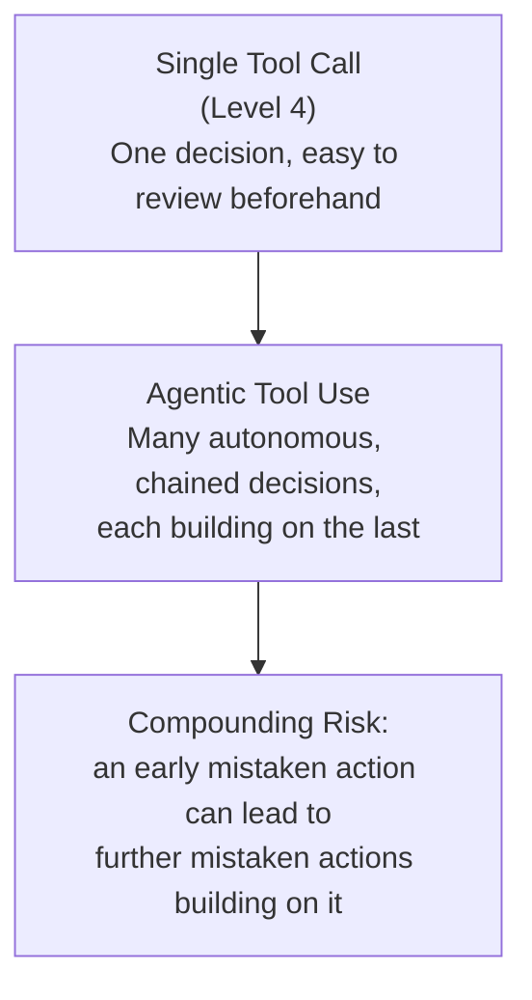

# Tool Use in Agentic Systems

> A single tool call is a request. A dozen tool calls in a loop, each one riskier than the last, is a system that needs governance.

**Type:** Learn
**Languages:** Python, Concept
**Prerequisites:** Memory Architectures for Agents
**Time:** ~30 minutes

## Learning Objectives

- Move from single tool calls (Level 4) to tool use inside a multi-step, autonomous agent loop
- Understand why the risk profile of tool use changes when many calls chain together autonomously
- Recognize the concept of a permission/scope boundary for agent tools
- Formulate the right questions when reviewing what tools an autonomous agent has access to and how

## The Problem

A coding agent given file-editing and shell-command tools is asked to "fix the failing tests." Across a 20-step autonomous loop, it doesn't just edit the relevant file — at one point it also deletes what it decides is an "unnecessary" configuration file, breaking something unrelated. In a single tool call (Level 4), this kind of risk is easy to review before it executes. In a long autonomous loop, each individual call looks reasonable in isolation, but the cumulative, compounding risk across many autonomous decisions requires a different kind of oversight.

## The Concept

Function calling (Level 4) covered the mechanics of a single tool call. In an agentic system, the same mechanism is used repeatedly, autonomously, and adaptively across many steps — which changes the risk profile even though the underlying mechanism is identical.



### Why Chained Autonomy Changes the Risk Calculation

- **A single tool call**: a human (or a simple validation check) can review the specific action before it executes, since there's only one decision point.
- **An autonomous loop of many tool calls**: no human reviews each individual step in real time, and each step's context includes the results of prior steps — meaning an early mistaken action or misread observation can compound into further incorrect actions, since the agent is reasoning from a context that already contains the earlier mistake.

### Permission and Scope Boundaries

Well-designed agentic systems don't give an agent unrestricted access to every possible tool for the full duration of a task — they define explicit boundaries:

- **Tool allowlisting**: only exposing the specific tools needed for this task, not every tool the system could technically support.
- **Scoped permissions**: e.g. a coding agent might be allowed to edit files within a specific project directory, but not system-level configuration files.
- **Human-in-the-loop checkpoints**: requiring explicit human approval before certain higher-risk actions (an irreversible delete, a financial transaction) execute, even mid-loop.
- **Dry-run / simulation modes**: letting an agent describe what it *would* do without actually executing it, for review before a real run.

## Build It

A simplified permission-scoping layer that gates tool calls based on risk level, inserted between the agent's decision and actual execution:

```python
TOOL_RISK_LEVELS = {
    "read_file": "low",
    "edit_file": "medium",
    "run_tests": "low",
    "delete_file": "high",
    "run_shell_command": "high",
}

def requires_human_approval(tool_name):
    return TOOL_RISK_LEVELS.get(tool_name, "high") == "high"

def execute_tool_call(tool_name, args, auto_approve_below="medium"):
    risk = TOOL_RISK_LEVELS.get(tool_name, "high")

    if requires_human_approval(tool_name):
        print(f"  [BLOCKED] '{tool_name}' requires human approval before executing (risk: {risk}). Args: {args}")
        return None

    print(f"  [EXECUTED] '{tool_name}' (risk: {risk}). Args: {args}")
    return f"Result of {tool_name}"

agent_planned_actions = [
    ("read_file", {"path": "test_utils.py"}),
    ("edit_file", {"path": "test_utils.py", "change": "fix import"}),
    ("run_tests", {}),
    ("delete_file", {"path": "old_config.yaml"}),
]

print("Agent executing its planned actions through the permission gate:\n")
for tool_name, args in agent_planned_actions:
    execute_tool_call(tool_name, args)
```

Notice that `delete_file` — the exact kind of action that caused a problem in the opening scenario — is blocked pending human approval, while lower-risk actions like reading a file or running tests proceed automatically. This is the core mechanism behind safely allowing autonomy for routine actions while still gating higher-risk ones.

## Use It

Real production agentic systems build these safeguards in deliberately:

- **Coding agents**: often allow autonomous file edits and test runs, but require explicit approval for destructive shell commands or deleting files.
- **Financial or transactional agents**: almost always require human confirmation before any action that moves money or commits an irreversible change.
- **Audit logging**: every tool call an agent makes, approved or blocked, should be logged for after-the-fact review, especially important once actions aren't individually reviewed in real time.

## Exercises

1. **Easy**: In the code above, which tool calls were auto-executed and which were blocked, and why?
2. **Medium**: Propose a risk classification for a "send_email" tool and a "search_web" tool, and justify each.
3. **Hard**: Design (in plain English) a policy for when a human-in-the-loop checkpoint should be required versus when full autonomy is acceptable, for a general-purpose coding agent.

## TPM Perspective

### Strategic Executive Summary
Giving an agent tool access is not a single security review at launch — it's an ongoing governance question about which actions are safe to fully automate and which require a human checkpoint, especially as the agent chains many autonomous decisions together. The compounding risk of a long autonomous loop is qualitatively different from a single, reviewable tool call, and should be evaluated as such.

### Questions to Challenge Engineering
1. *"What's the risk classification for each tool this agent has access to, and which ones require human approval before executing?"*
2. *"Is every tool call (approved or blocked) logged for after-the-fact review, given that we can't review each one in real time during autonomous execution?"*
3. *"If an early step in the agent's loop is based on a mistaken observation, how far can that mistake propagate before a human or safeguard catches it?"*

### Trade-Off Matrix

| Tool Governance Approach | Autonomy/Speed | Safety | Human Effort |
| :--- | :--- | :--- | :--- |
| **No restrictions, full autonomy** | Highest | Lowest — compounding risk unmitigated | None (until something breaks) |
| **Risk-based gating (auto-approve low-risk, block high-risk)** | High for routine actions | Good — targets oversight where it matters most | Moderate (reviewing blocked actions) |
| **Full human-in-the-loop for every action** | Lowest — no real autonomy | Highest | Very high |

## Key Terms

- **Agentic Tool Use**: Using function calling repeatedly and autonomously across many steps within an agent's loop, rather than a single reviewed call.
- **Compounding Risk**: The way an early mistaken action or observation in an autonomous loop can lead to further incorrect actions building on it.
- **Tool Allowlisting**: Restricting an agent to only the specific tools needed for its current task, rather than full system access.
- **Human-in-the-Loop Checkpoint**: A required human approval step before a higher-risk action executes, even during otherwise autonomous operation.
- **Scoped Permissions**: Limiting what a tool can affect (e.g. files within a specific directory only), reducing the blast radius of any single mistaken action.
