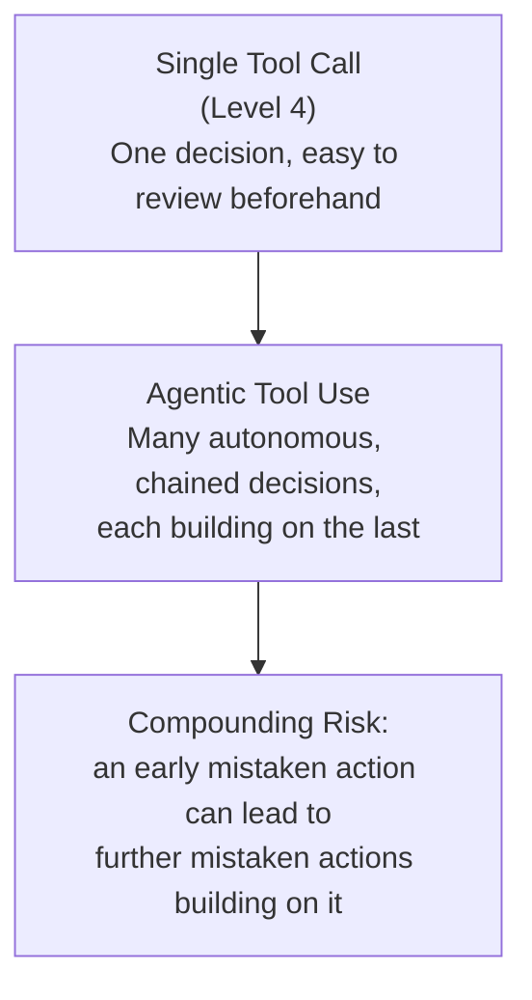

# Tool Use in Agentic Systems

> A single tool call is a request. A dozen tool calls in a loop, each one riskier than the last, is a system that needs governance.

**Type:** Learn
**Prerequisites:** Memory Architectures for Agents
**Time:** ~25 minutes

## Learning Objectives

- Move from single tool calls (Level 4) to tool use inside a multi-step, autonomous agent loop
- Explain why the risk profile of tool use changes when many calls chain together autonomously
- Describe permission and scope boundaries for agent tools
- Formulate the right questions when reviewing what tools an autonomous agent has access to and how

## What It Is

Function calling (Level 4) covered the mechanics of a single tool call. In an agentic system the same mechanism is used repeatedly, autonomously and adaptively across many steps. The mechanism is identical, but the risk profile is not, which is why agentic tool use needs its own governance: tool selection, permission boundaries, human checkpoints and logging.

## Why It Matters

A coding agent given file-editing and shell tools is asked to "fix the failing tests." Over a 20-step loop it does not just edit the relevant file; at one point it also deletes a configuration file it judges "unnecessary," breaking something unrelated. A single tool call is easy to review before it runs. In a long autonomous loop each call looks reasonable in isolation, but the cumulative, compounding risk needs a different kind of oversight.

## How It Works

Why chained autonomy changes the risk calculation:

- **A single tool call**: a human or a simple validation check can review the one action before it executes.
- **An autonomous loop**: no human reviews each step in real time, and each step's context includes earlier results, so an early mistaken action or misread observation can compound into further mistakes built on top of it.

Well-designed systems therefore set explicit boundaries instead of giving an agent every tool for the whole task:

- **Tool allowlisting**: expose only the tools needed for this task.
- **Scoped permissions**: for example, edit files inside one project directory but not system configuration.
- **Human-in-the-loop checkpoints**: require explicit approval before higher-risk actions (an irreversible delete, a financial transaction), even mid-loop.
- **Dry-run modes**: let the agent describe what it would do without doing it, for review before a real run.
- **Audit logging**: record every call, approved or blocked, for after-the-fact review.

## Architecture and Workflow



```archify
src: diagrams/single-vs-agentic-tool-use.html
title: From a single tool call to compounding agentic risk
aspect: 520/392
```

A permission gate sits between the agent's decision and the actual execution: the agent proposes an action, the gate looks up the tool's risk level, low-risk actions run automatically, high-risk actions wait for a human, and everything is logged.

## A Real-World Example

The coding agent from the opening scenario, behind a risk-based gate:

| Planned action | Risk level | Outcome |
| :--- | :--- | :--- |
| Read a test file | Low | Runs automatically |
| Edit the file to fix an import | Medium | Runs automatically (within the project folder) |
| Run the test suite | Low | Runs automatically |
| Delete an old configuration file | High | Blocked until a human approves |
| Any tool not on the risk list | Treated as high | Blocked until a human approves |

The deletion that caused the original incident is held for review, while routine work flows. Real deployments follow this pattern: coding agents may edit and test freely but need approval for destructive commands; financial agents almost always require confirmation before moving money; and every call is logged.

## What a TPM Needs to Understand

- Giving an agent tool access is not a one-time security review at launch. It is an ongoing question of which actions are safe to automate and which need a human.
- Compounding risk is qualitatively different from single-call risk, and should be evaluated separately.
- Unknown tools should default to the strictest treatment, not the loosest.
- Approval fatigue is real: too many prompts and humans rubber-stamp them. Gate by risk, not by volume.
- Logs are the safety net when no one watches live. Without them, an incident cannot be reconstructed.

## Risks, Dependencies, and Trade-Offs

| Tool Governance Approach | Autonomy/Speed | Safety | Human Effort |
| :--- | :--- | :--- | :--- |
| **No restrictions, full autonomy** | Highest | Lowest — compounding risk unmitigated | None (until something breaks) |
| **Risk-based gating (auto-approve low-risk, block high-risk)** | High for routine actions | Good — targets oversight where it matters most | Moderate (reviewing blocked actions) |
| **Full human-in-the-loop for every action** | Lowest — no real autonomy | Highest | Very high |

Dependencies: an accurate risk classification of every tool, and reliable permission enforcement outside the model (the model should not be the one deciding what it is allowed to do). Failure scenarios: a mistaken early observation propagating through later steps, a misclassified tool slipping through, and an irreversible action taken before anyone looks.

## Questions to Ask Engineers

1. *"What's the risk classification for each tool this agent has access to, and which ones require human approval before executing?"*
2. *"Is every tool call (approved or blocked) logged for after-the-fact review, given that we can't review each one in real time during autonomous execution?"*
3. *"If an early step in the agent's loop is based on a mistaken observation, how far can that mistake propagate before a human or safeguard catches it?"*

## Scenario Exercise

Your team is launching a coding agent that can read, edit and delete files and run shell commands in customers' repositories.

1. **Easy**: In the gate table above, which actions run automatically, which are blocked, and why?
2. **Medium**: Propose a risk classification for a "send email" tool and a "search the web" tool, and justify each.
3. **Hard**: Design, in plain English, a policy for when a human checkpoint is required versus when full autonomy is acceptable for a general-purpose coding agent, including what you would log.

## Key Terms

- **Agentic Tool Use**: Using function calling repeatedly and autonomously across many steps within an agent's loop, rather than a single reviewed call.
- **Compounding Risk**: The way an early mistaken action or observation in an autonomous loop can lead to further incorrect actions building on it.
- **Tool Allowlisting**: Restricting an agent to only the specific tools needed for its current task, rather than full system access.
- **Human-in-the-Loop Checkpoint**: A required human approval step before a higher-risk action executes, even during otherwise autonomous operation.
- **Scoped Permissions**: Limiting what a tool can affect (e.g. files within a specific directory only), reducing the blast radius of any single mistaken action.
