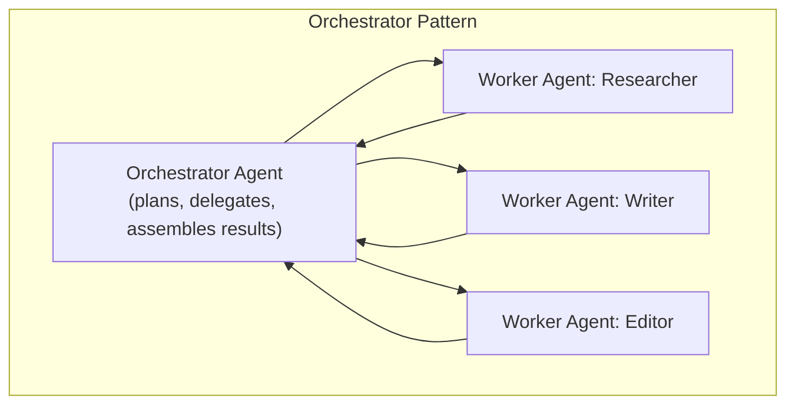

# Multi-Agent Coordination

> Adding a second agent doesn't double your capability — it adds a coordination problem that has to be actively designed, not assumed away.

**Type:** Learn
**Languages:** Python, Concept
**Prerequisites:** Tool Use in Agentic Systems
**Time:** ~30 minutes

## Learning Objectives

- Understand why and when a task is split across multiple specialized agents instead of one general agent
- Understand common coordination patterns: orchestrator-worker and peer-to-peer handoff
- Recognize the specific new failure modes multi-agent systems introduce beyond single-agent risk
- Formulate the right questions when reviewing a proposed multi-agent system design

## The Problem

A team proposes a multi-agent system: a "researcher" agent, a "writer" agent, and an "editor" agent working together to produce a report. It sounds appealing, but without a clear coordination design, the writer agent starts drafting before the researcher agent finishes, working from an incomplete research result — and the editor agent has no way to know whether the writer's draft actually reflects the final research. Multiple agents introduce a coordination problem that a single agent's internal loop (previous lessons) doesn't have.

## The Concept

**Multi-agent systems** split a complex task across several specialized agents, each often optimized (via prompt, tools, or fine-tuning) for a narrower sub-task — but this requires an explicit coordination mechanism, not just running them all and hoping it works out.



```archify
src: diagrams/multi-agent.html
title: Trace the handoffs: where a race condition or failure would spread
aspect: 718/384
```

### Why Split Across Multiple Agents

- **Specialization**: a narrowly-scoped agent (with a focused prompt and limited toolset) can be more reliable at its specific sub-task than one generalist agent trying to do everything.
- **Parallelism**: independent sub-tasks (e.g. researching three different competitors) can run concurrently across separate agents rather than sequentially within one agent's loop.
- **Modularity**: individual agents can be improved, tested, or replaced independently, similar to how separate functions/modules (Level 1) are easier to maintain than one giant function.

### Common Coordination Patterns

- **Orchestrator-Worker**: a central orchestrator agent breaks down the task, delegates sub-tasks to worker agents, and assembles their results — clear accountability, but the orchestrator becomes a single point of failure/bottleneck.
- **Peer-to-Peer Handoff**: agents pass a task directly to the next agent in a sequence (e.g. researcher hands off directly to writer) without a central coordinator — simpler for straightforward pipelines, but harder to manage for complex, non-linear workflows.

### New Failure Modes Multi-Agent Systems Introduce

- **Race conditions**: one agent starting its work before a dependency's output is actually ready (as in the opening example) — directly related to the async programming and concurrency concepts from Level 1.
- **Miscommunication between agents**: an agent misinterpreting another agent's output format, especially if outputs aren't structured (connecting back to the structured outputs lesson).
- **Compounding cost**: multiple agents, each potentially making multiple tool calls, can multiply cost and latency well beyond a single-agent system — a real trade-off against the specialization/parallelism benefits.

## Build It

A simplified orchestrator pattern enforcing correct sequencing (avoiding the race condition from the opening example):

```python
class AgentResult:
    def __init__(self, agent_name, output, is_complete):
        self.agent_name = agent_name
        self.output = output
        self.is_complete = is_complete

def researcher_agent(topic):
    return AgentResult("researcher", f"Research findings on {topic}: [competitor pricing data]", is_complete=True)

def writer_agent(research_output):
    return AgentResult("writer", f"Draft report based on: {research_output}", is_complete=True)

def editor_agent(draft):
    return AgentResult("editor", f"Edited final report: {draft}", is_complete=True)

def orchestrate(topic):
    print(f"Orchestrator: delegating research on '{topic}'")
    research_result = researcher_agent(topic)

    if not research_result.is_complete:
        print("Orchestrator: BLOCKED - research not complete, will not proceed to writing.")
        return None
    print(f"Orchestrator: research complete, delegating to writer")

    draft_result = writer_agent(research_result.output)
    if not draft_result.is_complete:
        print("Orchestrator: BLOCKED - draft not complete, will not proceed to editing.")
        return None
    print(f"Orchestrator: draft complete, delegating to editor")

    final_result = editor_agent(draft_result.output)
    print(f"\nOrchestrator: final result assembled:\n  {final_result.output}")
    return final_result

orchestrate("competitor pricing")
```

The orchestrator explicitly checks `is_complete` before delegating to the next agent — this is the coordination mechanism that prevents the writer agent from starting on incomplete research, the exact failure described at the start of this lesson.

## Use It

Real multi-agent systems are used deliberately, not by default:

- **Multi-agent code review systems**: separate agents review for correctness, security, and style, with an orchestrator combining their findings.
- **Customer service escalation**: a first-line agent handles routine queries and explicitly hands off to a specialized agent (or a human) for complex cases, with a clear handoff protocol.
- **Research and report generation**: an orchestrator coordinates parallel research agents (each covering a different sub-topic) before a single writer agent synthesizes their combined output.

## Exercises

1. **Easy**: In the code above, what would happen if `research_result.is_complete` were `False` — trace through what the orchestrator does.
2. **Medium**: Explain in plain English why running three research agents on independent sub-topics in parallel is a good use of multi-agent parallelism, while writer and editor agents generally cannot run in parallel with each other.
3. **Hard**: A team proposes 6 specialized agents for a task that a single well-designed agent could plausibly handle alone. Propose two questions to evaluate whether the added complexity is justified.

## TPM Perspective

### Strategic Executive Summary
Multi-agent systems are a real architectural choice with genuine benefits (specialization, parallelism, modularity) and genuine new risks (coordination failures, compounding cost, race conditions) — not an automatic upgrade over a single well-designed agent. The decision to split a task across multiple agents should be justified by a specific need (e.g. genuine parallelism opportunity, or meaningfully different specialization per sub-task), not adopted by default because it sounds more sophisticated.

### Questions to Challenge Engineering
1. *"Is there an explicit coordination mechanism (orchestrator or defined handoff protocol) ensuring agents don't act on incomplete or stale output from another agent?"*
2. *"Does this task genuinely benefit from parallelism or specialization across multiple agents, or would a single well-scoped agent with a clear internal plan (previous lessons) accomplish the same goal more simply and cheaply?"*
3. *"What's the total cost and latency of this multi-agent design compared to a single-agent alternative, and is that trade-off justified by the quality or speed improvement?"*

### Trade-Off Matrix

| Design | Specialization Benefit | Coordination Complexity | Cost |
| :--- | :--- | :--- | :--- |
| **Single agent, well-planned** | None (one generalist) | None | Lowest |
| **Orchestrator-worker multi-agent** | High, with clear accountability | Moderate-High (orchestrator logic needed) | Higher (multiple agents' calls) |
| **Peer-to-peer handoff multi-agent** | High, for simple linear pipelines | Lower for simple cases, higher for complex ones | Higher (multiple agents' calls) |

## Key Terms

- **Multi-Agent System**: A system splitting a complex task across multiple specialized agents rather than one generalist agent.
- **Orchestrator-Worker Pattern**: A coordination pattern where a central agent delegates sub-tasks to worker agents and assembles their results.
- **Peer-to-Peer Handoff**: A coordination pattern where agents pass a task directly to the next agent in a sequence without central coordination.
- **Race Condition (Multi-Agent)**: When one agent acts on another agent's output before that output is actually complete or ready.
