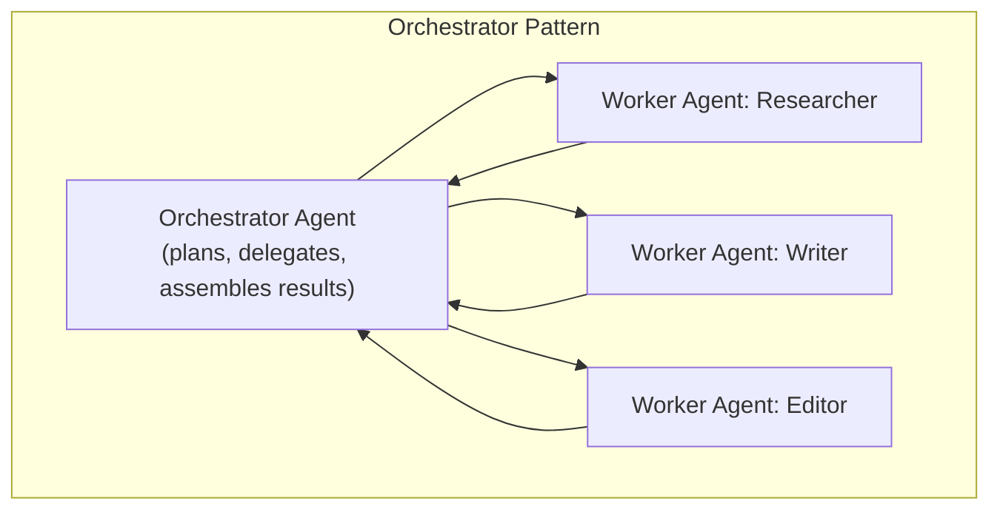

# Multi-Agent Coordination

> Adding a second agent doesn't double your capability — it adds a coordination problem that has to be actively designed, not assumed away.

**Type:** Learn
**Prerequisites:** Tool Use in Agentic Systems
**Time:** ~25 minutes

## Learning Objectives

- Explain why and when a task is split across multiple specialized agents instead of one general agent
- Describe common coordination patterns: orchestrator-worker and peer-to-peer handoff
- Recognize the specific new failure modes multi-agent systems introduce beyond single-agent risk
- Formulate the right questions when reviewing a proposed multi-agent system design

## What It Is

**Multi-agent systems** split a complex task across several specialized agents, each often tuned (through its prompt, tools or fine-tuning) for a narrower sub-task. This only works with an explicit coordination mechanism, not by running them all and hoping it works out.

## Why It Matters

A team proposes a "researcher" agent, a "writer" agent and an "editor" agent producing a report together. Without a coordination design, the writer starts drafting before the researcher finishes, working from incomplete research, and the editor cannot tell whether the draft reflects the final research. Multiple agents introduce a coordination problem that a single agent's internal loop does not have.

Reasons teams split work anyway:

- **Specialization**: a narrowly scoped agent (focused prompt, limited toolset) can be more reliable at its sub-task than one generalist.
- **Parallelism**: independent sub-tasks, such as researching three competitors, can run concurrently.
- **Modularity**: individual agents can be improved, tested or replaced independently, like modules in Level 1.

## How It Works

Two common coordination patterns:

- **Orchestrator-Worker**: a central orchestrator agent breaks down the task, delegates sub-tasks to workers and assembles results. Clear accountability, but the orchestrator is a single point of failure and a bottleneck.
- **Peer-to-Peer Handoff**: agents pass the task directly to the next agent in sequence (researcher to writer) with no central coordinator. Simpler for straightforward pipelines, harder to manage for complex, non-linear workflows.

New failure modes multi-agent systems introduce:

- **Race conditions**: an agent starts before a dependency's output is actually ready, related to the concurrency ideas in Level 1.
- **Miscommunication**: an agent misreads another's output, especially when outputs are unstructured (see the structured outputs lesson).
- **Compounding cost**: several agents each making several tool calls multiply cost and latency well beyond a single agent.

## Architecture and Workflow



```archify
src: diagrams/multi-agent.html
title: Trace the handoffs: where a race condition or failure would spread
aspect: 718/384
```

## A Real-World Example

The report pipeline with an orchestrator that enforces order:

1. The orchestrator delegates research on "competitor pricing" to the researcher.
2. It checks that the research is marked complete. If not, it blocks and does not move on to writing.
3. It passes the confirmed research to the writer, and again checks the draft is complete.
4. It passes the confirmed draft to the editor and assembles the final report.

The completeness check before each handoff is what prevents the opening race condition. In real products the pattern appears as multi-agent code review (separate correctness, security and style reviewers, combined by an orchestrator), customer service escalation (a first-line agent hands off to a specialist agent or a human with a clear protocol), and research reports (parallel research agents feeding a single writer).

## What a TPM Needs to Understand

- Multi-agent is an architectural choice with real benefits and real new risks, not an automatic upgrade over one well-designed agent.
- Justify the split by a specific need: genuine parallelism or meaningfully different specialization. "It sounds more sophisticated" is not a reason.
- Parallelism applies only to independent work. Writing depends on research, so those stages stay sequential.
- Every handoff is a place where output can be incomplete, stale or misinterpreted, so ask what is checked at each one.
- Total cost and latency must be compared against the single-agent alternative.

## Risks, Dependencies, and Trade-Offs

| Design | Specialization Benefit | Coordination Complexity | Cost |
| :--- | :--- | :--- | :--- |
| **Single agent, well-planned** | None (one generalist) | None | Lowest |
| **Orchestrator-worker multi-agent** | High, with clear accountability | Moderate-High (orchestrator logic needed) | Higher (multiple agents' calls) |
| **Peer-to-peer handoff multi-agent** | High, for simple linear pipelines | Lower for simple cases, higher for complex ones | Higher (multiple agents' calls) |

Dependencies: a defined handoff format between agents, and the orchestrator's reliability. Failure scenarios: the orchestrator failing and halting everything, an upstream error silently spreading to every downstream agent, and conflicting outputs from parallel workers with no rule to reconcile them.

## Questions to Ask Engineers

1. *"Is there an explicit coordination mechanism (orchestrator or defined handoff protocol) ensuring agents don't act on incomplete or stale output from another agent?"*
2. *"Does this task genuinely benefit from parallelism or specialization across multiple agents, or would a single well-scoped agent with a clear internal plan (previous lessons) accomplish the same goal more simply and cheaply?"*
3. *"What's the total cost and latency of this multi-agent design compared to a single-agent alternative, and is that trade-off justified by the quality or speed improvement?"*

## Scenario Exercise

A team proposes six specialized agents for a content workflow that one well-designed agent could plausibly handle.

1. **Easy**: In the report pipeline above, what should the orchestrator do if the research is not marked complete?
2. **Medium**: Explain why three research agents on independent sub-topics can run in parallel, while the writer and editor generally cannot.
3. **Hard**: Propose two questions to evaluate whether the added complexity of six agents is justified, and name one failure you would ask the team to test before launch.

## Key Terms

- **Multi-Agent System**: A system splitting a complex task across multiple specialized agents rather than one generalist agent.
- **Orchestrator-Worker Pattern**: A coordination pattern where a central agent delegates sub-tasks to worker agents and assembles their results.
- **Peer-to-Peer Handoff**: A coordination pattern where agents pass a task directly to the next agent in a sequence without central coordination.
- **Race Condition (Multi-Agent)**: When one agent acts on another agent's output before that output is actually complete or ready.
