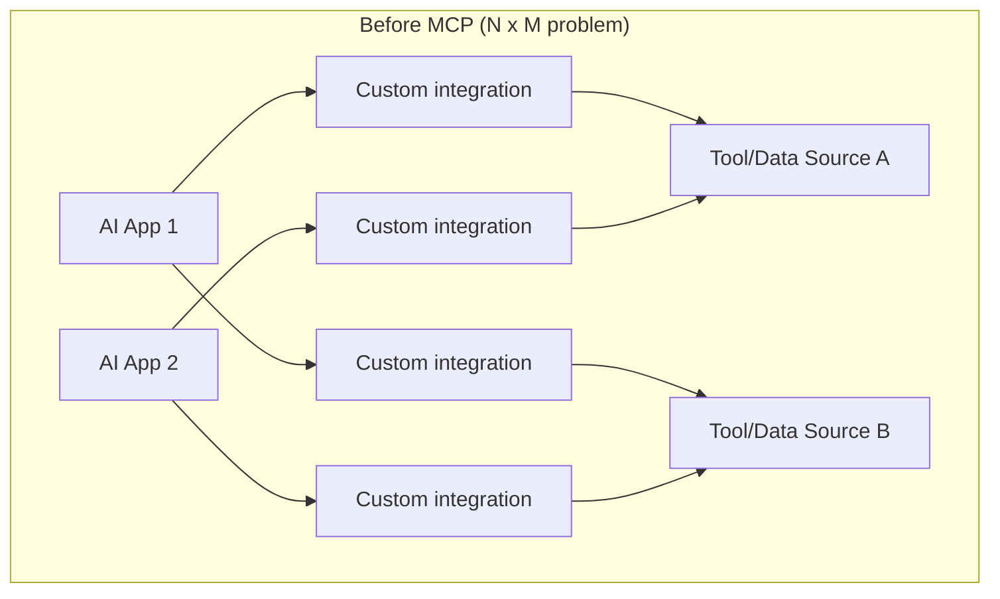
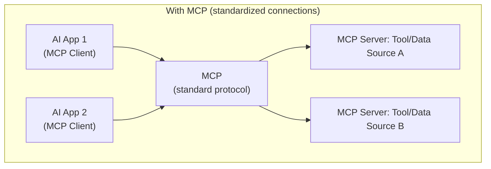

# What Is MCP and Why It Exists

> Before MCP, connecting an AI assistant to N different tools meant writing N different, incompatible integrations.

**Type:** Learn
**Prerequisites:** Multi-Agent Coordination
**Time:** ~20 minutes

## Learning Objectives

- Explain the integration problem MCP was designed to solve
- Describe MCP's core idea: a standard protocol between AI applications and external tools/data sources
- Distinguish "function calling" (Level 4, the mechanism) from MCP (a standard for exposing and discovering those functions)
- Formulate the right questions when a team debates building a custom integration vs. adopting MCP

## What It Is

**MCP (Model Context Protocol)** is an open standard defining how AI applications connect to external tools and data sources. Think of it as a common "plug shape": any compliant AI application can connect to any compliant tool server without custom one-off integration code for every pairing.

Function calling (Level 4) is the *mechanism* by which a model requests that a specific function run with specific arguments. MCP is the *standard* for how those functions and other resources are exposed, described and discovered in the first place. MCP servers commonly expose their capabilities as tools used via function calling, but MCP also standardizes things beyond a single call, such as data resources and reusable prompts.

## Why It Matters

A company wants its AI assistant to reach the internal ticketing system, file storage and calendar: three integrations, each hand-built by a different team, with different authentication, data formats and conventions. When a fourth AI application needs the same three sources, none of that work is reusable, because each was a tightly coupled one-off connector.

This is the **N x M problem**. Without a standard, connecting N AI applications to M tools needs up to N x M custom integrations. With MCP, each application implements the client side once and each tool implements the server side once, so the cost grows as N + M.

## How It Works

1. A tool owner exposes a system as an **MCP server**, which publishes a standard description of what it offers.
2. An AI application, acting as an **MCP client**, connects and asks the server what it can do (discovery).
3. The server answers with its capabilities, for example a ticketing server listing "get ticket" (needs a ticket ID) and "create ticket" (needs a title and a priority of low, medium or high), each with a plain-language description.
4. The model chooses a capability and the client calls it in the standard shape.
5. The server performs the work against the real system and returns the result.

The application needs no code written specifically for this ticketing system's API quirks. "Discover what is available, then call it in a standard shape" is the essence of what MCP standardizes.

## Architecture and Workflow





```archify
src: diagrams/mcp-intro.html
title: Trace the dependencies: which apps reach which tools through MCP
aspect: 718/394
```

## A Real-World Example

An enterprise has three internal AI assistants (support, HR, engineering) and five internal systems.

| Approach | Integrations to build | Reuse |
| :--- | :--- | :--- |
| Custom, one-off | Up to 3 x 5 = 15 | None; each pairing is bespoke |
| MCP | 3 clients + 5 servers = 8 | Any assistant can use any server, including future ones |

Where MCP shows up in practice:

- **Internal enterprise tools**: ticketing, HR and wiki systems exposed once as MCP servers, usable by any approved assistant.
- **Third-party ecosystems**: vendors publish MCP servers so any compliant application can integrate without custom work on either side.
- **Local developer tools**: coding assistants connecting to local servers for file access, running tests or querying a local database.

## What a TPM Needs to Understand

- MCP addresses a measurable integration cost problem, scaling as N + M instead of N x M. The argument strengthens whenever more than one AI application or more than one tool is realistically expected, which is increasingly the norm.
- MCP is a standard, not a security guarantee. It standardizes how to connect; it does not decide who may do what (see the enterprise lesson).
- It does not replace function calling. It sits above it.
- Ask early whether a vendor already ships an MCP server, which can remove integration work entirely.

## Risks, Dependencies, and Trade-Offs

| Approach | Integration Cost (N apps, M tools) | Reusability | Standardization |
| :--- | :--- | :--- | :--- |
| **Custom one-off integrations** | Up to N x M | None — each pairing is bespoke | None |
| **MCP (standard protocol)** | N + M | High — any client works with any server | Full |

Dependencies: the protocol's maturity and versioning, the quality of each server (vendor or internal), and security design for every exposed system. Risks: a poorly governed server becomes a new path into sensitive systems, and a one-off integration built "just for now" tends to become permanent.

## Questions to Ask Engineers

1. *"Are we building a one-off custom integration for this tool, or exposing it as an MCP server that other current or future AI applications could also use?"*
2. *"If we have multiple AI assistants needing access to the same internal systems, have we calculated the actual integration cost difference between custom integrations (N x M) and a standardized approach (N + M)?"*
3. *"For a third-party tool we want to integrate, do they already offer an MCP server, avoiding custom integration work entirely?"*

## Scenario Exercise

Three internal AI assistants must each reach the same five internal systems, and leadership asks whether to adopt MCP.

1. **Easy**: In plain English, explain the "N x M integration problem" using two AI applications and two tools of your own.
2. **Medium**: Explain the difference between function calling and MCP in one or two sentences, using a ticketing system as the example.
3. **Hard**: Without MCP, how many custom integrations are needed at most, and how many with MCP? Then name one risk MCP does not remove that you would still raise in the design review.

## Key Terms

- **MCP (Model Context Protocol)**: An open standard defining how AI applications connect to external tools and data sources.
- **MCP Client**: An AI application that connects to and uses MCP servers.
- **MCP Server**: A system exposing tools, data, or prompts to AI applications via the MCP standard.
- **N x M Integration Problem**: The scaling cost of connecting N applications to M tools without a shared standard, versus N + M with one.
