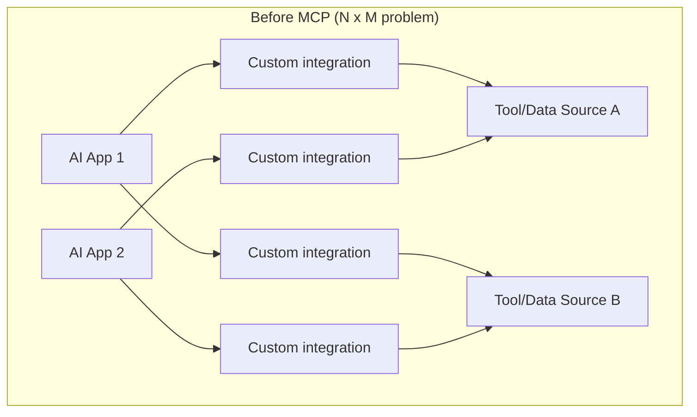
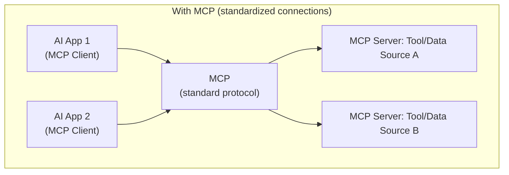

# What Is MCP and Why It Exists

> Before MCP, connecting an AI assistant to N different tools meant writing N different, incompatible integrations.

**Type:** Learn
**Languages:** Concept, JSON
**Prerequisites:** Multi-Agent Coordination
**Time:** ~25 minutes

## Learning Objectives

- Understand the integration problem MCP was designed to solve
- Understand MCP's core idea: a standard protocol between AI applications and external tools/data sources
- Recognize the difference between "function calling" (Level 4, the mechanism) and MCP (a standard for exposing and discovering those functions)
- Formulate the right questions when a team debates building a custom integration vs. adopting MCP

## The Problem

A company wants their AI assistant to access their internal ticketing system, their file storage, and their calendar — three separate integrations, each hand-built by a different team, each with different authentication, different data formats, and no shared conventions. When a fourth AI application needs the same three data sources, none of that integration work is reusable, because each was built as a one-off, tightly coupled connector.

## The Concept

**MCP (Model Context Protocol)** is an open standard defining how AI applications connect to external tools and data sources — think of it as a common "plug shape" so any compliant AI application can connect to any compliant tool server, without custom one-off integration code for every pairing.





### The "N x M" Integration Problem

Without a shared standard, connecting N AI applications to M tools/data sources requires up to N x M custom integrations — a number that grows quickly and none of which is reusable across pairings. MCP reduces this to N + M: each AI application implements the client side of MCP once, and each tool/data source implements the server side once, and any client can then talk to any server.

### Function Calling vs. MCP: Different Layers of the Same Problem

Function calling (Level 4) is the *mechanism* by which a model requests that a specific function run with specific arguments. MCP is a *standard* for how those functions (and other resources) are exposed, described, and discovered in the first place — MCP servers commonly expose their capabilities as tools that get used via function calling, but MCP also standardizes things beyond a single function call, like exposing data resources and reusable prompts.

## Build It

A simplified illustration of what an MCP server exposes to a client — a standardized description an AI application can discover and use, rather than a one-off custom API:

```python
mcp_server_capabilities = {
    "server_name": "internal-ticketing-system",
    "tools": [
        {
            "name": "get_ticket",
            "description": "Retrieve a support ticket by its ID",
            "input_schema": {
                "type": "object",
                "properties": {"ticket_id": {"type": "string"}},
                "required": ["ticket_id"],
            },
        },
        {
            "name": "create_ticket",
            "description": "Create a new support ticket",
            "input_schema": {
                "type": "object",
                "properties": {
                    "title": {"type": "string"},
                    "priority": {"type": "string", "enum": ["low", "medium", "high"]},
                },
                "required": ["title", "priority"],
            },
        },
    ],
}

def discover_tools(server_capabilities):
    print(f"Connected to MCP server: {server_capabilities['server_name']}")
    print("Available tools:")
    for tool in server_capabilities["tools"]:
        print(f"  - {tool['name']}: {tool['description']}")
    return server_capabilities["tools"]

discovered = discover_tools(mcp_server_capabilities)

print(f"\nAny MCP-compliant AI application could now discover and call these {len(discovered)} tools")
print("without any custom integration code specific to this particular ticketing system.")
```

This "discover what's available, then call it using a standard shape" pattern is the essence of what MCP standardizes — the AI application doesn't need custom code written specifically for this ticketing system's particular API quirks.

## Use It

MCP is increasingly used wherever an AI application needs to connect to external systems in a reusable way:

- **Internal enterprise tools**: exposing internal systems (ticketing, HR databases, internal wikis) as MCP servers once, usable by any internally approved AI assistant.
- **Third-party tool ecosystems**: tool providers publishing MCP servers so any MCP-compliant AI application (across different vendors) can integrate with their product without custom work on either side.
- **Local developer tools**: coding assistants connecting to local MCP servers for file system access, running tests, or querying a local database.

## Exercises

1. **Easy**: In plain English, explain what "N x M integration problem" means, using your own two examples of AI applications and tools.
2. **Medium**: Explain the difference between function calling and MCP in one or two sentences, using the ticketing system example above.
3. **Hard**: A team has three internal AI assistants and wants each to access the same five internal systems. Without MCP, how many custom integrations would be needed at most? With MCP, how many are needed?

## TPM Perspective

### Strategic Executive Summary
MCP directly addresses a real, measurable integration cost problem: without a standard, connecting N AI applications to M tools scales as N x M custom integrations; with a standard, it scales as N + M. This is a genuine strategic argument for adopting MCP over one-off integrations whenever more than one AI application or more than one tool is realistically expected — which is increasingly the common case, not the exception.

### Questions to Challenge Engineering
1. *"Are we building a one-off custom integration for this tool, or exposing it as an MCP server that other current or future AI applications could also use?"*
2. *"If we have multiple AI assistants needing access to the same internal systems, have we calculated the actual integration cost difference between custom integrations (N x M) and a standardized approach (N + M)?"*
3. *"For a third-party tool we want to integrate, do they already offer an MCP server, avoiding custom integration work entirely?"*

### Trade-Off Matrix

| Approach | Integration Cost (N apps, M tools) | Reusability | Standardization |
| :--- | :--- | :--- | :--- |
| **Custom one-off integrations** | Up to N x M | None — each pairing is bespoke | None |
| **MCP (standard protocol)** | N + M | High — any client works with any server | Full |

## Key Terms

- **MCP (Model Context Protocol)**: An open standard defining how AI applications connect to external tools and data sources.
- **MCP Client**: An AI application that connects to and uses MCP servers.
- **MCP Server**: A system exposing tools, data, or prompts to AI applications via the MCP standard.
- **N x M Integration Problem**: The scaling cost of connecting N applications to M tools without a shared standard, versus N + M with one.
