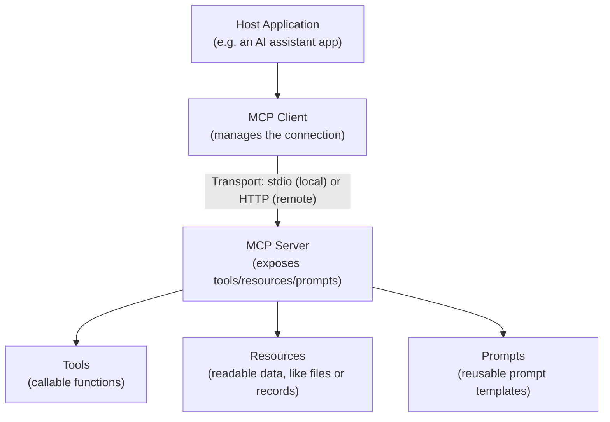

# MCP Architecture: Clients, Servers, and Transports

> "Where does the MCP server run?" changes your security model completely — local and remote are not the same decision.

**Type:** Learn
**Languages:** Concept, JSON
**Prerequisites:** What Is MCP and Why It Exists
**Time:** ~30 minutes

## Learning Objectives

- Understand MCP's core architecture: hosts, clients, and servers
- Understand the difference between local (stdio) and remote (HTTP-based) transports
- Recognize MCP's three primitives: tools, resources, and prompts
- Formulate the right questions when reviewing an MCP server's deployment and transport choice

## The Problem

A team deploys an MCP server that was designed for local, single-user use (running directly on a developer's machine) as a shared, multi-user remote service — without changing anything about authentication or transport. It works in a demo with one person, but breaks down under concurrent use and has no real access control, because the local architecture assumptions were never revisited for a fundamentally different deployment context.

## The Concept

MCP defines a clear architecture with distinct roles, and a choice of transport mechanism depending on where the server runs.



### Roles: Host, Client, Server

- **Host**: the overall AI application a user interacts with (e.g. a chat assistant).
- **Client**: the component within the host that manages a connection to one specific MCP server.
- **Server**: the system exposing tools, resources, and prompts — could be a local process or a remote service.

### Transports: Local (stdio) vs. Remote (HTTP)

- **stdio transport**: the MCP server runs as a local process on the same machine, communicating over standard input/output — simple, no network exposure, but limited to single-machine, typically single-user use.
- **HTTP-based transport**: the MCP server runs as a network-accessible service, allowing multiple clients/users to connect remotely — enables shared, multi-user access, but introduces real network security and authentication requirements that a local stdio server never had to consider.

### The Three MCP Primitives

- **Tools**: callable functions the model can invoke (via function calling) to perform an action or computation — the mechanism covered in Level 4 and 6.
- **Resources**: readable data the host application can access and provide as context — e.g. a specific file's contents, a database record — without necessarily involving a model-initiated tool call.
- **Prompts**: reusable, parameterized prompt templates the server can expose, so a common task's ideal prompt phrasing is defined and maintained in one place rather than duplicated across every client.

## Build It

A simplified illustration contrasting a local (stdio-style) server's assumptions versus what changes for a remote (HTTP-style) deployment:

```python
class LocalMCPServerAssumptions:
    def __init__(self):
        self.single_user = True
        self.requires_network_auth = False
        self.concurrent_connections_expected = 1

    def describe(self):
        return (
            f"single_user={self.single_user}, "
            f"requires_network_auth={self.requires_network_auth}, "
            f"concurrent_connections_expected={self.concurrent_connections_expected}"
        )

class RemoteMCPServerRequirements:
    def __init__(self):
        self.single_user = False
        self.requires_network_auth = True
        self.concurrent_connections_expected = "many"
        self.requires_rate_limiting = True
        self.requires_per_user_permission_scoping = True

    def describe(self):
        return (
            f"single_user={self.single_user}, "
            f"requires_network_auth={self.requires_network_auth}, "
            f"concurrent_connections_expected={self.concurrent_connections_expected}, "
            f"requires_rate_limiting={self.requires_rate_limiting}, "
            f"requires_per_user_permission_scoping={self.requires_per_user_permission_scoping}"
        )

local = LocalMCPServerAssumptions()
remote = RemoteMCPServerRequirements()

print(f"Local (stdio) server assumptions:\n  {local.describe()}")
print(f"\nRemote (HTTP) server requirements:\n  {remote.describe()}")
print("\nDeploying a server built with local assumptions directly as a shared remote")
print("service, without addressing auth, rate limiting, and per-user scoping, is")
print("exactly the kind of gap that causes production incidents.")
```

This mirrors the real gap in the opening scenario: several requirements (network authentication, rate limiting, per-user permission scoping, handling many concurrent connections) simply don't exist in a local, single-user design and must be deliberately added for a remote, multi-user deployment.

## Use It

Real MCP deployments make this transport choice deliberately based on use case:

- **Local developer tools**: a coding assistant's MCP server for file access typically runs locally via stdio, since it's inherently single-user and single-machine.
- **Shared enterprise integrations**: an internal ticketing system's MCP server, used by many employees' AI assistants, needs a remote HTTP-based deployment with proper authentication and per-user permission scoping (covered further in the enterprise integration lesson).
- **Resources vs. tools in practice**: a documentation MCP server might expose static docs as resources (simple reads) while also exposing a "search documentation" tool (an active function call) for more targeted queries.

## Exercises

1. **Easy**: In plain English, explain why a local stdio-based MCP server doesn't need network authentication, but a remote HTTP-based one does.
2. **Medium**: Classify each of the following as a tool, a resource, or a prompt: "read the contents of a specific file," "run a database query with parameters," "a standard template for summarizing a support ticket."
3. **Hard**: A team wants to convert a working local MCP server into a shared remote service for their whole team. List three specific requirements from this lesson they must now address that didn't apply before.

## TPM Perspective

### Strategic Executive Summary
The choice between local and remote MCP deployment is not a minor implementation detail — it determines whether authentication, rate limiting, and per-user access control are even needed, or whether they're implicitly handled by the local, single-user context. A team converting a local prototype into a shared service must explicitly revisit these requirements, not assume the original design already accounted for them.

### Questions to Challenge Engineering
1. *"Is this MCP server intended for local, single-user use or remote, multi-user use — and does the current design match that intended deployment?"*
2. *"If this server was originally built as a local prototype and is being converted to a shared remote service, have authentication, rate limiting, and per-user permission scoping been explicitly added?"*
3. *"For this integration, are we exposing data as a resource (simple read) or a tool (active function call), and does that choice match how the model actually needs to use it?"*

### Trade-Off Matrix

| Transport | Setup Complexity | Multi-User Support | Security Requirements |
| :--- | :--- | :--- | :--- |
| **stdio (local)** | Low | No — single user/machine | Minimal (no network exposure) |
| **HTTP (remote)** | Higher | Yes — many concurrent users | Significant — auth, rate limiting, permission scoping required |

## Key Terms

- **Host**: The overall AI application a user interacts with, containing one or more MCP clients.
- **MCP Client**: The component managing a connection to one specific MCP server on behalf of a host.
- **Transport**: The communication mechanism between client and server — commonly stdio (local) or HTTP-based (remote).
- **Tool (MCP)**: A callable function an MCP server exposes for a model to invoke.
- **Resource (MCP)**: Readable data an MCP server exposes, accessible without necessarily requiring a model-initiated tool call.
- **Prompt (MCP)**: A reusable, parameterized prompt template exposed by an MCP server.
