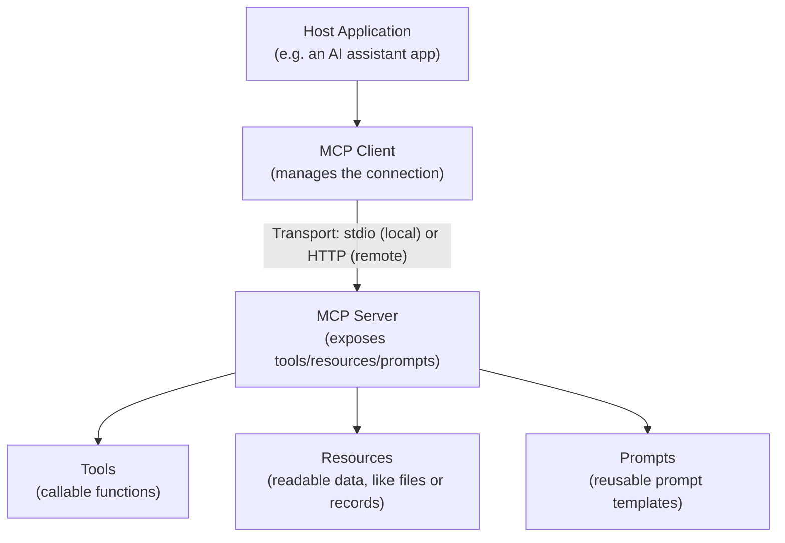

# MCP Architecture: Clients, Servers, and Transports

> "Where does the MCP server run?" changes your security model completely — local and remote are not the same decision.

**Type:** Learn
**Prerequisites:** What Is MCP and Why It Exists
**Time:** ~25 minutes

## Learning Objectives

- Describe MCP's core architecture: hosts, clients, and servers
- Explain the difference between local (stdio) and remote (HTTP-based) transports
- Recognize MCP's three primitives: tools, resources, and prompts
- Formulate the right questions when reviewing an MCP server's deployment and transport choice

## What It Is

MCP defines distinct roles, a choice of transport, and three kinds of things a server can offer.

**Roles**

- **Host**: the overall AI application a user interacts with (for example a chat assistant).
- **Client**: the component inside the host that manages a connection to one specific MCP server.
- **Server**: the system exposing capabilities, which could be a local process or a remote service.

**Transports** (how client and server talk)

- **stdio**: the server runs as a local process on the same machine, communicating over standard input/output. Simple, no network exposure, but limited to one machine and typically one user.
- **HTTP-based**: the server runs as a network-accessible service so many clients and users can connect remotely. It enables shared access but brings real network security and authentication requirements that a local server never faced.

**Primitives**

| Primitive | What it is | Who uses it |
| :--- | :--- | :--- |
| **Tools** | Callable functions that perform an action or computation | The model, via function calling (Levels 4 and 6) |
| **Resources** | Readable data such as a file's contents or a database record | The host application, as context, without a model-initiated call |
| **Prompts** | Reusable, parameterized prompt templates | Defined once on the server instead of duplicated in every client |

## Why It Matters

A team takes an MCP server designed for local, single-user use on a developer's machine and deploys it as a shared, multi-user remote service, changing nothing about authentication or transport. It works in a one-person demo but breaks under concurrent use and has no real access control, because the local design's assumptions were never revisited for a very different deployment.

## How It Works

1. The user interacts with the host application.
2. The host creates one client per MCP server it needs.
3. Each client connects to its server over the chosen transport and asks what it offers.
4. The server lists its tools, resources and prompts.
5. The host uses resources as context and exposes tools to the model; when the model calls a tool, the client relays the request and returns the result.

What changes between local and remote is everything around that flow: who is allowed to connect, how many connect at once, and how each user's permissions are enforced.

## Architecture and Workflow



```archify
src: diagrams/mcp-architecture.html
title: MCP host, client, server, and what a server exposes
aspect: 1500/362
```

## A Real-World Example

Local versus remote assumptions, side by side:

| Concern | Local (stdio) server | Remote (HTTP) server |
| :--- | :--- | :--- |
| Users | One | Many |
| Network authentication | Not needed | Required |
| Concurrent connections | One expected | Many |
| Rate limiting | Not needed | Required |
| Per-user permission scoping | Not needed | Required |

Typical choices: a coding assistant's file-access server runs locally over stdio because it is inherently single-user and single-machine. An internal ticketing server used by many employees' assistants needs the remote design with authentication and per-user scoping (see the enterprise lesson). A documentation server might expose static docs as resources while also offering a "search documentation" tool for targeted queries.

## What a TPM Needs to Understand

- Local versus remote is not an implementation detail. It decides whether authentication, rate limiting and per-user access control are needed at all, or were implicitly handled by the single-user context.
- Converting a local prototype into a shared service must explicitly revisit those requirements. A working demo proves nothing about multi-user readiness.
- Resource versus tool is a design choice: a simple read of known data versus an active function call chosen by the model. It should match how the model actually needs to use the data.
- Prompts keep a common task's best phrasing in one maintained place.

## Risks, Dependencies, and Trade-Offs

| Transport | Setup Complexity | Multi-User Support | Security Requirements |
| :--- | :--- | :--- | :--- |
| **stdio (local)** | Low | No — single user/machine | Minimal (no network exposure) |
| **HTTP (remote)** | Higher | Yes — many concurrent users | Significant — auth, rate limiting, permission scoping required |

Dependencies: network infrastructure, an identity provider for remote servers, and operational ownership (uptime, monitoring). Failure scenarios: a prototype promoted to shared service with no auth, one heavy user starving others without rate limits, and every user effectively sharing one set of permissions.

## Questions to Ask Engineers

1. *"Is this MCP server intended for local, single-user use or remote, multi-user use — and does the current design match that intended deployment?"*
2. *"If this server was originally built as a local prototype and is being converted to a shared remote service, have authentication, rate limiting, and per-user permission scoping been explicitly added?"*
3. *"For this integration, are we exposing data as a resource (simple read) or a tool (active function call), and does that choice match how the model actually needs to use it?"*

## Scenario Exercise

A developer's working local MCP server for your ticketing system impressed leadership, and the plan is to share it with the whole support organization next week.

1. **Easy**: Explain in plain English why a local stdio server does not need network authentication but a remote HTTP one does.
2. **Medium**: Classify as tool, resource or prompt: "read the contents of a specific file," "run a database query with parameters," and "a standard template for summarizing a support ticket."
3. **Hard**: List three requirements from this lesson the team must now address that did not apply to the local version, and say which you would make a launch blocker.

## Key Terms

- **Host**: The overall AI application a user interacts with, containing one or more MCP clients.
- **MCP Client**: The component managing a connection to one specific MCP server on behalf of a host.
- **Transport**: The communication mechanism between client and server — commonly stdio (local) or HTTP-based (remote).
- **Tool (MCP)**: A callable function an MCP server exposes for a model to invoke.
- **Resource (MCP)**: Readable data an MCP server exposes, accessible without necessarily requiring a model-initiated tool call.
- **Prompt (MCP)**: A reusable, parameterized prompt template exposed by an MCP server.
