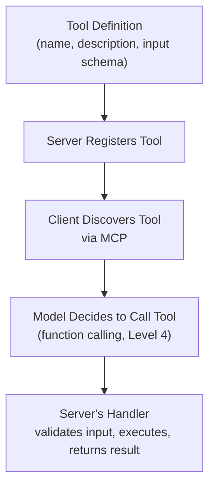

# Building Custom MCP Servers

> Building an MCP server is mostly the same discipline as building any API — plus one new question: what should a model be allowed to do with this?

**Type:** Learn
**Prerequisites:** MCP Architecture: Clients, Servers, and Transports
**Time:** ~30 minutes

## Learning Objectives

- Describe the practical anatomy of a custom MCP server: tool definitions, handlers, and schemas
- Recognize how MCP server design reuses concepts from earlier levels: JSON schemas, input validation, error handling
- Explain why good tool descriptions directly affect how reliably a model uses them
- Ask the right questions when reviewing a proposed custom MCP server's design

## What It Is

A custom MCP server is a service your team builds to expose its own systems (inventory, tickets, internal docs) to AI models through the standard MCP format. It is an API (Level 1), with structured input and output (Level 4), wrapped in a standard discovery format (the first lesson of this level).

Each capability the server offers is a **tool**, and each tool has four parts:

| Part | What it is | Why it matters |
| :--- | :--- | :--- |
| **Name** | A clear, specific identifier (`search_inventory`, not `search`) | Helps the model tell tools apart |
| **Description** | A precise explanation of what the tool does and when to use it | The model reasons from this text when deciding whether to call the tool |
| **Input schema** | The exact arguments expected, their types, and constraints | Defines what a valid call looks like |
| **Handler** | The server-side logic that validates input, does the real work, and returns a result | Where safety checks and error handling live |

## Why It Matters

A team builds an MCP server exposing their internal inventory system, but gives each tool a terse, one-word description ("search", "update") with no explanation of expected inputs or when to use each one. The model frequently calls the wrong tool or passes malformed arguments. The underlying system is not broken; the descriptions gave the model almost nothing to reason from. This is the same failure mode as a poorly written prompt (Level 3) or an under-specified schema (Level 4).

A model's decision about *which* tool to call and *how* to call it is based entirely on the tool's name, description, and schema. There is no other information available at that moment. A vague description is functionally equivalent to a vague prompt.

## How It Works

1. The developer defines each tool (name, description, input schema).
2. The server registers those tools so they can be discovered.
3. A client connects and discovers the tools through MCP.
4. The model decides to call a tool, based only on the name, description, and schema it was shown.
5. The server's handler checks the input, runs the real logic, and returns either a result or a clear error message.

Because the handler cannot assume the model's request is well-formed, it applies the same defensive input checks used in the software engineering and structured outputs lessons.

## Architecture and Workflow



```archify
src: diagrams/mcp-tool-lifecycle.html
title: Lifecycle of a custom MCP tool from definition to handler
aspect: 460/634
```

## A Real-World Example

Two versions of the same inventory tool, side by side:

| | Poorly specified | Well specified |
| :--- | :--- | :--- |
| **Name** | "search" | "search_inventory" |
| **Description** | "searches things" | "Search the inventory system for products matching a query. Use this when the user asks about product availability, stock levels, or wants to find a specific item by name or SKU." |
| **Inputs** | One unlabeled text field | A required "query" (product name or SKU) and an optional "in stock only" flag, each explained |
| **Model behavior** | Guesses when to use it and what to pass | Knows when it applies and what to send |

When a call arrives missing a required field, a good handler does not crash or guess. It returns a clear message such as "Missing required field: query", which gives the model enough information to correct itself and retry.

## What a TPM Needs to Understand

- Tool description quality is a direct, measurable lever on how reliably an MCP server gets used correctly. The same discipline as prompt engineering (Level 3) and structured outputs (Level 4) applies.
- A design review of a proposed MCP server should review the tool descriptions as carefully as the implementation.
- Good production practice means example-rich descriptions (written like documentation for a new engineer), strict input validation, and clear error messages returned to the model.
- Testing the handler in isolation is not enough. The server must be tested with realistic model usage to confirm the right tool is chosen.

## Risks, Dependencies, and Trade-Offs

| Tool Definition Quality | Model Tool Selection Accuracy | Development Time |
| :--- | :--- | :--- |
| **Terse, one-word name/description** | Low — frequent wrong tool selection or bad arguments | Fastest to write |
| **Clear description, no examples** | Moderate | Slightly more time |
| **Clear description + examples of when to use/not use** | High | More upfront time, pays off in reliability |

Dependencies: the underlying system's own reliability and permissions. Risk: a tool that can change data (cancel an order, issue a refund) needs a decision about what the model is allowed to do on its own and what needs human approval.

## Questions to Ask Engineers

1. *"Do our tool descriptions explain both what each tool does and when a model should (and shouldn't) use it, or are they terse labels?"*
2. *"Does the handler validate input strictly and return clear, actionable error messages, or does it assume the model's request is always well-formed?"*
3. *"Have we tested this MCP server with realistic model usage to confirm it selects the right tool and passes valid arguments, not just tested the handler in isolation?"*

## Scenario Exercise

Your team is about to launch an MCP server with two similarly named tools: `search_inventory` and `search_orders`. In early testing, the model sometimes uses one when it should use the other.

1. **Easy**: What happens, and what should the model receive back, when a call arrives without a required field?
2. **Medium**: Draft the description for a hypothetical `cancel_order` tool that explains when a model should and shouldn't call it (for example, what must be checked first).
3. **Hard**: Propose three example scenarios the descriptions could include to help the model tell the two search tools apart, and name one risk you would raise at the design review.

## Key Terms

- **Tool Definition**: The combination of a name, description, and input schema that describes a callable function to an MCP client/model.
- **Handler**: The server-side logic that receives a tool call, validates its input, executes the real work, and returns a result.
- **Input Validation**: Checking that a tool call's arguments meet expected constraints before executing, guarding against malformed or unexpected input.
- **Tool Description Quality**: How clearly a tool's description conveys what it does and when to use it, directly affecting how reliably a model selects and calls it correctly.
