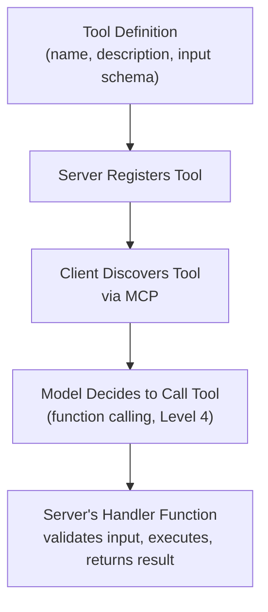

# Building Custom MCP Servers

> Building an MCP server is mostly the same discipline as building any API — plus one new question: what should a model be allowed to do with this?

**Type:** Learn
**Languages:** Python, JSON
**Prerequisites:** MCP Architecture: Clients, Servers, and Transports
**Time:** ~35 minutes

## Learning Objectives

- Understand the practical anatomy of a custom MCP server: tool definitions, handlers, and schemas
- Recognize how MCP server design reuses concepts from earlier levels: JSON schemas, input validation, error handling
- Understand why good tool descriptions directly affect how reliably a model uses them
- Formulate the right questions when reviewing a proposed custom MCP server's design

## The Problem

A team builds an MCP server exposing their internal inventory system, but gives each tool a terse, one-word description ("search", "update") with no explanation of expected inputs or when to use each one. The model frequently calls the wrong tool or passes malformed arguments — not because the underlying system is broken, but because the tool descriptions gave it almost nothing to reason from, the same failure mode as a poorly written prompt (Level 3) or an under-specified JSON schema (Level 4).

## The Concept

Building a custom MCP server draws directly on concepts from earlier levels — it's an API (Level 1), with structured input/output (Level 4), wrapped in a standard discovery format (this level's first lesson).



### The Anatomy of a Tool Definition

- **Name**: a clear, specific identifier (`search_inventory`, not `search`).
- **Description**: a precise explanation of what the tool does and when to use it — this description is what the model reasons from when deciding whether to call this tool, so vague descriptions directly cause misuse.
- **Input schema**: a JSON schema (Level 4) defining exactly what arguments are expected, their types, and constraints.
- **Handler**: the actual server-side code that validates input, executes the real logic, and returns a result — following the same input validation and error handling discipline from the software engineering fundamentals and structured outputs lessons.

### Why Tool Descriptions Are a First-Class Design Concern

A model's decision about *which* tool to call and *how* to call it is entirely based on the tool's name, description, and schema — there's no other information available to it at that decision point. A vague or ambiguous description is functionally equivalent to a vague prompt (Level 3): it increases the chance of the model making the wrong choice, exactly as the opening scenario illustrates.

## Build It

A well-specified vs. poorly-specified tool definition, showing the practical difference:

```python
poorly_specified_tool = {
    "name": "search",
    "description": "searches things",
    "input_schema": {"type": "object", "properties": {"q": {"type": "string"}}},
}

well_specified_tool = {
    "name": "search_inventory",
    "description": (
        "Search the inventory system for products matching a query. "
        "Use this when the user asks about product availability, stock levels, "
        "or wants to find a specific item by name or SKU."
    ),
    "input_schema": {
        "type": "object",
        "properties": {
            "query": {"type": "string", "description": "Product name or SKU to search for"},
            "in_stock_only": {"type": "boolean", "description": "If true, only return items currently in stock"},
        },
        "required": ["query"],
    },
}

def validate_and_handle(tool_def, arguments):
    schema = tool_def["input_schema"]
    for field in schema.get("required", []):
        if field not in arguments:
            return {"error": f"Missing required field: {field}"}
    return {"result": f"Executed '{tool_def['name']}' with {arguments}"}

print("Poorly-specified tool definition:")
print(f"  name: {poorly_specified_tool['name']!r}, description: {poorly_specified_tool['description']!r}")

print("\nWell-specified tool definition:")
print(f"  name: {well_specified_tool['name']!r}")
print(f"  description: {well_specified_tool['description']!r}")

result = validate_and_handle(well_specified_tool, {"query": "USB-C cable"})
print(f"\nHandler result with valid input: {result}")

result_missing = validate_and_handle(well_specified_tool, {"in_stock_only": True})
print(f"Handler result with missing required field: {result_missing}")
```

The well-specified tool gives a model a precise understanding of *when* to use it and *what* inputs it expects — directly reducing the ambiguity that causes wrong tool selection or malformed calls.

## Use It

Teams building production MCP servers apply standard engineering discipline to the whole surface:

- **Comprehensive, example-rich descriptions**: writing tool descriptions the way you'd write documentation for a new engineer joining the team, not a one-line label.
- **Strict input validation**: rejecting malformed arguments at the handler level rather than trusting that the model's request is always well-formed (the same defensive posture from the structured outputs and function calling lessons).
- **Clear error messages returned to the model**: so that if a call fails, the model has enough information to potentially correct and retry, rather than a bare, unhelpful failure.

## Exercises

1. **Easy**: In the code above, what happens when `validate_and_handle` is called without the required `query` field?
2. **Medium**: Rewrite the description for a hypothetical `cancel_order` tool so that it clearly explains when a model should and shouldn't call it (e.g. what to check before canceling).
3. **Hard**: Propose three example scenarios a tool's description could include to help a model correctly distinguish it from a similarly-named tool (e.g. `search_inventory` vs. `search_orders`).

## TPM Perspective

### Strategic Executive Summary
Tool description quality is a direct, measurable lever on how reliably an MCP server gets used correctly — the same discipline that applies to prompt engineering (Level 3) and structured outputs (Level 4) applies here, because the model's only information about a tool is its name, description, and schema. Reviewing a proposed MCP server should include reviewing its tool descriptions as carefully as its actual implementation code.

### Questions to Challenge Engineering
1. *"Do our tool descriptions clearly explain both what the tool does and when a model should (and shouldn't) use it, or are they terse, one-line labels?"*
2. *"Does our handler code validate input strictly and return clear, actionable error messages, or does it assume the model's request is always well-formed?"*
3. *"Have we tested this MCP server with realistic model usage to confirm it selects the right tool and passes valid arguments, not just tested the handler code in isolation?"*

### Trade-Off Matrix

| Tool Definition Quality | Model Tool Selection Accuracy | Development Time |
| :--- | :--- | :--- |
| **Terse, one-word name/description** | Low — frequent wrong tool selection or bad arguments | Fastest to write |
| **Clear description, no examples** | Moderate | Slightly more time |
| **Clear description + examples of when to use/not use** | High | More upfront time, pays off in reliability |

## Key Terms

- **Tool Definition**: The combination of a name, description, and input schema that describes a callable function to an MCP client/model.
- **Handler**: The server-side code that receives a tool call, validates its input, executes the real logic, and returns a result.
- **Input Validation**: Checking that a tool call's arguments meet expected constraints before executing, guarding against malformed or unexpected input.
- **Tool Description Quality**: How clearly a tool's description conveys what it does and when to use it, directly affecting how reliably a model selects and calls it correctly.
