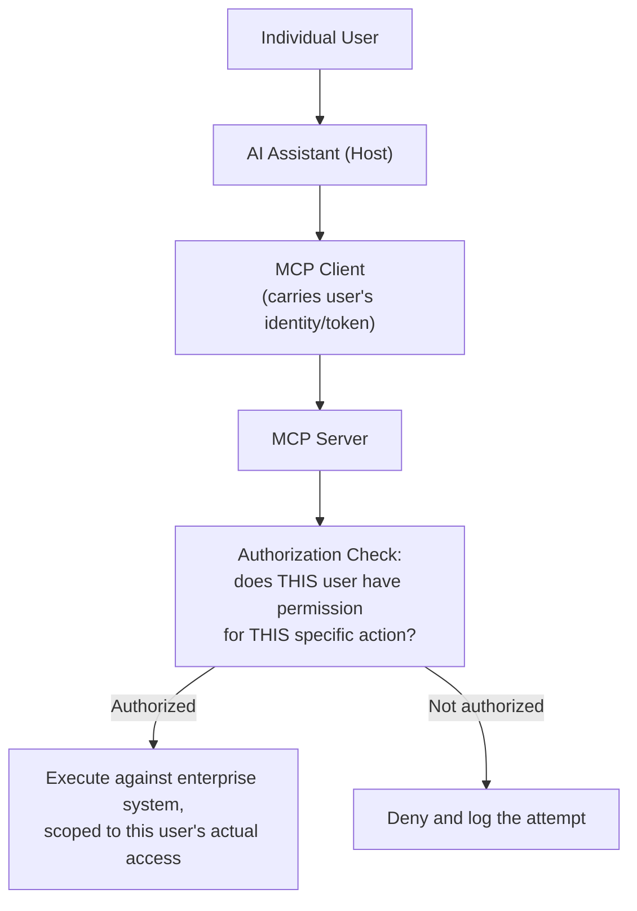

# Enterprise MCP Integration: Auth, Security, and Governance

> Connecting an AI assistant to a real enterprise system means every existing security and access control requirement still applies — MCP doesn't waive any of them.

**Type:** Learn
**Prerequisites:** Building Custom MCP Servers
**Time:** ~25 minutes

## Learning Objectives

- Explain why enterprise MCP deployments need authentication and per-user authorization, not just server-level access control
- Recognize the risk of an AI assistant inheriting broader permissions than the specific user it's acting on behalf of
- Describe audit logging requirements for AI-initiated actions on enterprise systems
- Formulate the right questions when reviewing an enterprise MCP integration's access control design

## What It Is

Enterprise MCP integration means layering authentication, authorization and audit on top of the base MCP architecture from the previous lessons. The protocol enables the connection; it does not decide who may do what. Three controls matter most:

- **Per-user authorization**: each request is checked against the specific requesting user's actual permissions, not just the server's own broad access.
- **Least privilege for tools**: each tool is scoped to the minimum its purpose needs, mirroring the tool risk-scoping in the agentic tool use lesson.
- **Audit logging**: every AI-initiated action is recorded with enough detail to reconstruct it later.

## Why It Matters

A company connects its AI assistant to an MCP server exposing the HR system. The server authenticates with one shared service account that has broad admin access. Any user's assistant calling a tool through that server can technically read or modify any employee's record, regardless of what that user is allowed to see. This is not hypothetical; it is the foreseeable result of skipping per-user authorization, and it holds even if the server's code has no bugs.

## How It Works

1. The user signs in and asks the AI assistant (host) for something.
2. The MCP client carries the user's own identity or token along with the request (**identity passthrough**).
3. The MCP server receives the request and checks: does this user have permission for this specific action?
4. If authorized, the action runs against the enterprise system, scoped to that user's real access.
5. If not authorized, the request is denied and the attempt is logged.
6. Either way, an audit entry records who, which tool, which arguments, and the result.

The common serious mistake is authenticating the server to the enterprise system with a single broad service account and never separately checking the individual user. The AI assistant then effectively inherits far more access than the person using it. Audit logging is also often overlooked because "the AI did it" can obscure who was actually responsible.

## Architecture and Workflow



```archify
src: diagrams/enterprise-mcp.html
title: Explore the trust boundaries: trace what each component can reach
aspect: 718/275
```

## A Real-World Example

An HR assistant with a "get employee record" tool. The rule: you may view your own record, or the record of someone who reports to you.

| Request | Decision | Logged as |
| :--- | :--- | :--- |
| A manager asks for their direct report's record | Allowed | Allowed: manager viewed that employee |
| An employee asks for a peer's record (not their report) | Denied; the user gets "not authorized" | Denied: employee attempted to view that peer |
| Any user asks for salary data through a "look up job title" tool | Should be impossible: the tool is scoped to basic profile fields only | n/a |

Every request is judged against the requesting user's own permissions, not the server's service account, and every attempt, allowed or denied, leaves a trail. Real deployments pass user identity through, expose separate narrow tools ("view basic profile" versus "view compensation data"), and feed AI-initiated actions into the existing enterprise audit system so security teams have one place to review all access.

## What a TPM Needs to Understand

- An MCP integration deserves the same rigor as a new API endpoint into a sensitive system, because that is exactly what it is.
- Per-user authorization, least-privilege tool scoping and audit logging must be designed in. They do not come free with the protocol.
- The primary question for any review is whose permissions apply: the user's or the server's.
- Audit entries should answer "who did what, when, with what inputs, with what result, and was it authorized," ideally in the existing compliance tooling.
- Retrofitting these controls after launch is far more expensive than building them in.

## Risks, Dependencies, and Trade-Offs

| Access Control Approach | Security | Implementation Effort | Risk |
| :--- | :--- | :--- | :--- |
| **Single shared service account, no per-user checks** | Low | Lowest | High — any user's assistant can access anything the service account can |
| **Per-user authorization enforced at the server** | High | Moderate — requires identity passthrough | Low, matches existing enterprise permission model |
| **Per-user authorization + least-privilege tool scoping + audit logging** | Highest | Higher upfront effort | Lowest, auditable and defensible |

Dependencies: the enterprise identity provider, the target system's own permission model, and the central logging platform. Failure scenarios: a shared admin account exposing every record to every user, an over-broad tool leaking sensitive fields, expired or forwarded tokens used beyond their intent, and missing logs leaving an incident impossible to investigate.

## Questions to Ask Engineers

1. *"Does this MCP server enforce per-user authorization based on the actual requesting user's permissions, or does it use one broad service account for every request regardless of who's asking?"*
2. *"Are AI-initiated actions on this enterprise system logged with enough detail (user, tool, arguments, result) to support a security or compliance audit?"*
3. *"Are our exposed tools scoped to least privilege — e.g. separating 'view basic info' from 'view sensitive data' — or does one broad tool expose more than its stated purpose requires?"*

## Scenario Exercise

Your company's AI assistant is about to go live against the HR system through an MCP server using one shared admin-level service account.

1. **Easy**: In the table above, why does the employee's request for a peer's record get denied?
2. **Medium**: Explain in plain English why a broad service account with no per-user authorization is a real security risk even if the server's code has no bugs.
3. **Hard**: Propose the fields an audit log entry for AI-initiated actions should contain to answer "who did what, when, and was it authorized," and say who in your organization should review those logs.

## Key Terms

- **Per-User Authorization**: Enforcing that each request is checked against the specific requesting user's actual permissions, not just the server's own broad access.
- **Identity Passthrough**: Carrying a user's actual identity/token through the AI assistant and MCP client to the server, rather than relying on a generic service account.
- **Least Privilege**: Scoping each tool and access grant to the minimum required for its specific purpose, reducing the impact of any single compromised or misused tool.
- **Audit Logging**: Recording sufficient detail about every action (who, what, when, result) to support after-the-fact security and compliance review.
