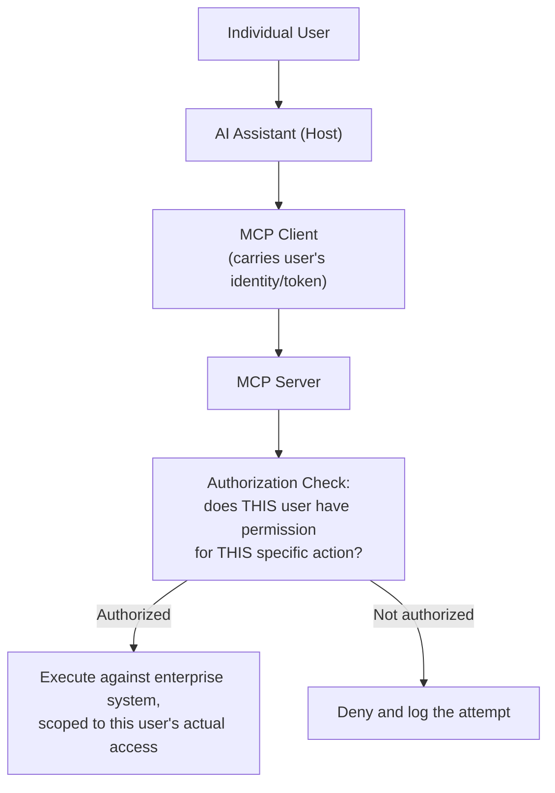

# Enterprise MCP Integration: Auth, Security, and Governance

> Connecting an AI assistant to a real enterprise system means every existing security and access control requirement still applies — MCP doesn't waive any of them.

**Type:** Learn
**Languages:** Concept, JSON
**Prerequisites:** Building Custom MCP Servers
**Time:** ~30 minutes

## Learning Objectives

- Understand why enterprise MCP deployments need authentication and per-user authorization, not just server-level access control
- Recognize the risk of an AI assistant inheriting broader permissions than the specific user it's acting on behalf of
- Understand audit logging requirements for AI-initiated actions on enterprise systems
- Formulate the right questions when reviewing an enterprise MCP integration's access control design

## The Problem

A company connects their AI assistant to an MCP server exposing their HR system. The server authenticates using a single, shared service account with broad admin access — meaning any user's AI assistant, when it calls a tool through this server, can technically read or modify any employee's record, regardless of what that specific user is actually authorized to see. This isn't a hypothetical risk; it's a direct, foreseeable consequence of skipping per-user authorization in the integration design.

## The Concept

Enterprise MCP integrations must layer authentication and authorization on top of the base MCP architecture (previous lessons) — the protocol enables the connection, but doesn't automatically enforce who should be allowed to do what.



```archify
src: diagrams/enterprise-mcp.html
title: Explore the trust boundaries: trace what each component can reach
aspect: 718/275
```

### Per-User Authorization, Not Just Server-Level Access

A common, serious mistake is authenticating the *MCP server itself* to the enterprise system with one broad service account, without separately checking whether the *individual user* making the request through their AI assistant has permission for that specific action. Enterprise-grade MCP integrations must pass the user's own identity through the chain and enforce the enterprise system's existing permission model per request — not grant every AI-initiated action the server's own broad access level.

### Audit Logging for AI-Initiated Actions

Every action an AI assistant takes against an enterprise system through an MCP server should be logged with enough detail to answer, after the fact: which user initiated it, what tool was called, with what arguments, and what was the result. This is the same audit logging discipline expected of any enterprise system, extended to cover AI-initiated actions specifically — an area often overlooked because "the AI did it" can obscure who was actually responsible.

### Least Privilege for AI Tool Access

Beyond per-user authorization, the tools themselves should be scoped to the minimum access needed for their stated purpose — a tool for "look up an employee's job title" shouldn't also have unrestricted access to salary or performance review data, even if built on the same underlying HR system, mirroring the tool risk-scoping discipline from the agentic tool use lesson.

## Build It

A simplified authorization check layered on top of a tool call, enforcing per-user permissions rather than trusting server-level access:

```python
employee_records = {
    "emp_100": {"name": "Alex Kim", "job_title": "Engineer", "manager_id": "emp_200"},
    "emp_200": {"name": "Jordan Lee", "job_title": "Engineering Manager", "manager_id": None},
}

def user_can_view_record(requesting_user_id, target_employee_id):
    if requesting_user_id == target_employee_id:
        return True
    target = employee_records.get(target_employee_id)
    return target is not None and target.get("manager_id") == requesting_user_id

def get_employee_record(requesting_user_id, target_employee_id):
    if not user_can_view_record(requesting_user_id, target_employee_id):
        log_entry = f"DENIED: user={requesting_user_id} attempted to view employee={target_employee_id}"
        print(log_entry)
        return {"error": "Not authorized to view this record"}

    log_entry = f"ALLOWED: user={requesting_user_id} viewed employee={target_employee_id}"
    print(log_entry)
    return employee_records[target_employee_id]

print("Manager viewing their own direct report's record:")
print(get_employee_record("emp_200", "emp_100"))

print("\nEmployee attempting to view a peer's record they don't manage:")
print(get_employee_record("emp_100", "emp_200"))
```

Every request is checked against the *requesting user's own* actual permissions — not the MCP server's own broad service-account access — and every attempt, allowed or denied, is logged with enough detail to audit later.

## Use It

Real enterprise MCP deployments build this in as a foundational requirement, not an afterthought:

- **Identity passthrough**: the user's actual identity/token flows through the AI assistant and MCP client to the server, rather than the server using its own generic service credentials for every request.
- **Scoped tools per system**: separate, narrowly-scoped tools (e.g. "view basic profile" vs. "view compensation data") rather than one broad tool exposing an entire system's data.
- **Centralized audit logs**: AI-initiated actions logged alongside (or integrated with) existing enterprise audit systems, so security and compliance teams have one place to review all access, human or AI-initiated.

## Exercises

1. **Easy**: In the code above, why does the employee-viewing-a-peer's-record attempt get denied?
2. **Medium**: Explain in plain English why authenticating the MCP server itself with a broad service account, without per-user authorization, creates a real security risk even if the server's code has no bugs.
3. **Hard**: Propose an audit log entry format (what fields it should contain) for AI-initiated actions on an enterprise system, sufficient to answer "who did what, when, and was it authorized" after the fact.

## TPM Perspective

### Strategic Executive Summary
Enterprise MCP integrations must satisfy the same identity, authorization, and audit requirements as any other enterprise system access path — MCP provides the connection mechanism, but per-user authorization, least-privilege tool scoping, and audit logging must be deliberately designed in, not assumed to come "for free" with the protocol. A security review of an MCP integration should treat it with the same rigor as reviewing a new API endpoint into a sensitive system, because that's exactly what it is.

### Questions to Challenge Engineering
1. *"Does this MCP server enforce per-user authorization based on the actual requesting user's permissions, or does it use one broad service account for every request regardless of who's asking?"*
2. *"Are AI-initiated actions on this enterprise system logged with enough detail (user, tool, arguments, result) to support a security or compliance audit?"*
3. *"Are our exposed tools scoped to least privilege — e.g. separating 'view basic info' from 'view sensitive data' — or does one broad tool expose more than its stated purpose requires?"*

### Trade-Off Matrix

| Access Control Approach | Security | Implementation Effort | Risk |
| :--- | :--- | :--- | :--- |
| **Single shared service account, no per-user checks** | Low | Lowest | High — any user's assistant can access anything the service account can |
| **Per-user authorization enforced at the server** | High | Moderate — requires identity passthrough | Low, matches existing enterprise permission model |
| **Per-user authorization + least-privilege tool scoping + audit logging** | Highest | Higher upfront effort | Lowest, auditable and defensible |

## Key Terms

- **Per-User Authorization**: Enforcing that each request is checked against the specific requesting user's actual permissions, not just the server's own broad access.
- **Identity Passthrough**: Carrying a user's actual identity/token through the AI assistant and MCP client to the server, rather than relying on a generic service account.
- **Least Privilege**: Scoping each tool and access grant to the minimum required for its specific purpose, reducing the impact of any single compromised or misused tool.
- **Audit Logging**: Recording sufficient detail about every action (who, what, when, result) to support after-the-fact security and compliance review.
