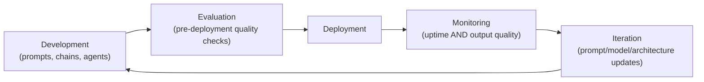

# LLMOps Fundamentals

> DevOps asked "did the code work?" LLMOps has to ask that plus "was the output actually good, this time, for this user?"

**Type:** Learn
**Prerequisites:** Enterprise MCP Integration: Auth, Security, and Governance
**Time:** ~20 minutes

## Learning Objectives

- Explain what LLMOps is and how it extends traditional DevOps/MLOps practices for LLM-specific concerns
- Recognize the core operational lifecycle: development, evaluation, deployment, monitoring, and iteration
- Explain why LLM applications need continuous quality monitoring, not just uptime monitoring
- Formulate the right questions when reviewing a team's operational maturity for an AI feature

## What It Is

**LLMOps** (LLM Operations) extends traditional DevOps and MLOps to the operational needs of LLM-based applications. Its central point: "did it work" for an LLM includes a quality dimension that traditional software monitoring does not capture.

What makes it different from traditional DevOps:

- **Non-deterministic outputs**: the same input can produce different outputs (Level 2's probability lesson), so "did it work" cannot be checked with a simple equality test.
- **Quality is continuous, not binary**: a response can be "not an error" yet unhelpful, off-topic, or subtly wrong. Pass/fail monitoring misses this.
- **Cost is usage-dependent**: unlike a fixed-cost server, LLM spend scales with usage patterns (Level 4's token economics), so cost monitoring is a first-class concern.
- **Prompts and models change independently of code deploys**: a prompt tweak or a provider's silent model update can change behavior with no code deployment, so deployment tracking that only watches code misses a whole category of change.

## Why It Matters

A team ships an AI feature and monitors it like any web service: uptime, response time, error rate. Three weeks later users complain the responses have gotten noticeably worse, yet every traditional metric is green. The service is up, fast, and returning 200 status codes. The failure was in output *quality*, a dimension traditional monitoring was never built to see.

## How It Works

The LLMOps lifecycle is a loop:

1. **Development**: building and iterating on prompts, chains, or agents.
2. **Evaluation**: testing quality before deployment (expanded in the evals lesson).
3. **Deployment**: releasing to production, usually in staged rollouts because quality is uncertain.
4. **Monitoring**: tracking operational metrics and output quality continuously (expanded in the observability lesson).
5. **Iteration**: using monitoring insights to improve prompts, retrieval, or architecture, feeding back into development.

## Architecture and Workflow



```archify
src: diagrams/llmops-lifecycle.html
title: The LLMOps lifecycle loop
aspect: 920/332
```

## A Real-World Example

A support assistant has a service-level view and an LLMOps view of the same response:

| Signal | Traditional dashboard | LLMOps-aware dashboard |
| :--- | :--- | :--- |
| Status code | 200 (healthy) | 200 (healthy) |
| Latency | 850 ms, under the 2,000 ms limit | 850 ms, under the 2,000 ms limit |
| Quality score | Not tracked | 0.55, below the 0.70 alert threshold |
| Cost per request | Not tracked | $0.03, under the $0.05 anomaly threshold |
| Verdict | "Everything looks fine" | Quality regression flagged |

Both see the same response, but only the LLMOps view surfaces the problem. Mature teams build this in deliberately: quality dashboards next to uptime dashboards, change tracking that includes prompt and model versions, and staged rollouts for prompt and model changes.

## What a TPM Needs to Understand

- "The service is up and fast" is necessary but not sufficient for an AI feature. Output quality is a distinct, continuously monitorable dimension.
- A mature program should answer "has quality regressed in the last week?" with the same confidence as "has uptime regressed?"
- Prompt and model changes deserve the same rigor as code deploys: versioned, reviewable, and rolled out in stages.
- Cost is an operational signal too, not just a finance report.

## Risks, Dependencies, and Trade-Offs

| Monitoring Approach | Catches Uptime/Latency Issues | Catches Quality Regressions | Catches Cost Anomalies |
| :--- | :--- | :--- | :--- |
| **Traditional monitoring only** | Yes | No | No |
| **Traditional + quality monitoring** | Yes | Yes | No, unless added separately |
| **Full LLMOps monitoring (uptime + quality + cost)** | Yes | Yes | Yes |

Failure scenarios: a provider silently updates a model and behavior shifts with no deploy on your side; a prompt edit ships untracked and nobody can say what changed; spend doubles because a new feature sends longer prompts. Dependencies: an evaluation process (to define "good"), a tracing capability, and an owner for quality metrics.

## Questions to Ask Engineers

1. *"Beyond uptime and latency, do we have any continuous signal for output quality, and would we actually notice a quality regression before users start complaining?"*
2. *"Are prompt and model version changes tracked and reviewable the same way code deploys are, given that they can change behavior without a traditional deployment?"*
3. *"What's our staged rollout process for a prompt or model change, given the added quality uncertainty compared to a typical code change?"*

## Scenario Exercise

Your team's AI summarization feature has shown 99.9% uptime and 600 ms median latency for a month, but support tickets mentioning "bad summaries" have tripled.

1. **Easy**: In plain English, explain why a "200 OK, fast response" does not guarantee the feature is working well.
2. **Medium**: List two types of changes that would NOT appear in a code deployment log but could explain the drop, and say how you would track them.
3. **Hard**: Propose a lightweight quality signal (for example, thumbs-down rate or a sampled score) the team could add to the existing dashboard this sprint without a full evaluation framework, and name the alert threshold you would start with and why.

## Key Terms

- **LLMOps**: The practices and tooling for operating LLM-based applications reliably, extending DevOps/MLOps to address quality, cost, and non-deterministic-output-specific concerns.
- **Quality Regression**: A decline in output quality/helpfulness that traditional uptime/error-rate monitoring doesn't detect.
- **Staged Rollout**: Releasing a change (prompt, model, or code) to a small subset of traffic first, to catch regressions before a full rollout.
- **Non-Deterministic Output**: Output that can vary between runs even for the same input, requiring quality evaluation rather than simple equality checks.
