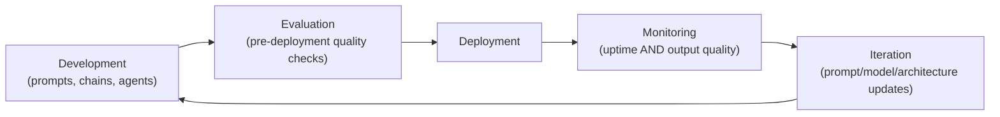

# LLMOps Fundamentals

> DevOps asked "did the code work?" LLMOps has to ask that plus "was the output actually good, this time, for this user?"

**Type:** Learn
**Languages:** Concept
**Prerequisites:** Enterprise MCP Integration: Auth, Security, and Governance
**Time:** ~25 minutes

## Learning Objectives

- Understand what LLMOps is and how it extends traditional DevOps/MLOps practices for LLM-specific concerns
- Recognize the core operational lifecycle: development, evaluation, deployment, monitoring, and iteration
- Understand why LLM applications need continuous quality monitoring, not just uptime monitoring
- Formulate the right questions when reviewing a team's operational maturity for an AI feature

## The Problem

A team ships an AI feature and monitors it the same way they'd monitor any web service: uptime, response time, error rate. Three weeks later, users start complaining the responses have gotten noticeably worse — but every traditional metric looks fine, because the service is up, fast, and returning 200 status codes. The failure was in output *quality*, a dimension traditional operations monitoring was never built to catch, but LLMOps specifically addresses.

## The Concept

**LLMOps** (LLM Operations) extends traditional DevOps and MLOps practices to address the unique operational needs of LLM-based applications — most centrally, that "did it work" for an LLM includes a quality dimension that traditional software monitoring doesn't capture.



### What Makes LLMOps Different from Traditional DevOps

- **Non-deterministic outputs**: the same input can produce different outputs (Level 2's probability lesson), so "did it work" can't be checked with a simple equality test the way traditional software often can.
- **Quality is continuous, not binary**: an LLM response can be "technically not an error" but still unhelpful, off-topic, or subtly wrong — traditional pass/fail monitoring misses this entirely.
- **Cost is usage-dependent and variable**: unlike a fixed-cost server, LLM costs scale directly with usage patterns (Level 4's token economics), requiring cost monitoring as a first-class operational concern.
- **Prompts and models change independently of code deploys**: a prompt tweak or a model provider's silent update can change behavior without a traditional code deployment ever happening — meaning traditional "what changed" deployment tracking misses a whole category of changes.

### The LLMOps Lifecycle

1. **Development**: building and iterating on prompts, chains, or agents.
2. **Evaluation**: testing quality before deployment (expanded in the evals lesson).
3. **Deployment**: releasing to production, often with staged rollouts given the added quality uncertainty.
4. **Monitoring**: tracking both traditional operational metrics and output quality metrics continuously (expanded in the observability lesson).
5. **Iteration**: using monitoring insights to improve prompts, retrieval, or architecture — feeding back into development.

## Build It

A simplified illustration contrasting traditional service monitoring with LLMOps-aware monitoring:

```python
def traditional_monitoring_check(response):
    return {
        "status_code": response["status_code"],
        "latency_ms": response["latency_ms"],
        "is_healthy": response["status_code"] == 200 and response["latency_ms"] < 2000,
    }

def llmops_aware_monitoring_check(response, quality_score, cost_usd):
    traditional = traditional_monitoring_check(response)
    return {
        **traditional,
        "quality_score": quality_score,
        "cost_usd": cost_usd,
        "quality_regression_flag": quality_score < 0.7,
        "cost_anomaly_flag": cost_usd > 0.05,
    }

response = {"status_code": 200, "latency_ms": 850}

traditional_result = traditional_monitoring_check(response)
print(f"Traditional monitoring: {traditional_result}")
print("  -> Looks completely healthy by traditional standards.\n")

llmops_result = llmops_aware_monitoring_check(response, quality_score=0.55, cost_usd=0.03)
print(f"LLMOps-aware monitoring: {llmops_result}")
print("  -> Reveals a quality regression that traditional monitoring completely missed.")
```

Both checks see the same underlying response (200 status, reasonable latency), but only the LLMOps-aware check surfaces the actual problem: a quality regression happening silently beneath a healthy-looking traditional dashboard.

## Use It

Teams with mature LLMOps practices build quality monitoring in as a first-class operational concern:

- **Quality dashboards alongside uptime dashboards**, tracked with the same seriousness as latency or error rate.
- **Change tracking that includes prompt and model version changes**, not just code deploys, since these can silently affect behavior.
- **Staged rollouts for prompt/model changes**, similar to how code changes are staged, given that quality regressions are a real, distinct risk category.

## Exercises

1. **Easy**: In plain English, explain why a "200 OK, fast response" doesn't guarantee an LLM feature is actually working well for users.
2. **Medium**: List two types of changes to an LLM application that would NOT show up in a traditional code deployment log, but should still be tracked operationally.
3. **Hard**: Propose a lightweight quality monitoring signal a team could add to their existing traditional monitoring dashboard without a full evaluation framework in place yet.

## TPM Perspective

### Strategic Executive Summary
"The service is up and fast" is necessary but not sufficient for an AI feature — LLMOps exists specifically because output quality is a distinct, continuously-monitorable dimension that traditional operations practices were never designed to capture. A mature AI program should be able to answer "has quality regressed in the last week" with the same confidence as "has uptime regressed," and treat prompt/model changes with the same operational rigor as code deploys.

### Questions to Challenge Engineering
1. *"Beyond uptime and latency, do we have any continuous signal for output quality, and would we actually notice a quality regression before users start complaining?"*
2. *"Are prompt and model version changes tracked and reviewable the same way code deploys are, given that they can change behavior without a traditional deployment?"*
3. *"What's our staged rollout process for a prompt or model change, given the added quality uncertainty compared to a typical code change?"*

### Trade-Off Matrix

| Monitoring Approach | Catches Uptime/Latency Issues | Catches Quality Regressions | Catches Cost Anomalies |
| :--- | :--- | :--- | :--- |
| **Traditional monitoring only** | Yes | No | No |
| **Traditional + quality monitoring** | Yes | Yes | No, unless added separately |
| **Full LLMOps monitoring (uptime + quality + cost)** | Yes | Yes | Yes |

## Key Terms

- **LLMOps**: The practices and tooling for operating LLM-based applications reliably, extending DevOps/MLOps to address quality, cost, and non-deterministic-output-specific concerns.
- **Quality Regression**: A decline in output quality/helpfulness that traditional uptime/error-rate monitoring doesn't detect.
- **Staged Rollout**: Releasing a change (prompt, model, or code) to a small subset of traffic first, to catch regressions before a full rollout.
- **Non-Deterministic Output**: Output that can vary between runs even for the same input, requiring quality evaluation rather than simple equality checks.
