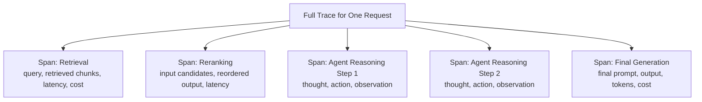

# Observability and Tracing

> "The answer was wrong" is a symptom. A trace is what tells you which of the five steps that produced it was actually to blame.

**Type:** Learn
**Prerequisites:** LLMOps Fundamentals
**Time:** ~20 minutes

## Learning Objectives

- Explain what a "trace" is for an LLM application and why it matters more here than in typical software
- Describe the core components of a trace: spans, inputs/outputs, latency, and cost per step
- Recognize how tools like Langfuse fit in: capturing and visualizing traces for debugging and monitoring
- Formulate the right questions when reviewing whether a team can actually debug their AI pipeline's failures

## What It Is

**Tracing** captures a step-by-step record of everything that happened during a single request through an LLM pipeline: every prompt sent, every tool called, every intermediate result, with timing and cost at each step.

A **span** is one distinct step within a trace: a single retrieval call, a single LLM generation, a single tool call. Each span typically records its input, output, latency, and cost. Spans can be nested (an agent's overall run is a parent span, each tool call a child), mirroring the prompt-chaining and agent-loop structures from earlier levels, but captured for after-the-fact inspection.

**Langfuse** and similar platforms are purpose-built for capturing, storing, and visualizing traces, aggregating cost and latency across many requests, and often connecting to evaluation metrics (next lesson). This is a distinct tool category from generic server logs or APM tools.

## Why It Matters

A RAG-powered agent (Levels 5 and 6) gives a wrong answer. The pipeline involves retrieval, reranking, and a multi-step agent loop with several tool calls. Without visibility into each step, "the answer was wrong" is all the team knows. They cannot tell whether retrieval failed, reranking mis-ordered results, or the agent reasoned badly from good context. Debugging becomes guesswork.

Traditional bugs are usually deterministic: rerun the input, get the same failure. LLM pipelines are non-deterministic (Level 2), multi-step (Levels 4-7), and expensive to rerun. A trace captures what actually happened in the original failing request, often the only reliable way to diagnose it.

## How It Works

1. A request enters the pipeline and receives a unique request ID.
2. Each step (retrieval, reranking, each agent reasoning step, final generation) records a span with its input, output, latency, and cost.
3. The spans are stored together as one trace, linked to the request ID.
4. Engineers open a single trace to debug one failure, or aggregate many traces to find patterns.
5. Totals (end-to-end latency, total cost) are computed by summing the spans.

## Architecture and Workflow



```archify
src: diagrams/trace-spans.html
title: One request trace broken into spans
aspect: 740/532
```

## A Real-World Example

A support bot is asked "what is the policy for defective products?" and the trace shows:

| Span | What it recorded | Latency | Cost |
| :--- | :--- | :--- | :--- |
| Retrieval | Returned two chunks: the defective-product policy and the store hours | 120 ms | $0.0010 |
| Reranking | Kept only the policy chunk | 80 ms | $0.0005 |
| Generation | "Defective products can be exchanged with manager approval." | 900 ms | $0.0120 |
| **Total** | | **1,100 ms** | **$0.0135** |

If the answer had been wrong, the trace shows immediately what was retrieved, what survived reranking, and what generation did with it, so the faulty span is identified instead of treating the pipeline as a black box. It also shows generation is about 82% of latency and about 89% of cost, which tells the team where optimization effort pays off.

Teams use traces three ways: debugging a specific user-reported issue, aggregate analysis ("retrieval returns low-relevance chunks for one topic"), and cost/latency breakdown by span.

## What a TPM Needs to Understand

- Without tracing, debugging a multi-step LLM pipeline is closer to guessing than engineering. It should be a baseline requirement, like logging for any production service.
- Traces are the evidence base for escalations: "which step failed" is answerable in minutes, not days.
- Traces contain user prompts and model outputs, so they inherit privacy and retention obligations (see the guardrails lesson on PII).
- Per-span cost and latency data drives prioritization of optimization work.

## Risks, Dependencies, and Trade-Offs

| Debugging Approach | Diagnostic Precision | Setup Effort | Scales to Complex Pipelines |
| :--- | :--- | :--- | :--- |
| **No tracing (only final input/output logged)** | Very low: guesswork | None | Poor |
| **Basic custom logging per step** | Moderate | Low-Moderate | Fair, but harder to aggregate/visualize |
| **Purpose-built LLM tracing (e.g. Langfuse)** | High | Moderate (integration effort) | Good: built for this exact problem |

Failure scenarios: a user reports a bad answer from last Tuesday but traces were retained only 24 hours; traces store raw customer data with no redaction; a pipeline step is not instrumented, leaving a blind spot exactly where the bug is. Dependencies: instrumentation in every step, storage and retention policy, and access controls.

## Questions to Ask Engineers

1. *"When a user reports a wrong or bad answer, can we pull up the exact trace for that specific request, or are we limited to guessing at what might have gone wrong?"*
2. *"Do we have visibility into per-step latency and cost across our pipeline, so we know where to prioritize optimization effort?"*
3. *"Are we using a purpose-built LLM observability tool (like Langfuse), or trying to debug multi-step, non-deterministic pipelines with only traditional application logs?"*

## Scenario Exercise

An enterprise customer escalates: your agent told their employee the wrong refund window. The pipeline has retrieval, reranking, two agent steps, and final generation.

1. **Easy**: In the support-bot trace above, which span took the most latency, and which was the most expensive?
2. **Medium**: Explain in plain English why tracing is often more valuable for LLM pipelines than for traditional deterministic software.
3. **Hard**: Beyond inputs, outputs, latency, and cost, what additional information would you want captured in the agent's trace to explain why it took an unnecessary or wrong tool-calling step? Also name one privacy concern about storing these traces.

## Key Terms

- **Trace**: A detailed, step-by-step record of everything that happened during a single request through an LLM pipeline.
- **Span**: One distinct step within a trace (e.g. a retrieval call, a tool call, a generation step), capturing its input, output, latency, and cost.
- **Langfuse**: A purpose-built LLM observability platform for capturing, storing, and visualizing traces and related evaluation metrics.
- **Observability**: The broader capability of understanding a system's internal behavior from its external outputs, including traces, metrics, and logs.
