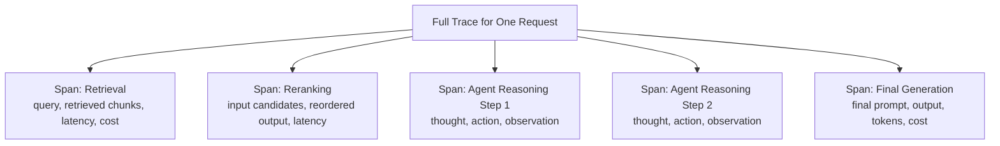

# Observability and Tracing

> "The answer was wrong" is a symptom. A trace is what tells you which of the five steps that produced it was actually to blame.

**Type:** Learn
**Languages:** Concept, JSON
**Prerequisites:** LLMOps Fundamentals
**Time:** ~30 minutes

## Learning Objectives

- Understand what a "trace" is for an LLM application and why it matters more here than in typical software
- Understand the core components of a trace: spans, inputs/outputs, latency, and cost per step
- Recognize how tools like Langfuse fit into this: capturing and visualizing traces for debugging and monitoring
- Formulate the right questions when reviewing whether a team can actually debug their AI pipeline's failures

## The Problem

A RAG-powered agent (Levels 5 and 6) gives a wrong answer, and the pipeline involves retrieval, reranking, and a multi-step agent loop with several tool calls. Without visibility into each individual step, "the answer was wrong" is the only information available — a team can't tell whether retrieval failed, reranking mis-ordered results, or the agent reasoned incorrectly from otherwise-good context. Debugging becomes guesswork instead of a systematic process.

## The Concept

**Tracing** captures a detailed, step-by-step record of everything that happened during a single request through an LLM pipeline — every prompt sent, every tool called, every intermediate result, with timing and cost at each step.



### Spans: The Building Blocks of a Trace

A **span** represents one distinct step within a larger request — a single retrieval call, a single LLM generation, a single tool call. Each span typically records its input, output, latency, and cost, and spans can be nested (e.g. an agent's overall run as a parent span, with each individual tool call as a child span) — mirroring the prompt chaining and agent loop structures from earlier levels, but captured for after-the-fact inspection rather than just executed once and discarded.

### Why This Matters More for LLM Pipelines Than Traditional Software

Traditional software debugging often has deterministic, reproducible bugs — rerun the same input, get the same failure. LLM pipelines are non-deterministic (Level 2), multi-step (Levels 4-7), and expensive to simply "rerun and hope to reproduce." Tracing captures what actually happened during the original failing request, which is often the only reliable way to diagnose it, since rerunning might not reproduce the exact same behavior.

### Tools Like Langfuse

**Langfuse** and similar LLM observability platforms provide purpose-built infrastructure for capturing, storing, and visualizing these traces — showing a request's full step-by-step breakdown, aggregating cost and latency across many requests, and often integrating with the evaluation metrics from the next lesson. This is a distinct category of tooling from traditional application monitoring (like generic server logs or APM tools), purpose-built for the multi-step, non-deterministic nature of LLM pipelines.

## Build It

A simplified trace-capturing wrapper around a multi-step RAG + agent pipeline:

```python
import time

class Trace:
    def __init__(self, request_id):
        self.request_id = request_id
        self.spans = []

    def add_span(self, name, input_data, output_data, latency_ms, cost_usd=0.0):
        self.spans.append({
            "name": name,
            "input": input_data,
            "output": output_data,
            "latency_ms": latency_ms,
            "cost_usd": cost_usd,
        })

    def print_trace(self):
        print(f"Trace for request: {self.request_id}")
        total_latency = 0
        total_cost = 0
        for i, span in enumerate(self.spans, 1):
            print(f"  Span {i}: {span['name']}")
            print(f"    input:  {span['input']}")
            print(f"    output: {span['output']}")
            print(f"    latency: {span['latency_ms']}ms, cost: ${span['cost_usd']:.4f}")
            total_latency += span["latency_ms"]
            total_cost += span["cost_usd"]
        print(f"  TOTAL: {total_latency}ms, ${total_cost:.4f}")

def run_traced_pipeline(query):
    trace = Trace(request_id="req_8821")

    start = time.perf_counter()
    retrieved = ["chunk about defective product policy", "chunk about store hours"]
    trace.add_span("retrieval", query, retrieved, latency_ms=120, cost_usd=0.001)

    reranked = [retrieved[0]]
    trace.add_span("reranking", retrieved, reranked, latency_ms=80, cost_usd=0.0005)

    final_answer = "Defective products can be exchanged with manager approval."
    trace.add_span("generation", reranked, final_answer, latency_ms=900, cost_usd=0.012)

    trace.print_trace()
    return final_answer

run_traced_pipeline("what is the policy for defective products?")
```

If this request had produced a wrong answer, this trace immediately shows exactly what was retrieved, what survived reranking, and what the final generation step produced from that — making it possible to pinpoint which specific span introduced the problem, rather than treating the whole pipeline as an opaque box.

## Use It

Real production LLM systems rely on tracing as a core operational capability:

- **Debugging specific user-reported issues**: pulling up the exact trace for a specific failed request to see precisely what happened, rather than trying to guess or reproduce it blindly.
- **Aggregate analysis**: looking across many traces to find patterns — e.g. "retrieval consistently returns low-relevance chunks for questions about a specific topic."
- **Cost and latency breakdown**: identifying which specific span in a pipeline is the most expensive or slowest, to prioritize optimization effort (connecting to the latency optimization lesson).

## Exercises

1. **Easy**: In the trace output above, which span took the most latency, and which was the most expensive?
2. **Medium**: Explain in plain English why tracing is often more valuable for LLM pipelines than for traditional deterministic software.
3. **Hard**: Propose what additional information you'd want captured in an agent's trace (beyond what's shown above) to debug a case where the agent seemingly took an unnecessary or wrong tool-calling step.

## TPM Perspective

### Strategic Executive Summary
Without tracing, debugging a multi-step LLM pipeline is closer to guessing than engineering — "the answer was wrong" gives no information about which of several steps actually failed. Tracing (via tools like Langfuse or equivalent) should be treated as a baseline operational requirement for any non-trivial LLM pipeline, the same way logging is considered non-negotiable for traditional production services.

### Questions to Challenge Engineering
1. *"When a user reports a wrong or bad answer, can we pull up the exact trace for that specific request, or are we limited to guessing at what might have gone wrong?"*
2. *"Do we have visibility into per-step latency and cost across our pipeline, so we know where to prioritize optimization effort?"*
3. *"Are we using a purpose-built LLM observability tool (like Langfuse), or trying to debug multi-step, non-deterministic pipelines with only traditional application logs?"*

### Trade-Off Matrix

| Debugging Approach | Diagnostic Precision | Setup Effort | Scales to Complex Pipelines |
| :--- | :--- | :--- | :--- |
| **No tracing (only final input/output logged)** | Very low — guesswork | None | Poor |
| **Basic custom logging per step** | Moderate | Low-Moderate | Fair, but harder to aggregate/visualize |
| **Purpose-built LLM tracing (e.g. Langfuse)** | High | Moderate (integration effort) | Good — built for this exact problem |

## Key Terms

- **Trace**: A detailed, step-by-step record of everything that happened during a single request through an LLM pipeline.
- **Span**: One distinct step within a trace (e.g. a retrieval call, a tool call, a generation step), capturing its input, output, latency, and cost.
- **Langfuse**: A purpose-built LLM observability platform for capturing, storing, and visualizing traces and related evaluation metrics.
- **Observability**: The broader capability of understanding a system's internal behavior from its external outputs, including traces, metrics, and logs.
