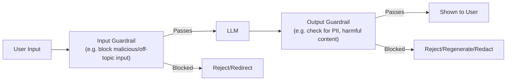

# Guardrails and Safety Controls

> Prompting a model to "never do X" is a request. A guardrail that blocks X regardless is a guarantee — production systems need the guarantee.

**Type:** Learn
**Prerequisites:** Observability and Tracing
**Time:** ~20 minutes

## Learning Objectives

- Explain what guardrails are and why they are a separate, enforced layer distinct from prompt instructions
- Recognize the two directions guardrails operate in: input guardrails and output guardrails
- Describe common guardrail categories: content safety, PII detection, topic restriction, and format validation
- Formulate the right questions when reviewing whether an AI feature has adequate safety controls

## What It Is

A **guardrail** is a separate, deterministic check, outside the model itself, that validates input before it reaches the model or output before it reaches the user. It enforces a rule regardless of what the model was prompted to do.

- **Input guardrails** check the user's request first: detecting prompt injection (attempts to override the system prompt), blocking off-topic or abusive requests, validating expected format.
- **Output guardrails** check the model's response before display: scanning for PII that should not be disclosed, checking for policy-violating content, validating that structured output (Level 4) matches its schema.

Common categories:

- **Content safety**: blocking harmful, offensive, or policy-violating content in either direction.
- **PII detection and redaction**: catching personal information (SSNs, card numbers) that should not appear in a response.
- **Topic/scope restriction**: keeping a specialized assistant (such as a support bot) from answering unrelated queries.
- **Format validation**: confirming structured output matches the required schema before it is used downstream.

## Why It Matters

A company's system prompt tells its customer-facing chatbot "never discuss competitor products or give financial advice." A user gets the model to do exactly that with a cleverly worded request. As the prompting lesson (Level 3) explained, a system prompt is a strong influence on behavior, not an unbreakable rule. The team's mistake was treating a prompt instruction as an enforced guarantee.

## How It Works

A system prompt instruction is just another input the model probabilistically weighs (Level 2). It strongly influences behavior but does not guarantee it, especially under adversarial inputs. A guardrail is a deterministic check that runs no matter what the model decided to output, so it provides enforcement the prompt cannot.

1. The user request arrives and passes through input guardrails.
2. If blocked, the user gets a polite rejection or redirect and the model is never called.
3. If it passes, the model generates a response.
4. The response passes through output guardrails.
5. If blocked, the system rejects, regenerates, or redacts. Otherwise the user sees it.

## Architecture and Workflow



```archify
src: diagrams/guardrails.html
title: Follow one request through every input and output check
aspect: 718/462
```

## A Real-World Example

A banking support bot has two rules: never give investment advice, and never reveal a Social Security number (SSN).

| Request | Guardrail action | What the user sees |
| :--- | :--- | :--- |
| "Which shares should I buy?" | Input guardrail detects an out-of-scope topic and blocks it; the model is never called | "I'm not able to help with that particular request." |
| "What is on my account?" | Input passes; the model's raw reply includes an SSN; the output guardrail pattern-matches it and redacts it | The reply with the SSN replaced by a redaction marker |

The second row is the key point. Even if the model was never told to avoid SSNs, or was tricked, the protection still holds because it does not depend on the model.

In real systems guardrails are layered: prompt injection detection (a real risk when RAG retrieves untrusted content, Level 5), PII scrubbing on both input and output (also keeping sensitive data out of traces and logs), and schema validation that rejects malformed structured output rather than passing it downstream.

## What a TPM Needs to Understand

- Treating a system prompt instruction as a guaranteed safety control is a common and risky mistake. Prompts influence probabilistically; guardrails enforce deterministically.
- Any feature with safety, compliance, or scope requirements needs an explicit guardrail layer in addition to prompt engineering, especially for anything a regulator, customer, or security review treats as a hard requirement.
- Every guardrail has a false-positive rate (blocking good requests) and a false-negative rate (missing bad ones). Both need owners and measurements.
- Guardrails add latency and a maintenance burden: rules must evolve as new attacks and policies appear.

## Risks, Dependencies, and Trade-Offs

| Enforcement Mechanism | Reliability | Implementation Effort | Best For |
| :--- | :--- | :--- | :--- |
| **Prompt instruction only** | Low-Moderate: probabilistic, can be bypassed | Very low | Soft preferences, non-critical guidance |
| **Input guardrails only** | Moderate: catches bad requests, but not bad outputs | Moderate | Preventing clearly out-of-scope or malicious requests |
| **Input + output guardrails** | High | Higher (checks on both sides) | Hard safety, compliance, or PII requirements |

Failure scenarios: keyword-based rules are bypassed by paraphrasing or disguised wording; over-aggressive rules block legitimate customers and drive complaints; an injected instruction hidden in a retrieved document is trusted because only user input was filtered; PII patterns miss unusual formats. Dependencies: a clear written policy of what is prohibited, plus monitoring of block rates so drift is noticed.

## Questions to Ask Engineers

1. *"For our stated safety/scope rules (e.g. 'never discuss X'), are these enforced by deterministic guardrails, or only by a prompt instruction the model might not always follow?"*
2. *"Do we have output guardrails checking for PII or policy-violating content before a response reaches the user, not just input-side filtering?"*
3. *"If a retrieved document (RAG) contains adversarial instructions embedded in its content, do our guardrails catch this, or does our system trust all input equally?"*

## Scenario Exercise

You are launching a customer-facing banking assistant in six weeks. Compliance requires that it never gives investment advice and never exposes SSNs or full account numbers.

1. **Easy**: A user asks the bot for stock tips. Describe what happens at each guardrail stage.
2. **Medium**: Explain in plain English why a guardrail is more reliable than a system prompt instruction for a hard rule like "never disclose SSNs."
3. **Hard**: For a coding assistant that must never suggest deleting a production database table, propose an output guardrail and explain how a cleverly disguised version of that action might slip past it. What metric would you track after launch?

## Key Terms

- **Guardrail**: A separate, deterministic check enforcing a rule on input or output, independent of what the model itself was prompted to do.
- **Input Guardrail**: A check applied to user input before it reaches the model, e.g. blocking off-topic or malicious requests.
- **Output Guardrail**: A check applied to a model's response before it reaches the user, e.g. redacting PII or validating format.
- **Prompt Injection**: An attempt to manipulate a model's behavior by embedding adversarial instructions in user input or retrieved content.
- **PII (Personally Identifiable Information)**: Sensitive personal data (e.g. SSNs, credit card numbers) that guardrails commonly detect and redact.
