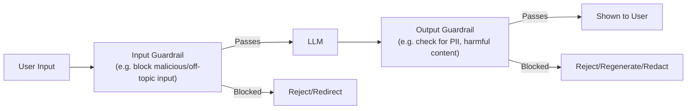

# Guardrails and Safety Controls

> Prompting a model to "never do X" is a request. A guardrail that blocks X regardless is a guarantee — production systems need the guarantee.

**Type:** Learn
**Languages:** Python
**Prerequisites:** Observability and Tracing
**Time:** ~30 minutes

## Learning Objectives

- Understand what guardrails are and why they're a separate, enforced layer distinct from prompt instructions
- Recognize the two directions guardrails operate in: input guardrails and output guardrails
- Understand common guardrail categories: content safety, PII detection, topic restriction, and format validation
- Formulate the right questions when reviewing whether an AI feature has adequate safety controls

## The Problem

A company's system prompt tells their customer-facing chatbot "never discuss competitor products or give financial advice." Despite this instruction, a user manages to get the model to do exactly that through a cleverly worded request — because, as covered in the prompting lesson (Level 3), a system prompt is a strong influence on behavior, not an unbreakable rule. The team's mistake was treating the prompt instruction as if it were an enforced guarantee.

## The Concept

A **guardrail** is a separate, deterministic check — outside the model itself — that validates input before it reaches the model or validates output before it reaches the user, enforcing a rule regardless of what the model was prompted to do.



### Input Guardrails vs. Output Guardrails

- **Input guardrails**: check the user's request before it ever reaches the model — e.g. detecting attempts to manipulate the system prompt ("prompt injection"), blocking clearly off-topic or abusive requests, or validating expected input format.
- **Output guardrails**: check the model's response before showing it to the user — e.g. scanning for personally identifiable information (PII) that shouldn't be disclosed, checking for policy-violating content, or validating that a structured output (Level 4) actually matches its expected schema.

### Why Guardrails Are Separate From the Prompt

A system prompt instruction is itself just another input the model probabilistically weighs (Level 2) — it strongly influences behavior but doesn't guarantee it, especially under adversarial or unusual inputs. A guardrail is deterministic code that runs regardless of what the model decided to output, providing an enforcement layer the prompt alone cannot.

### Common Guardrail Categories

- **Content safety**: blocking harmful, offensive, or policy-violating content in either direction.
- **PII detection and redaction**: catching and removing personal information (SSNs, credit card numbers) that shouldn't appear in a response.
- **Topic/scope restriction**: keeping a specialized assistant (e.g. a support bot) from answering entirely unrelated queries.
- **Format validation**: confirming structured output actually matches the required schema (Level 4) before it's used downstream.

## Build It

A simplified guardrail layer wrapping a model call with both input and output checks:

```python
import re

def input_guardrail(user_message):
    off_topic_keywords = ["stock advice", "medical diagnosis", "legal advice"]
    for keyword in off_topic_keywords:
        if keyword in user_message.lower():
            return False, f"Blocked: input requests out-of-scope topic ('{keyword}')"
    return True, None

def output_guardrail(model_response):
    ssn_pattern = r"\b\d{3}-\d{2}-\d{4}\b"
    if re.search(ssn_pattern, model_response):
        redacted = re.sub(ssn_pattern, "[REDACTED-SSN]", model_response)
        return redacted, "Output redacted: SSN pattern detected"
    return model_response, None

def fake_model_call(user_message):
    if "account" in user_message.lower():
        return "Your account number is 4821-9910, and your SSN on file is 123-45-6789."
    return "I can help you with that request."

def handle_request(user_message):
    passed, block_reason = input_guardrail(user_message)
    if not passed:
        print(f"[INPUT GUARDRAIL] {block_reason}")
        return "I'm not able to help with that particular request."

    raw_response = fake_model_call(user_message)
    final_response, redaction_note = output_guardrail(raw_response)
    if redaction_note:
        print(f"[OUTPUT GUARDRAIL] {redaction_note}")

    return final_response

print("Request 1 (off-topic):")
print(f"  Response: {handle_request('Can you give me stock advice on which shares to buy?')}\n")

print("Request 2 (contains PII in model's raw response):")
print(f"  Response: {handle_request('what is on my account?')}")
```

Notice that even though the fake model's raw response contained a real SSN pattern, the output guardrail caught and redacted it before it reached the user — a protection that exists regardless of what the model was prompted (or not prompted) to avoid.

## Use It

Real production AI systems layer guardrails as a standard, expected component:

- **Prompt injection detection**: catching attempts to override a system prompt's instructions embedded within user input or retrieved documents (a real risk when RAG retrieves untrusted content, from Level 5).
- **PII scrubbing on both input and output**: preventing sensitive data from entering logs/traces (previous lesson) or reaching end users inappropriately.
- **Schema validation as a guardrail**: rejecting a structured output (Level 4) that fails schema validation, rather than passing malformed data downstream.

## Exercises

1. **Easy**: In the code above, what happens when a user asks a request containing the word "stock advice"?
2. **Medium**: Explain in plain English why a guardrail is considered more reliable than a system prompt instruction for enforcing a hard rule like "never disclose SSNs."
3. **Hard**: Propose an output guardrail for a coding assistant that should never suggest deleting a production database table — what would it check, and how might it fail to catch a cleverly disguised version of that action?

## TPM Perspective

### Strategic Executive Summary
Treating a system prompt instruction as a guaranteed safety control is a common and risky mistake — prompts influence behavior probabilistically, while guardrails enforce it deterministically. Any AI feature with real safety, compliance, or scope requirements needs an explicit guardrail layer, separate from and in addition to prompt engineering, especially for anything a regulator, a customer, or a security review would treat as a hard requirement.

### Questions to Challenge Engineering
1. *"For our stated safety/scope rules (e.g. 'never discuss X'), are these enforced by deterministic guardrails, or only by a prompt instruction the model might not always follow?"*
2. *"Do we have output guardrails checking for PII or policy-violating content before a response reaches the user, not just input-side filtering?"*
3. *"If a retrieved document (RAG) contains adversarial instructions embedded in its content, do our guardrails catch this, or does our system trust all input equally?"*

### Trade-Off Matrix

| Enforcement Mechanism | Reliability | Implementation Effort | Best For |
| :--- | :--- | :--- | :--- |
| **Prompt instruction only** | Low-Moderate — probabilistic, can be bypassed | Very low | Soft preferences, non-critical guidance |
| **Input guardrails only** | Moderate — catches bad requests, but not bad outputs | Moderate | Preventing clearly out-of-scope or malicious requests |
| **Input + output guardrails** | High | Higher (checks on both sides) | Hard safety, compliance, or PII requirements |

## Key Terms

- **Guardrail**: A separate, deterministic check enforcing a rule on input or output, independent of what the model itself was prompted to do.
- **Input Guardrail**: A check applied to user input before it reaches the model, e.g. blocking off-topic or malicious requests.
- **Output Guardrail**: A check applied to a model's response before it reaches the user, e.g. redacting PII or validating format.
- **Prompt Injection**: An attempt to manipulate a model's behavior by embedding adversarial instructions in user input or retrieved content.
- **PII (Personally Identifiable Information)**: Sensitive personal data (e.g. SSNs, credit card numbers) that guardrails commonly detect and redact.
