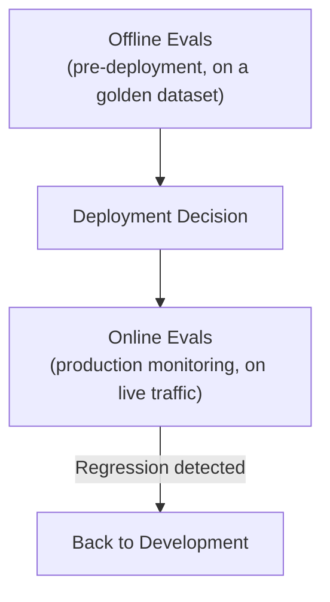

# Evals in Production

> An eval suite is a test suite (Level 1) for a system that doesn't always give the same answer twice — which is exactly why you need one.

**Type:** Learn
**Prerequisites:** Guardrails and Safety Controls
**Time:** ~20 minutes

## Learning Objectives

- Explain what an "eval" is in the LLM context and how it extends traditional software testing
- Distinguish offline evals (pre-deployment) from online evals (production monitoring)
- Describe common eval approaches: golden datasets, LLM-as-judge, and human review
- Formulate the right questions when reviewing whether a team can confidently say a prompt/model change improved or regressed quality

## What It Is

**Evals** (evaluations) are the LLM-specific evolution of automated testing (Level 1). Because LLM outputs are non-deterministic (Level 2) and often open-ended, evals need different techniques than a traditional exact-match check.

- **Offline evals** run before deployment against a **golden dataset**: a curated set of representative inputs paired with a known-good answer or clear scoring criteria. They measure whether a candidate prompt or model change improved, stayed flat, or regressed compared to production.
- **Online evals** sample and score actual production traffic continuously, catching issues the golden dataset did not anticipate.

How do you score an open-ended answer?

- **Exact match / rule-based scoring**: works for structured outputs (Level 4) with clear correctness criteria, such as "must mention a 30-day window and a receipt."
- **LLM-as-judge**: a separate LLM scores responses against defined criteria (helpfulness, faithfulness). It scales far better than manual review but is itself imperfect and must be periodically validated against humans.
- **Human review**: most reliable, least scalable. Used on samples and to validate the LLM judge.

## Why It Matters

A team changes its system prompt and someone asks "did this make things better or worse?" The honest answer is "we're not sure." There is no golden dataset, no consistent scoring, and no before/after comparison. Every change is a judgment call based on a few spot checks, the AI equivalent of shipping code with no test suite.

## How It Works

1. Build a golden dataset of representative queries with expected content or criteria.
2. Run the current production prompt and the candidate prompt against the whole dataset.
3. Score each response and average the scores per version.
4. Compare: ship, fix, or reject based on the gap and on any individually failing cases.
5. After release, sample live traffic with online evals and feed regressions back to development.
6. Add newly discovered failure cases to the golden dataset.

## Architecture and Workflow



```archify
src: diagrams/offline-online-evals.html
title: Offline evals, deployment decision, and online evals
aspect: 1000/362
```

## A Real-World Example

A retail support bot has a three-case golden dataset, each scored by the share of required facts mentioned:

| Query | Required facts | Prompt v1 score | Prompt v2 score |
| :--- | :--- | :--- | :--- |
| What is your return policy? | "30 days", "receipt" | 0.00 ("We accept returns.") | 1.00 |
| Refunds on digital downloads? | "final sale", "no refunds" | 1.00 | 1.00 |
| Exception for a damaged product? | "manager", "approval" | 0.00 ("Contact support.") | 1.00 |
| **Average** | | **0.33** | **1.00** |

The return-policy query shows the clearest improvement: v1 gave a vague answer with neither required fact. This is a concrete, repeatable answer to "did the change help," exactly what the opening scenario's team lacked. Real suites have hundreds of cases, and teams typically set a gate, for example "average at least 0.90 and no drop of more than 2 points on any category."

Mature teams treat evals as a required gate: every prompt or model change runs against the golden dataset before deployment, online evals feed quality dashboards (LLMOps lesson), and the dataset is actively maintained as new failure modes appear.

## What a TPM Needs to Understand

- Without evals, every change ships on faith. "It looked fine on a few examples" is not a measurement.
- A golden dataset plus a repeatable scoring method turns "better or worse" from an opinion into a number tracked over time.
- The dataset is a living asset that needs an owner and a refresh cadence. A stale dataset gives false confidence.
- Offline and online evals answer different questions: "is this change safe to ship" versus "is production still healthy."

## Risks, Dependencies, and Trade-Offs

| Eval Approach | Scalability | Accuracy | Setup Effort |
| :--- | :--- | :--- | :--- |
| **No formal evals (spot-checking)** | High (fast, easy) | Low: subjective, inconsistent | None |
| **Golden dataset + rule-based scoring** | High | Good for structured/well-defined tasks | Moderate |
| **Golden dataset + LLM-as-judge** | High | Good for open-ended tasks, needs periodic validation | Moderate |
| **Human review** | Low: doesn't scale | Highest | High (ongoing reviewer time) |

Failure scenarios: the golden dataset is too small or unrepresentative, so a change passes offline and fails in production; the LLM judge shares the same blind spots as the model being judged; the team optimizes the prompt against the dataset until it overfits; scores average out and hide a serious regression in one customer segment. Dependencies: dataset ownership, reviewer time, and compute budget for running evals on every change.

## Questions to Ask Engineers

1. *"Do we have a golden dataset and repeatable scoring method to measure whether a prompt or model change improved or regressed quality, before it ships?"*
2. *"Are we running online evals on live production traffic to catch regressions that our golden dataset didn't anticipate?"*
3. *"If we're using LLM-as-judge scoring, have we validated it against human review periodically to confirm it's actually measuring what we think it's measuring?"*

## Scenario Exercise

Your team wants to ship a new prompt for the refund bot on Friday. Engineering says "it looks better in our tests."

1. **Easy**: In the retail example above, which query showed the clearest quality improvement between v1 and v2, and why?
2. **Medium**: Explain in plain English why LLM-as-judge scoring, despite being imperfect, is often more practical than pure human review for evaluating production traffic at scale.
3. **Hard**: Propose three golden dataset cases designed to catch a regression in how the bot handles refund policy exceptions, and define a release gate (pass rate and what blocks the launch).

## Key Terms

- **Eval (Evaluation)**: The LLM-specific practice of measuring output quality, extending traditional automated testing to handle non-deterministic, open-ended outputs.
- **Golden Dataset**: A curated set of representative inputs with known-good expected outputs or scoring criteria, used for repeatable pre-deployment evaluation.
- **Offline Eval**: Running evaluation against a golden dataset before deployment, to compare a candidate change against the current production version.
- **Online Eval**: Continuously sampling and scoring live production traffic to catch quality regressions that a golden dataset didn't anticipate.
- **LLM-as-Judge**: Using a separate LLM call to automatically score a response against defined quality criteria, at a scale manual review can't match.
