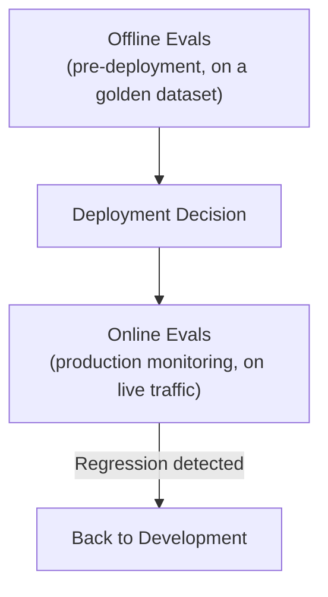

# Evals in Production

> An eval suite is a test suite (Level 1) for a system that doesn't always give the same answer twice — which is exactly why you need one.

**Type:** Learn
**Languages:** Python
**Prerequisites:** Guardrails and Safety Controls
**Time:** ~30 minutes

## Learning Objectives

- Understand what an "eval" is in the LLM context and how it extends traditional software testing
- Recognize the difference between offline evals (pre-deployment) and online evals (production monitoring)
- Understand common eval approaches: golden datasets, LLM-as-judge, and human review
- Formulate the right questions when reviewing whether a team can confidently say a prompt/model change improved or regressed quality

## The Problem

A team changes their system prompt, and someone asks "did this make things better or worse?" The honest answer is "we're not sure" — there's no golden dataset of representative queries, no consistent scoring method, and no before/after comparison. Without an evaluation process, every prompt or model change is a judgment call based on a few spot checks, not a measured, comparable result — the AI equivalent of shipping code changes with no test suite (Level 1).

## The Concept

**Evals** (evaluations) are the LLM-specific evolution of automated testing (Level 1) — but because LLM outputs are non-deterministic (Level 2) and often open-ended (not simply right/wrong), evals need different techniques than a traditional `assert result == expected_value`.



### Offline Evals: Testing Before Deployment

A **golden dataset** is a curated set of representative inputs paired with either a known-good expected output or clear scoring criteria — run against a candidate prompt or model change before deploying it, to measure whether quality improved, stayed flat, or regressed, compared to the current production version.

### Online Evals: Monitoring Live Traffic

Since a golden dataset can't cover every real-world input, **online evals** sample and score actual production traffic continuously — catching quality issues that only appear with real, unpredictable user inputs the golden dataset didn't anticipate.

### Scoring Methods: How Do You Score an Open-Ended Answer?

- **Exact match / rule-based scoring**: works well for structured outputs (Level 4) with clear correctness criteria (e.g. did it return valid JSON matching the schema).
- **LLM-as-judge**: using a separate LLM call to score a response against defined criteria (helpfulness, faithfulness, from the RAG evaluation lesson) — scales far better than manual review, though it's itself an imperfect, probabilistic judge worth periodically validating against human review.
- **Human review**: the most reliable but least scalable method, typically reserved for a sample of cases or for validating that LLM-as-judge scoring is itself trustworthy.

## Build It

A simplified offline eval comparing two prompt versions against a golden dataset:

```python
golden_dataset = [
    {"query": "What is your return policy?", "must_mention": ["30 days", "receipt"]},
    {"query": "Do you offer refunds on digital downloads?", "must_mention": ["final sale", "no refunds"]},
    {"query": "Can I get an exception for a damaged product?", "must_mention": ["manager", "approval"]},
]

def fake_model_call(query, prompt_version):
    responses_v1 = {
        "What is your return policy?": "We accept returns.",
        "Do you offer refunds on digital downloads?": "Digital downloads are final sale, no refunds.",
        "Can I get an exception for a damaged product?": "Contact support.",
    }
    responses_v2 = {
        "What is your return policy?": "Returns are accepted within 30 days with a receipt.",
        "Do you offer refunds on digital downloads?": "Digital downloads are final sale, no refunds.",
        "Can I get an exception for a damaged product?": "Yes, with manager approval, exceptions can be made.",
    }
    return (responses_v1 if prompt_version == "v1" else responses_v2)[query]

def score_response(response, must_mention):
    response_lower = response.lower()
    mentioned = [term for term in must_mention if term.lower() in response_lower]
    return len(mentioned) / len(must_mention)

def run_eval(prompt_version):
    scores = []
    for case in golden_dataset:
        response = fake_model_call(case["query"], prompt_version)
        score = score_response(response, case["must_mention"])
        scores.append(score)
        print(f"  [{prompt_version}] '{case['query'][:40]}...' -> score {score:.2f}")
    average = sum(scores) / len(scores)
    print(f"  Average score for {prompt_version}: {average:.2f}\n")
    return average

print("Evaluating Prompt v1:")
score_v1 = run_eval("v1")

print("Evaluating Prompt v2:")
score_v2 = run_eval("v2")

print(f"Result: v2 {'improved' if score_v2 > score_v1 else 'did not improve'} on the golden dataset "
      f"({score_v1:.2f} -> {score_v2:.2f})")
```

This gives a concrete, repeatable, comparable answer to "did this change make things better" — exactly the kind of measurement the opening scenario's team lacked.

## Use It

Mature AI teams treat evals as a required gate, not an optional nicety:

- **Every prompt/model change runs against the golden dataset** before deployment, similar to how code changes run against a test suite before merging (Level 1).
- **Online evals sample live traffic continuously**, feeding into the quality monitoring dashboards from the LLMOps lesson.
- **Golden datasets are actively maintained**, adding new representative cases as new failure modes are discovered in production — an evolving asset, not a one-time setup task.

## Exercises

1. **Easy**: In the code above, which specific query showed the clearest quality improvement between v1 and v2, and why?
2. **Medium**: Explain in plain English why LLM-as-judge scoring, despite being imperfect, is often more practical than pure human review for evaluating production traffic at scale.
3. **Hard**: Propose three golden dataset test cases you'd add for a customer support bot, specifically designed to catch a regression in how it handles refund policy exceptions.

## TPM Perspective

### Strategic Executive Summary
Without an eval process, every prompt or model change is shipped on faith — "it looked fine when I tried a few examples" is not a measurement, and it doesn't scale to catching subtle regressions. A golden dataset plus a repeatable scoring method turns "did this change help or hurt" from an opinion into a number that can be tracked over time and compared before every deployment, exactly mirroring the discipline traditional software applies via automated testing (Level 1).

### Questions to Challenge Engineering
1. *"Do we have a golden dataset and repeatable scoring method to measure whether a prompt or model change improved or regressed quality, before it ships?"*
2. *"Are we running online evals on live production traffic to catch regressions that our golden dataset didn't anticipate?"*
3. *"If we're using LLM-as-judge scoring, have we validated it against human review periodically to confirm it's actually measuring what we think it's measuring?"*

### Trade-Off Matrix

| Eval Approach | Scalability | Accuracy | Setup Effort |
| :--- | :--- | :--- | :--- |
| **No formal evals (spot-checking)** | High (fast, easy) | Low — subjective, inconsistent | None |
| **Golden dataset + rule-based scoring** | High | Good for structured/well-defined tasks | Moderate |
| **Golden dataset + LLM-as-judge** | High | Good for open-ended tasks, needs periodic validation | Moderate |
| **Human review** | Low — doesn't scale | Highest | High (ongoing reviewer time) |

## Key Terms

- **Eval (Evaluation)**: The LLM-specific practice of measuring output quality, extending traditional automated testing to handle non-deterministic, open-ended outputs.
- **Golden Dataset**: A curated set of representative inputs with known-good expected outputs or scoring criteria, used for repeatable pre-deployment evaluation.
- **Offline Eval**: Running evaluation against a golden dataset before deployment, to compare a candidate change against the current production version.
- **Online Eval**: Continuously sampling and scoring live production traffic to catch quality regressions that a golden dataset didn't anticipate.
- **LLM-as-Judge**: Using a separate LLM call to automatically score a response against defined quality criteria, at a scale manual review can't match.
