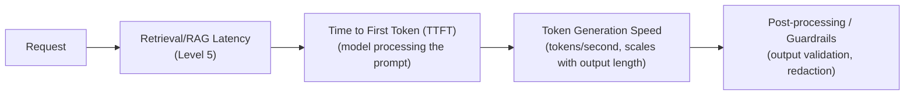

# Latency Optimization

> "Make it faster" is not one lever — it's at least five different levers, and the right one depends entirely on where the time is actually going.

**Type:** Learn
**Prerequisites:** Evals in Production
**Time:** ~20 minutes

## Learning Objectives

- Identify the main sources of latency in an LLM application: time to first token, generation speed, and pipeline overhead
- Match concrete optimization levers to each source, drawing on concepts from earlier levels
- Explain why optimizing the wrong stage wastes engineering effort without improving perceived speed
- Formulate the right questions when a team proposes a latency fix without first measuring where time is spent

## What It Is

Latency in an LLM application comes from several distinct sources, each needing a different fix. That is why tracing (this level's second lesson) is the prerequisite to optimizing correctly.

- **Time to First Token (TTFT)**: the delay between sending a request and receiving the first generated token. It is dominated by how long the model takes to process the input prompt, which connects to attention's quadratic scaling (Level 3): longer prompts and context mean higher TTFT.
- **Token generation speed**: once generation starts, tokens stream out at a rate influenced by model size, hardware, and whether output is streamed incrementally or returned all at once.
- **Pipeline overhead**: every step around the model call, such as retrieval and reranking (Level 5), guardrail checks (previous lesson), or multi-step agent loops (Level 6), adds its own latency. A slow stage can dominate even if the model is fast.

## Why It Matters

Users complain a chatbot feels slow. The team's first instinct is "switch to a faster, smaller model." After the change, the feature is barely faster, because the real bottleneck was a slow RAG retrieval step (Level 5) that runs before the model is ever called. Model generation was a small fraction of total latency. Without measuring where time goes, latency work becomes a guessing game and engineering effort is wasted.

## How It Works

Matching the lever to the root cause:

1. **Measure**: use per-span timings from tracing to break total latency down by stage.
2. **Identify the dominant stage**: the biggest share is the biggest lever.
3. **Choose a fix that targets that stage**: see the table below.
4. **Re-measure**: confirm the change moved the number users feel, and that quality did not regress (run the evals).

| Root cause | Typical fix |
| :--- | :--- |
| High TTFT from long prompts | Trim unnecessary context, use RAG to retrieve only relevant content instead of stuffing everything in (Level 5), or use prompt caching (Level 0) for repeated prefixes |
| Slow token generation | Use a smaller or faster model where quality allows, or stream output so users see partial results immediately |
| Slow retrieval or pipeline steps | Optimize similarity search (Level 5's ANN discussion), cut unnecessary reranking, or run independent steps in parallel (Level 1's async programming) |

## Architecture and Workflow



```archify
src: diagrams/latency-pipeline.html
title: Where latency accrues across an AI request
aspect: 940/312
```

## A Real-World Example

A chatbot pipeline is measured with traces:

| Stage | Time | Share of total |
| :--- | :--- | :--- |
| Retrieval | 800 ms | 67% |
| Model call | 300 ms | 25% |
| Guardrail check | 100 ms | 8% |
| **Total** | **1,200 ms** | 100% |

Retrieval is the biggest lever. Swapping to a model twice as fast would save at most 150 ms (about 12%), while halving retrieval time saves 400 ms (about 33%). This is exactly what the opening scenario's team skipped: measuring first reveals that "switch to a faster model" was never going to help much.

Other measurement-first practices: streaming responses (dramatically improves perceived speed even when total generation time is unchanged), and caching results for repeated or similar queries to avoid redundant work.

## What a TPM Needs to Understand

- "Make it faster" without a measured breakdown risks optimizing the wrong stage. Insist on a trace-based latency breakdown before approving an optimization effort.
- Total latency and perceived latency are different problems. Streaming is a UX-level lever that improves perception without changing the pipeline.
- Most latency fixes trade against quality or cost: a smaller model may regress quality, caching may serve stale answers.
- Set latency targets as budgets per stage (for example, a 2-second end-to-end budget split across retrieval, model, and guardrails) so trade-offs are explicit.

## Risks, Dependencies, and Trade-Offs

| Optimization Lever | Addresses | Effort | Risk |
| :--- | :--- | :--- | :--- |
| **Switch to a smaller/faster model** | Token generation speed | Moderate (requires quality validation) | Possible quality regression |
| **Trim/optimize prompt and context (RAG, caching)** | Time to First Token | Moderate | Low, if done carefully |
| **Stream responses to the user** | Perceived speed, not total time | Low-Moderate (UI/engineering work) | Low |
| **Optimize retrieval/pipeline steps** | Pipeline overhead | Varies (depends on specific bottleneck) | Low, if correctly targeted via tracing |

Failure scenarios: a model swap ships without evals and quietly lowers answer quality; a cache returns outdated policy information; removing a guardrail to save 100 ms reintroduces a safety gap; high TTFT appears only on long conversations and is missed because tests use short ones. Dependencies: tracing in place, an eval suite to verify quality after each change, and UI work for streaming.

## Questions to Ask Engineers

1. *"Do we have a latency breakdown by pipeline stage (retrieval, model call, guardrails, etc.), or are we guessing at where the bottleneck is?"*
2. *"Is this a total-latency problem or a perceived-latency problem — would streaming the response meaningfully improve user experience even without reducing total generation time?"*
3. *"For the specific bottleneck identified, is the proposed fix actually targeting that stage, or is it a generic fix (like 'use a faster model') that may not address the real cause?"*

## Scenario Exercise

Your support chatbot's median response time is 4.5 seconds against a 3-second target. A senior engineer proposes migrating to a smaller model, a six-week effort.

1. **Easy**: In the 1,200 ms breakdown above, which stage is the biggest contributor, and would a faster model meaningfully help?
2. **Medium**: Explain in plain English why streaming a response token by token can make a feature feel faster even if total generation time is unchanged.
3. **Hard**: The chatbot has high TTFT specifically in long conversations. Propose two distinct fixes, one drawing on Level 0 (context and caching) and one on Level 5 (retrieval), and say what quality check you would require before shipping either.

## Key Terms

- **Time to First Token (TTFT)**: The delay between sending a request and receiving the first generated token, dominated by prompt processing time.
- **Token Generation Speed**: The rate at which tokens stream out once generation begins, influenced by model size and hardware.
- **Pipeline Overhead**: Latency contributed by non-model steps in a request's path, such as retrieval, reranking, or guardrail checks.
- **Perceived Latency**: How fast a feature feels to a user, which can be improved (e.g. via streaming) independently of total processing time.
- **Trace-Driven Optimization**: Using per-step latency measurements from tracing to identify and target the actual bottleneck before optimizing.
