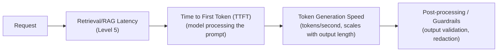

# Latency Optimization

> "Make it faster" is not one lever — it's at least five different levers, and the right one depends entirely on where the time is actually going.

**Type:** Learn
**Languages:** Python, Concept
**Prerequisites:** Evals in Production
**Time:** ~30 minutes

## Learning Objectives

- Understand the main sources of latency in an LLM application: time to first token, generation speed, and pipeline overhead
- Recognize concrete optimization levers for each source, drawing on concepts from across earlier levels
- Understand why optimizing the wrong stage wastes engineering effort without improving perceived speed
- Formulate the right questions when a team proposes a latency fix without first measuring where time is spent

## The Problem

Users complain a chatbot feels slow. The team's first instinct is "switch to a faster, smaller model." After making the change, the feature is barely faster, because the actual bottleneck was a slow RAG retrieval step (Level 5) running before the model was ever called — the model's own generation time was a small fraction of the total latency. Without measuring where time is actually spent (using the tracing tools from earlier in this level), latency optimization becomes a guessing game.

## The Concept

Latency in an LLM application comes from several distinct sources, each requiring a different fix — exactly why tracing (from this level's second lesson) is the prerequisite to optimizing latency correctly, not guessing at it.



### Time to First Token (TTFT)

The delay between sending a request and receiving the very first generated token — dominated by how long the model takes to process the input prompt, which connects directly to the attention mechanism's quadratic scaling (Level 3): longer prompts and context mean higher TTFT.

### Token Generation Speed

Once generation starts, tokens stream out at a certain rate — influenced by model size, hardware, and whether the response is streamed to the user incrementally (perceived as faster) versus returned all at once after full generation completes.

### Pipeline Overhead

Any additional steps around the model call itself — retrieval (Level 5), reranking (Level 5), guardrail checks (previous lesson), or multi-step agent loops (Level 6) — each add their own latency, and a slow pipeline stage can dominate total latency even if the model itself is fast.

### Concrete Optimization Levers, Matched to Root Cause

- **High TTFT from long prompts**: trim unnecessary context, use RAG to retrieve only relevant content instead of stuffing everything into context (Level 5), or use prompt caching (Level 0) for repeated prefixes.
- **Slow token generation**: use a smaller/faster model where quality allows, or stream output so users see partial results immediately rather than waiting for the full response.
- **Slow retrieval/pipeline steps**: optimize similarity search (Level 5's ANN discussion), reduce unnecessary reranking overhead, or parallelize independent steps (Level 1's async programming).

## Build It

A simplified latency breakdown, showing why measuring first matters before optimizing:

```python
import time

def simulate_retrieval():
    time.sleep(0.8)
    return "retrieved context"

def simulate_model_call(context):
    time.sleep(0.3)
    return "generated answer"

def simulate_guardrail_check(answer):
    time.sleep(0.1)
    return answer

def run_pipeline_with_timing():
    timings = {}

    start = time.perf_counter()
    context = simulate_retrieval()
    timings["retrieval"] = time.perf_counter() - start

    start = time.perf_counter()
    answer = simulate_model_call(context)
    timings["model_call"] = time.perf_counter() - start

    start = time.perf_counter()
    final_answer = simulate_guardrail_check(answer)
    timings["guardrail_check"] = time.perf_counter() - start

    total = sum(timings.values())
    print("Latency breakdown:")
    for stage, duration in timings.items():
        percentage = (duration / total) * 100
        print(f"  {stage:20s}: {duration*1000:6.0f}ms ({percentage:.0f}% of total)")
    print(f"  {'TOTAL':20s}: {total*1000:6.0f}ms")

    bottleneck = max(timings, key=timings.get)
    print(f"\nBiggest lever: optimizing '{bottleneck}' would have the largest impact on total latency.")

run_pipeline_with_timing()
```

This makes explicit what the opening scenario's team skipped: measuring first reveals that retrieval, not the model call, is the dominant cost — meaning "switch to a faster model" was never going to meaningfully help, no matter how much faster the new model actually was.

## Use It

Real production teams treat latency optimization as measurement-first, not intuition-first:

- **Trace-driven optimization**: using the per-span latency data from tracing (previous lesson) to identify the actual bottleneck before choosing a fix.
- **Streaming responses**: showing partial output as it generates, dramatically improving *perceived* speed even when total generation time is unchanged — a UX-level lever independent of the underlying pipeline's actual speed.
- **Caching**: reusing previous retrieval or generation results for repeated or similar queries, avoiding redundant work entirely for cacheable cases.

## Exercises

1. **Easy**: In the code above, which stage is the biggest latency contributor, and would switching to a faster model meaningfully help here?
2. **Medium**: Explain in plain English why streaming a response token-by-token can make a feature feel faster even if the total time to generate the full response is unchanged.
3. **Hard**: A team's chatbot has high TTFT specifically for long conversations. Propose two distinct fixes drawing on concepts from Level 0 (context/caching) and Level 5 (retrieval) respectively.

## TPM Perspective

### Strategic Executive Summary
"Make it faster" without first measuring where time is actually spent risks optimizing the wrong stage entirely — exactly what happened in the opening scenario, where a model swap didn't help because the real bottleneck was retrieval. Insisting on a trace-based latency breakdown before approving an optimization effort ensures engineering time is spent on the change that will actually move the needle.

### Questions to Challenge Engineering
1. *"Do we have a latency breakdown by pipeline stage (retrieval, model call, guardrails, etc.), or are we guessing at where the bottleneck is?"*
2. *"Is this a total-latency problem or a perceived-latency problem — would streaming the response meaningfully improve user experience even without reducing total generation time?"*
3. *"For the specific bottleneck identified, is the proposed fix actually targeting that stage, or is it a generic fix (like 'use a faster model') that may not address the real cause?"*

### Trade-Off Matrix

| Optimization Lever | Addresses | Effort | Risk |
| :--- | :--- | :--- | :--- |
| **Switch to a smaller/faster model** | Token generation speed | Moderate (requires quality validation) | Possible quality regression |
| **Trim/optimize prompt and context (RAG, caching)** | Time to First Token | Moderate | Low, if done carefully |
| **Stream responses to the user** | Perceived speed, not total time | Low-Moderate (UI/engineering work) | Low |
| **Optimize retrieval/pipeline steps** | Pipeline overhead | Varies (depends on specific bottleneck) | Low, if correctly targeted via tracing |

## Key Terms

- **Time to First Token (TTFT)**: The delay between sending a request and receiving the first generated token, dominated by prompt processing time.
- **Token Generation Speed**: The rate at which tokens stream out once generation begins, influenced by model size and hardware.
- **Pipeline Overhead**: Latency contributed by non-model steps in a request's path, such as retrieval, reranking, or guardrail checks.
- **Perceived Latency**: How fast a feature feels to a user, which can be improved (e.g. via streaming) independently of total processing time.
- **Trace-Driven Optimization**: Using per-step latency measurements from tracing to identify and target the actual bottleneck before optimizing.
