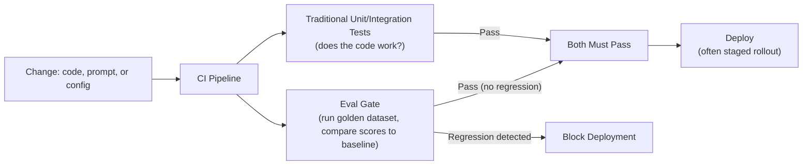

# CI/CD for AI Systems

> A traditional CI/CD pipeline checks "does the code still work." An AI pipeline also has to check "does the output still sound right."

**Type:** Learn
**Prerequisites:** Latency Optimization
**Time:** ~20 minutes

## Learning Objectives

- Explain how CI/CD for AI systems extends traditional CI/CD (Level 1) with eval gates
- Recognize what needs to be versioned and tested beyond code: prompts, model versions, and golden datasets
- Explain why a "green" traditional CI pipeline doesn't guarantee an AI feature is safe to deploy
- Formulate the right questions when reviewing an AI team's deployment pipeline and rollback readiness

## What It Is

CI/CD for AI systems takes the traditional pipeline (Level 1: automated tests, code review, automated deployment) and adds an AI-specific gate: **eval-based quality checks** run automatically alongside traditional tests.

What must be versioned beyond code:

- **Prompts**: version-controlled like code, so a prompt change is a reviewable, revertible artifact rather than an unstructured edit made in a dashboard.
- **Model versions**: explicitly tracked and pinned where possible, since a provider update can shift behavior even without a visible version change.
- **Golden datasets**: versioned alongside the system, since the dataset grows as new failure modes appear (previous evals lesson) and old results must be comparable to a specific dataset version.

The **eval gate** runs a candidate prompt, model, or retrieval change against the golden dataset, compares scores to the current production baseline, and blocks deployment if quality regresses beyond an agreed threshold, the same way a failing unit test blocks a code change.

## Why It Matters

A team's pipeline runs unit tests, passes, and auto-deploys a prompt change straight to production. The unit tests check that the code calls the API and parses the response correctly. Nothing checks whether the new prompt's *actual output quality* regressed. The deployment is "green" by every traditional measure while shipping a real regression to every user.

## How It Works

1. A change (code, prompt, or config) is committed and reviewed.
2. Traditional unit and integration tests run: does the code work?
3. The eval gate runs the golden dataset and compares scores to the production baseline: does the output still sound right?
4. Both gates must pass. A regression beyond the threshold blocks deployment.
5. Approved changes deploy as a staged rollout, a small percentage of traffic first, expanding gradually.
6. Online evals watch the rollout, and a regression triggers rollback.

Staged rollouts matter even more for AI than for code because non-deterministic outputs add uncertainty. They catch regressions that slipped past the eval gate before they reach everyone.

## Architecture and Workflow



```archify
src: diagrams/cicd-ai.html
title: Follow a prompt change through the eval gate, and see what blocks it
aspect: 718/421
```

## A Real-World Example

A prompt change for a support bot goes through the pipeline. All 12 unit tests pass. The eval gate then compares per-query scores to the baseline, with a regression threshold of 0.05:

| Golden dataset query | Baseline | Candidate | Verdict |
| :--- | :--- | :--- | :--- |
| Return policy | 0.90 | 0.91 | Fine (slight gain) |
| Refund exception | 0.85 | 0.60 | Regression of 0.25, exceeds threshold |
| Store hours | 0.95 | 0.94 | Fine (within threshold) |

Result: deployment blocked despite passing unit tests. The eval gate caught the refund-exception regression that traditional testing was never designed to see, the exact gap in the opening scenario. Had it passed, the change would roll out to a small slice of traffic (for example 5%, then 25%, then 100%) with online evals watching each step.

Mature organizations run eval gates on every prompt, model, or retrieval change (not just code), keep prompts in the same repository with the same review process, and use canary rollouts with automated monitoring.

## What a TPM Needs to Understand

- A "green" pipeline is not evidence an AI feature is safe unless it includes an eval gate. Traditional tests check that code works, not that quality is acceptable.
- Prompts and model versions carry the same regression risk as code, so they need the same version control, review, and staged rollout.
- Gate thresholds are a product decision: too strict blocks every release, too loose lets regressions through. Someone must own them.
- Rollback readiness is part of release readiness: know how to revert a prompt or model in minutes before the launch, not during the incident.

## Risks, Dependencies, and Trade-Offs

| CI/CD Maturity Level | Catches Code Bugs | Catches Quality Regressions | Deployment Risk |
| :--- | :--- | :--- | :--- |
| **Traditional CI/CD only (no eval gate)** | Yes | No | High: quality regressions ship silently |
| **CI/CD + eval gate, full rollout** | Yes | Yes | Moderate: regressions caught before full deploy but no staged safety net |
| **CI/CD + eval gate + staged rollout** | Yes | Yes | Low: additional safety net catches regressions the eval gate missed |

Failure scenarios: someone edits a prompt directly in production, bypassing the pipeline; a provider silently updates an unpinned model and the eval gate never runs because no code changed; the gate passes because the golden dataset is stale; a regression is detected at 20% rollout but no one has rehearsed the rollback. Dependencies: a maintained golden dataset, a quality baseline, pinned model versions, and online monitoring during rollout.

## Questions to Ask Engineers

1. *"Does our CI/CD pipeline include an eval gate comparing candidate quality scores to a production baseline, or does 'green' only mean traditional tests passed?"*
2. *"Are prompt and model version changes version-controlled and code-reviewed the same way code changes are, or can they be edited directly in production without that process?"*
3. *"What's our rollback plan if a quality regression is detected mid-rollout, after it's already reached a percentage of live traffic?"*

## Scenario Exercise

Your team ships prompt updates weekly. Last week's update passed all tests, rolled out to 100% of users, and refund-related complaints rose 40% over two days.

1. **Easy**: In the example above, which query triggered the regression that blocked deployment, and by how much did it drop?
2. **Medium**: Explain in plain English why a prompt change should go through the same version control and review as a code change, even though it is "just text."
3. **Hard**: Propose a rollback plan for a regression detected only after a staged rollout has reached 20% of traffic. Cover who decides, how traffic is reverted, and which metric confirms recovery.

## Key Terms

- **Eval Gate**: An automated check in a CI/CD pipeline that runs a candidate change against a golden dataset and blocks deployment if quality regresses beyond a threshold.
- **Prompt Version Control**: Managing prompts as reviewable, revertible artifacts, similar to how code is version-controlled.
- **Staged Rollout / Canary Deployment**: Releasing a change to a small percentage of traffic first, expanding gradually, to catch regressions before full deployment.
- **Regression Threshold**: The acceptable amount of quality score decline before an eval gate blocks a deployment.
