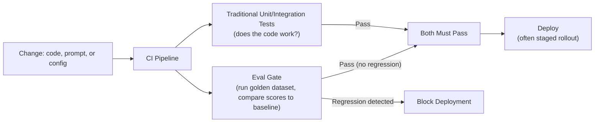

# CI/CD for AI Systems

> A traditional CI/CD pipeline checks "does the code still work." An AI pipeline also has to check "does the output still sound right."

**Type:** Learn
**Languages:** Concept, YAML
**Prerequisites:** Latency Optimization
**Time:** ~30 minutes

## Learning Objectives

- Understand how CI/CD for AI systems extends traditional CI/CD (Level 1) to include eval gates
- Recognize what needs to be versioned and tested beyond just code: prompts, model versions, and golden datasets
- Understand why a "green" traditional CI pipeline doesn't guarantee an AI feature is safe to deploy
- Formulate the right questions when reviewing an AI team's deployment pipeline and rollback readiness

## The Problem

A team's CI/CD pipeline runs unit tests, passes, and auto-deploys a prompt change straight to production. The unit tests check that the code correctly calls the API and parses the response — but nothing in the pipeline checks whether the new prompt's *actual output quality* regressed. The deployment is "green" by every traditional measure while shipping a real quality regression straight to every user.

## The Concept

CI/CD for AI systems takes the traditional CI/CD pipeline (Level 1: automated testing, code review, automated deployment) and adds a specifically AI-relevant gate: **eval-based quality checks**, run automatically alongside traditional tests.



```archify
src: diagrams/cicd-ai.html
title: Follow a prompt change through the eval gate, and see what blocks it
aspect: 718/421
```

### What Needs to Be Versioned Beyond Code

- **Prompts**: version-controlled the same way code is, so a prompt change is a reviewable, revertible artifact — not an unstructured edit made directly in a config file or dashboard.
- **Model versions**: explicitly tracked, since a provider updating a model (even without a version number change on their end) can shift behavior — pinning to specific model versions where possible.
- **Golden datasets**: versioned alongside the system, since the dataset itself needs updates as new failure modes are discovered (Level 8's evals lesson), and old eval results should be comparable to a specific dataset version.

### The Eval Gate: The AI-Specific Addition to CI/CD

Before a prompt, model, or retrieval-pipeline change is deployed, the eval gate runs it against the golden dataset (previous lesson) and compares the resulting scores to the current production baseline — blocking the deployment if quality regresses beyond an acceptable threshold, the same way a failing unit test blocks a traditional code deployment.

### Staged Rollouts as a Standard Practice

Given the added uncertainty from non-deterministic outputs, AI deployments commonly use staged rollouts (a small percentage of traffic first, expanding gradually) even more conservatively than typical code deployments — catching a quality regression that slipped past the eval gate before it reaches all users.

## Build It

A simplified CI/CD pipeline check incorporating an eval gate alongside traditional tests:

```python
def run_unit_tests():
    return {"passed": True, "details": "All 12 unit tests passed"}

def run_eval_gate(candidate_scores, baseline_scores, regression_threshold=0.05):
    regressions = []
    for query, candidate_score in candidate_scores.items():
        baseline_score = baseline_scores.get(query, 0)
        if candidate_score < baseline_score - regression_threshold:
            regressions.append((query, baseline_score, candidate_score))
    return regressions

def deployment_pipeline(candidate_scores, baseline_scores):
    print("Running traditional unit tests...")
    unit_result = run_unit_tests()
    print(f"  {unit_result['details']}\n")

    print("Running eval gate against golden dataset...")
    regressions = run_eval_gate(candidate_scores, baseline_scores)

    if regressions:
        print("  REGRESSIONS DETECTED:")
        for query, baseline, candidate in regressions:
            print(f"    '{query}': baseline={baseline:.2f} -> candidate={candidate:.2f}")
        print("\nDEPLOYMENT BLOCKED: eval gate failed despite passing unit tests.")
        return False

    print("  No regressions detected.\n")
    if unit_result["passed"]:
        print("DEPLOYMENT APPROVED: proceeding with staged rollout.")
        return True

baseline_scores = {"return policy query": 0.90, "refund exception query": 0.85, "store hours query": 0.95}
candidate_scores = {"return policy query": 0.91, "refund exception query": 0.60, "store hours query": 0.94}

deployment_pipeline(candidate_scores, baseline_scores)
```

Notice the deployment is blocked despite unit tests passing cleanly — the eval gate catches the specific regression (the "refund exception query" score dropping significantly) that traditional testing was never designed to detect, exactly the gap in the opening scenario.

## Use It

Mature AI engineering organizations build this into their standard deployment process:

- **Automated eval gates in CI**, run on every prompt, model, or retrieval-pipeline change, not just code changes.
- **Prompt version control**, often stored alongside code in the same repository, with the same review process as code changes.
- **Staged/canary rollouts for AI changes**, with automated online eval monitoring (from the evals lesson) during the rollout to catch regressions early, before full deployment.

## Exercises

1. **Easy**: In the code above, which specific query triggered the regression that blocked deployment?
2. **Medium**: Explain in plain English why a prompt change should go through the same version control and review process as a code change, even though it's "just text."
3. **Hard**: Propose a rollback plan for an AI feature where a quality regression is detected only after a staged rollout has already reached 20% of production traffic.

## TPM Perspective

### Strategic Executive Summary
A "green" CI/CD pipeline for an AI feature is not evidence that the feature is safe to deploy unless the pipeline includes an eval gate — traditional tests check that code works, not that output quality is acceptable. Prompts and model versions should be treated with the same version control, review, and staged rollout discipline as code, since they can just as easily introduce a production-impacting regression.

### Questions to Challenge Engineering
1. *"Does our CI/CD pipeline include an eval gate comparing candidate quality scores to a production baseline, or does 'green' only mean traditional tests passed?"*
2. *"Are prompt and model version changes version-controlled and code-reviewed the same way code changes are, or can they be edited directly in production without that process?"*
3. *"What's our rollback plan if a quality regression is detected mid-rollout, after it's already reached a percentage of live traffic?"*

### Trade-Off Matrix

| CI/CD Maturity Level | Catches Code Bugs | Catches Quality Regressions | Deployment Risk |
| :--- | :--- | :--- | :--- |
| **Traditional CI/CD only (no eval gate)** | Yes | No | High — quality regressions ship silently |
| **CI/CD + eval gate, full rollout** | Yes | Yes | Moderate — regressions caught before full deploy but no staged safety net |
| **CI/CD + eval gate + staged rollout** | Yes | Yes | Low — additional safety net catches regressions the eval gate missed |

## Key Terms

- **Eval Gate**: An automated check in a CI/CD pipeline that runs a candidate change against a golden dataset and blocks deployment if quality regresses beyond a threshold.
- **Prompt Version Control**: Managing prompts as reviewable, revertible artifacts, similar to how code is version-controlled.
- **Staged Rollout / Canary Deployment**: Releasing a change to a small percentage of traffic first, expanding gradually, to catch regressions before full deployment.
- **Regression Threshold**: The acceptable amount of quality score decline before an eval gate blocks a deployment.
