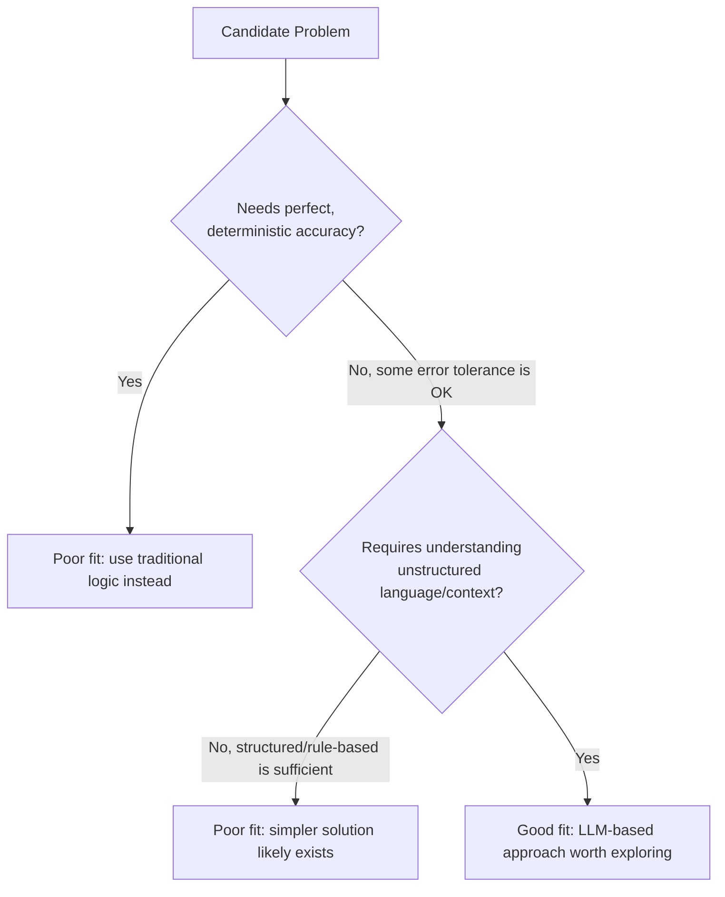

# Problem-Model Fit

> Before asking "which model should we use," ask whether this problem should be solved with a model at all.

**Type:** Learn
**Languages:** Concept
**Prerequisites:** CI/CD for AI Systems
**Time:** ~25 minutes

## Learning Objectives

- Understand "problem-model fit": whether a problem is actually well-suited to an LLM-based solution
- Recognize signals that a problem is a poor fit for AI: needs perfect accuracy, needs full explainability, or has a much simpler deterministic solution
- Recognize signals that a problem is a good fit: tolerant of some error rate, benefits from language understanding, or is otherwise intractable with rules
- Formulate the right questions when a team proposes "let's add AI" to a feature

## The Problem

A team wants to use an LLM to calculate a customer's exact monthly invoice total, because "AI can do anything now." This is a poor fit: invoice calculation needs to be perfectly accurate every time, has a well-defined deterministic formula, and an LLM's probabilistic nature (Level 2) introduces exactly the kind of occasional error that's unacceptable for a legally binding financial document — a simple, deterministic calculation would be both more reliable and cheaper.

## The Concept

Not every problem benefits from an LLM-based solution — **problem-model fit** is the assessment of whether a given problem's characteristics actually match what LLMs are good and bad at, before committing engineering effort.



### Signals of a Poor Fit

- **Requires perfect, deterministic accuracy**: financial calculations, legal compliance checks with zero tolerance for error, safety-critical control systems.
- **A much simpler, well-established solution already exists**: sorting a list, validating an email format, basic arithmetic — using an LLM for these is slower, more expensive, and less reliable than a simple deterministic function.
- **Requires full explainability for every individual decision**: some regulated contexts require a fully auditable, deterministic decision trail that a probabilistic model can't cleanly provide.

### Signals of a Good Fit

- **Involves understanding unstructured language or context**: summarization, classification of nuanced text, natural language interfaces to complex systems.
- **Some error rate is acceptable, and the cost of an occasional mistake is manageable**: draft generation reviewed by a human, a support suggestion the user can dismiss.
- **The problem is otherwise intractable with hand-written rules**: understanding open-ended user intent, generating varied creative content, handling infinite input variations that rules can't enumerate.

### Why This Assessment Should Happen Before Building

Skipping this assessment leads to two common failure patterns: over-applying AI to problems better solved deterministically (wasting cost and introducing unnecessary error risk), or under-applying it to genuinely good-fit problems out of unfamiliarity — both are avoidable with a deliberate problem-model fit check upfront.

## Build It

A simplified problem-model fit checklist, scoring candidate problems against the signals above:

```python
def assess_problem_model_fit(problem_name, needs_perfect_accuracy, has_simple_existing_solution,
                              needs_full_explainability, involves_unstructured_language,
                              error_tolerance_acceptable):
    poor_fit_signals = []
    if needs_perfect_accuracy:
        poor_fit_signals.append("requires perfect, deterministic accuracy")
    if has_simple_existing_solution:
        poor_fit_signals.append("a simpler deterministic solution already exists")
    if needs_full_explainability:
        poor_fit_signals.append("requires full explainability per decision")

    good_fit_signals = []
    if involves_unstructured_language:
        good_fit_signals.append("involves understanding unstructured language/context")
    if error_tolerance_acceptable:
        good_fit_signals.append("some error rate is acceptable")

    print(f"Problem: {problem_name}")
    if poor_fit_signals:
        print(f"  Poor-fit signals: {', '.join(poor_fit_signals)}")
    if good_fit_signals:
        print(f"  Good-fit signals: {', '.join(good_fit_signals)}")

    if poor_fit_signals and not good_fit_signals:
        print("  Recommendation: Use a traditional/deterministic approach instead.\n")
    elif good_fit_signals and not poor_fit_signals:
        print("  Recommendation: Good candidate for an LLM-based approach.\n")
    else:
        print("  Recommendation: Mixed signals, needs deeper scoping discussion.\n")

assess_problem_model_fit(
    "Calculate exact monthly invoice total",
    needs_perfect_accuracy=True, has_simple_existing_solution=True,
    needs_full_explainability=True, involves_unstructured_language=False,
    error_tolerance_acceptable=False,
)

assess_problem_model_fit(
    "Summarize a long customer support conversation for the next agent",
    needs_perfect_accuracy=False, has_simple_existing_solution=False,
    needs_full_explainability=False, involves_unstructured_language=True,
    error_tolerance_acceptable=True,
)
```

The invoice calculation problem scores clearly as a poor fit across every signal, while the conversation summarization problem scores clearly as a good fit — making the case for or against an AI-based approach explicit and checkable rather than assumed.

## Use It

Product teams apply this assessment early in scoping, before committing engineering resources:

- **Feature intake reviews**: asking "is this actually a good problem-model fit" as a standard early question, the same way "is this technically feasible" is asked for any new feature.
- **Avoiding AI-washing**: resisting the pressure to add AI to a feature just because it's currently fashionable, when a simpler deterministic solution would serve users better and more reliably.
- **Identifying underused opportunities**: proactively looking for genuinely good-fit problems (open-ended language understanding, nuanced classification) that a team might not have considered as AI candidates.

## Exercises

1. **Easy**: Classify "validate that an email address is correctly formatted" and "understand a customer's vague complaint and route it to the right team" using the poor-fit/good-fit signals above.
2. **Medium**: Explain in plain English why "some error rate is acceptable" is a meaningful criterion for problem-model fit, connecting back to the probability lesson from Level 2.
3. **Hard**: A team proposes using an LLM to make final approval/denial decisions on loan applications with no human review. Assess this against the poor-fit signals and explain the specific risk.

## TPM Perspective

### Strategic Executive Summary
Problem-model fit is the first and most important AI product management question — it should be assessed before "which model" or "how do we build this," because building a technically excellent AI solution to a poor-fit problem still produces a poor product outcome. A TPM's job here is to push back on both over-application (AI for its own sake) and under-application (missing genuinely good opportunities) of AI to a given problem.

### Questions to Challenge Engineering
1. *"Does this problem require perfect, deterministic accuracy, or is some error rate genuinely acceptable given how the output will be used?"*
2. *"Is there already a simpler, well-established deterministic solution to this problem that an LLM-based approach would be slower, costlier, and less reliable than?"*
3. *"If this problem does need full explainability for every decision (e.g. for regulatory reasons), does our proposed AI approach actually provide that, or are we assuming it does?"*

### Trade-Off Matrix

| Problem Characteristic | Favors Traditional/Deterministic Approach | Favors LLM-Based Approach |
| :--- | :--- | :--- | 
| **Accuracy requirement** | Must be perfect/deterministic | Some error rate is acceptable |
| **Input structure** | Structured, well-defined rules suffice | Unstructured language/context understanding needed |
| **Explainability need** | Full per-decision explainability required | General reasoning/quality sufficient, not per-decision proof |
| **Existing solution** | Simple, established deterministic solution exists | No practical rule-based solution exists |

## Key Terms

- **Problem-Model Fit**: The assessment of whether a given problem's characteristics genuinely match what LLM-based approaches are good at, before committing to build one.
- **Deterministic Solution**: An approach that always produces the same, predictable output for a given input, contrasted with an LLM's probabilistic behavior (Level 2).
- **Error Tolerance**: How acceptable it is for a solution to occasionally produce a wrong or suboptimal output, a key factor in problem-model fit assessment.
- **AI-Washing**: Adding AI to a feature primarily for marketing or trend reasons, without a genuine problem-model fit justification.
