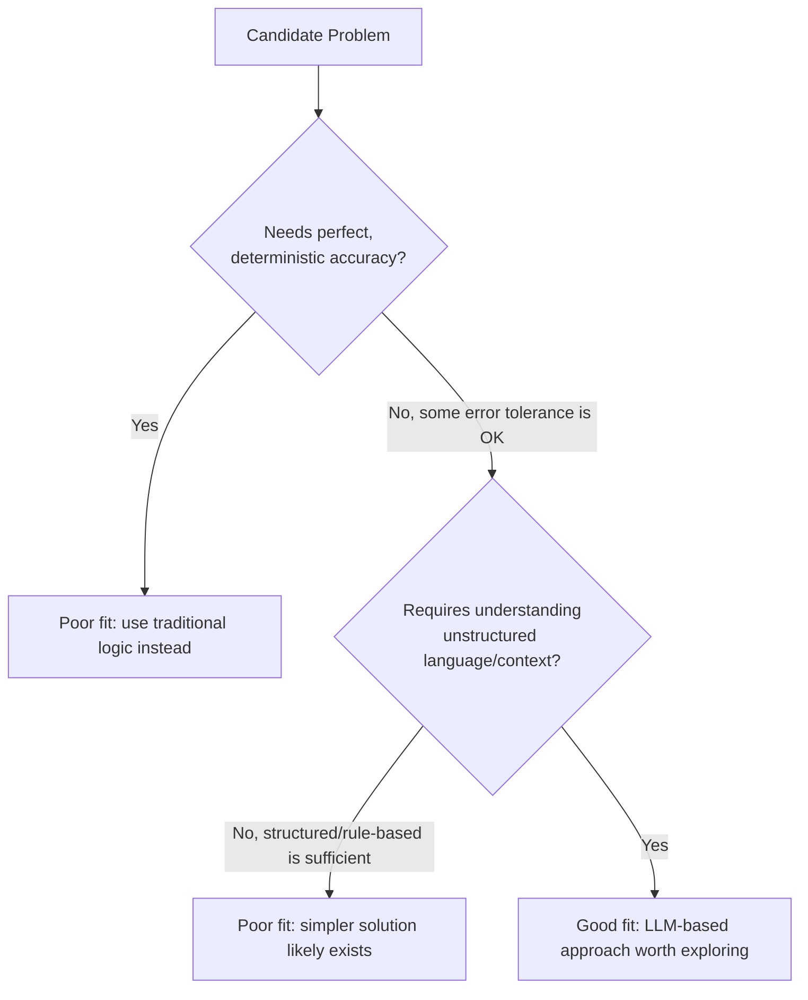

# Problem-Model Fit

> Before asking "which model should we use," ask whether this problem should be solved with a model at all.

**Type:** Learn
**Prerequisites:** CI/CD for AI Systems
**Time:** ~20 minutes

## Learning Objectives

- Explain "problem-model fit": whether a problem is actually well-suited to an LLM-based solution
- Recognize signals that a problem is a poor fit for AI: needs perfect accuracy, needs full explainability, or has a much simpler deterministic solution
- Recognize signals that a problem is a good fit: tolerant of some error rate, benefits from language understanding, or is otherwise intractable with rules
- Formulate the right questions when a team proposes "let's add AI" to a feature

## What It Is

**Problem-model fit** is the assessment of whether a problem's characteristics match what LLMs are good and bad at, made before committing engineering effort.

Signals of a **poor fit**:

- **Requires perfect, deterministic accuracy**: financial calculations, legal compliance checks with zero tolerance for error, safety-critical control systems.
- **A much simpler, well-established solution exists**: sorting a list, validating an email format, basic arithmetic. An LLM is slower, costlier, and less reliable here.
- **Requires full explainability for every individual decision**: some regulated contexts need a fully auditable, deterministic trail that a probabilistic model cannot cleanly provide.

Signals of a **good fit**:

- **Involves understanding unstructured language or context**: summarization, nuanced text classification, natural language interfaces to complex systems.
- **Some error rate is acceptable and the cost of an occasional mistake is manageable**: draft generation reviewed by a human, a support suggestion the user can dismiss.
- **Otherwise intractable with hand-written rules**: open-ended user intent, varied creative content, infinite input variations rules cannot enumerate.

## Why It Matters

A team wants an LLM to calculate a customer's exact monthly invoice total, because "AI can do anything now." This is a poor fit. Invoicing needs perfect accuracy every time and has a well-defined formula. An LLM's probabilistic nature (Level 2) introduces exactly the occasional error that is unacceptable for a legally binding financial document, and a simple deterministic calculation is both more reliable and cheaper.

Skipping the assessment causes two failures: over-applying AI to problems better solved deterministically (wasted cost, unnecessary error risk), or under-applying it to genuinely good-fit problems out of unfamiliarity.

## How It Works

Run the check as a short sequence of questions at feature intake:

1. Does it need perfect, deterministic accuracy? If yes, use traditional logic.
2. If some error is tolerable, does it require understanding unstructured language or context? If a structured or rule-based approach suffices, a simpler solution likely exists.
3. If yes to language understanding, is there a simple existing solution, and does it need per-decision explainability? Mixed signals mean a deeper scoping discussion.
4. If the signals are good, it is worth exploring an LLM-based approach, with evals and guardrails planned from the start.

## Architecture and Workflow



```archify
src: diagrams/problem-model-fit-decision.html
title: Decision flow for judging problem-model fit
aspect: 1120/652
```

## A Real-World Example

Two candidate features scored against the signals:

| Signal | Calculate exact monthly invoice total | Summarize a long support conversation for the next agent |
| :--- | :--- | :--- |
| Needs perfect accuracy | Yes (poor-fit signal) | No |
| Simple existing solution | Yes, a formula (poor-fit signal) | No |
| Needs full explainability | Yes (poor-fit signal) | No |
| Unstructured language | No | Yes (good-fit signal) |
| Error tolerance acceptable | No | Yes, the next agent can read the thread (good-fit signal) |
| **Recommendation** | Use deterministic logic | Good candidate for an LLM approach |

This makes the case for or against AI explicit and checkable rather than assumed. Product teams use it in feature intake reviews, to resist AI-washing, and to spot good-fit opportunities the team had not considered.

## What a TPM Needs to Understand

- Problem-model fit is the first and most important AI product question, asked before "which model" or "how do we build it." A technically excellent solution to a poor-fit problem is still a poor product.
- Push back on both over-application (AI for its own sake) and under-application (missing genuinely good opportunities).
- "Some error rate is acceptable" is the pivotal criterion. It ties directly to Level 2: probabilistic outputs mean some failures are guaranteed, so what an error costs decides fit.
- Mixed signals are common. A hybrid design (LLM drafts, deterministic rules or a human verifies) often resolves them.

## Risks, Dependencies, and Trade-Offs

| Problem Characteristic | Favors Traditional/Deterministic Approach | Favors LLM-Based Approach |
| :--- | :--- | :--- |
| **Accuracy requirement** | Must be perfect/deterministic | Some error rate is acceptable |
| **Input structure** | Structured, well-defined rules suffice | Unstructured language/context understanding needed |
| **Explainability need** | Full per-decision explainability required | General reasoning/quality sufficient, not per-decision proof |
| **Existing solution** | Simple, established deterministic solution exists | No practical rule-based solution exists |

Failure scenarios: an LLM is used for a rules problem and produces rare but costly errors; a regulated decision is automated and cannot be explained to an auditor; a team builds an impressive prototype and then discovers the acceptable error rate is far lower than the model delivers. Dependencies: a clear definition of what an error costs, access to domain experts to judge it, and an eval plan to measure the actual error rate.

## Questions to Ask Engineers

1. *"Does this problem require perfect, deterministic accuracy, or is some error rate genuinely acceptable given how the output will be used?"*
2. *"Is there already a simpler, well-established deterministic solution to this problem that an LLM-based approach would be slower, costlier, and less reliable than?"*
3. *"If this problem does need full explainability for every decision (e.g. for regulatory reasons), does our proposed AI approach actually provide that, or are we assuming it does?"*

## Scenario Exercise

Three feature requests land on your desk in the same week: format-check email addresses at signup, route vague customer complaints to the right team, and make final approve/deny decisions on loan applications with no human review.

1. **Easy**: Classify the email format check and the complaint routing using the poor-fit and good-fit signals.
2. **Medium**: Explain in plain English why "some error rate is acceptable" is a meaningful fit criterion, connecting back to the probability lesson in Level 2.
3. **Hard**: Assess the loan decision proposal against the poor-fit signals, explain the specific risk, and propose a redesign that keeps some AI value (for example, drafting a recommendation for a human reviewer).

## Key Terms

- **Problem-Model Fit**: The assessment of whether a given problem's characteristics genuinely match what LLM-based approaches are good at, before committing to build one.
- **Deterministic Solution**: An approach that always produces the same, predictable output for a given input, contrasted with an LLM's probabilistic behavior (Level 2).
- **Error Tolerance**: How acceptable it is for a solution to occasionally produce a wrong or suboptimal output, a key factor in problem-model fit assessment.
- **AI-Washing**: Adding AI to a feature primarily for marketing or trend reasons, without a genuine problem-model fit justification.
